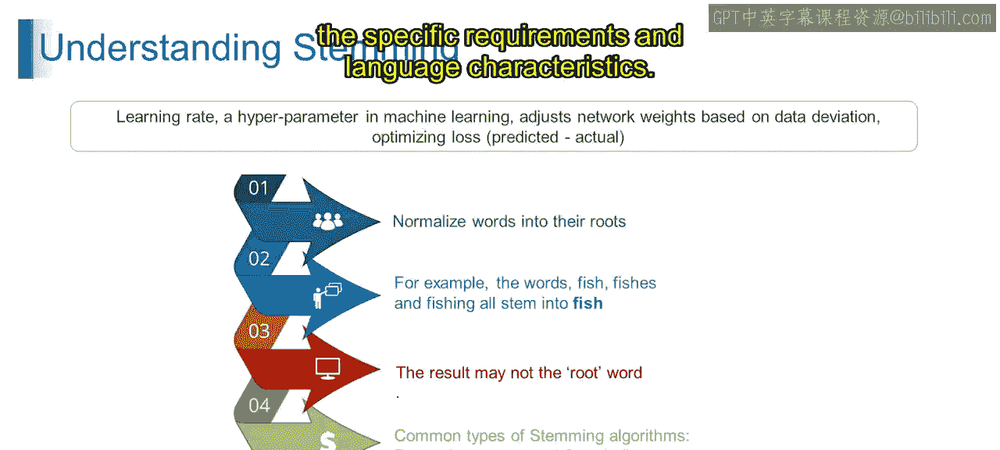

# Edureka《通过LLMs学习生成式人工智能（机器学习和NLP基础，第1课／共4课）｜Learn Generative AI with LLMs》中英字幕 - P111：110_词干提取.zh_en - GPT中英字幕课程资源 - BV1q4421Q7qh

Hello everyone welcome back to machine learning and NLP basics so now let's understand the next topic that is stemming in this we are going to understand what exactly a stemming is and what are the different types of stem with NLTK by the end of the session you will be able to comprehend the concept and purpose of stemming in natural language processing and also able to identify and utilize various stemming algorithms available in NLTK so let's get started first of all what exactly a stemming is all about stemming is a process used in natural language processing to reduce the words to their base or root form known as the stem it involves removing suffixes or prefixes from the words to extract their base form thus reducing multiple variations of a word to a common form for example let's say。

😊。

For example， consider the words running runs runner。

 the stem of each of these words is run means stemming would reduce all these words to their common base form。

 facilitating tasks such as text analysis and information retrieval means technically stemming is a linguistic normalization technique that aims to remove aixes from the words producing the root or base form of a word。

 known as the STEM， it is based on linguistic rules and algorithms designed to identify and strip away aixes。

 thereby simplifying the representation of words in the text data means in simple words。

 stemming simplifies words form by reducing them to their base or root form。

 aiding in various NLP tasks such as text classification。😊。

Information retrieval and sentiment analysis it helps in retreating words with similar meanings as identical。

 thereby improving the efficiency and effectiveness of text processing algorithms So now let's understand brief about it understanding stemming let's break down the concept of stemming starting with its definition and then exploring its applications and common stemming algorithms first of all。

 definition of stemming stemming is a text normalmalization technique used in natural language processing to reduce words to their base or root form known as the stem it involves removing suffixes or prexes from the words to extract their base form simplifying word variations to a common form then what about the applications of stemming so stemming helps in normalizing the words by converting them into。

😊，The root forms， which aids in tasks like text analysis and information retrieval。😊，For example。

 as I mentioned， fish， fishsurees and fishing all will set to the fish once after performing the stemming。

 which will enable algorithms to treat them as identical entities means consider the word fish。

 fisureers and fishing after stemming， all these words would be reduced to their commonbased form。

 which is fish， this simplification a algorithms to focus on the core meaning of the words disregarding minor variations。

 then coming to the limitations， while stemming normalizes words into their root forms。

 it's essential to note that the result may not always be the actual root word Steming algorithms are rule based and may sometimes produce stem forms that are not regular that are not recognized as valid。

😊，In the language then common stemming algorithms include there are several stemming algorithms。

 commonly used in NLP， including poster stemming Lancaster stemming and snowball stemming when I say porter stemming it is developed by Martin porter the porter stemmer is one of the most widely used stemming algorithms。

 it applies a set of rules to reduce the words to their stems。

 although it may sometimes produce stems that are not actual words。

 and then coming to the lancaster stem。 the Lancaster stemmer also known as the P or husk stemmer is popular stemming algorithm it it is more aggressive than the Porter stemmer and tends to produce shorter stems although it can be less accurate then snowballs。

😊，Stammer， the snowball Stmer also known as Porter to Stemer is an improved version of Porter STmer。

 It offers better performance and language support。

 making it a preferred choice for many applications means in simple terms。

 stemming plays a vital role in the NLP by normalizing the words into their base forms。

 Faacilitating text processing and analysis tasks while stemming algorithms like Porter Lancaster and snowball provide valuable tools for this purpose it's essential to understand their limitations and choose the most suitable algorithm based on the specific requirements and language characteristics。

😊。

So stay tuned for the next video where we will elaborate on this topic。😊。

