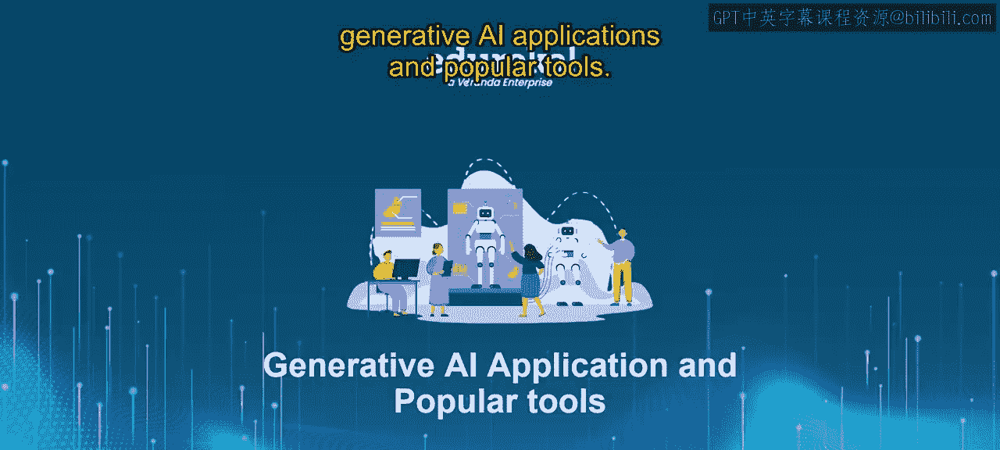
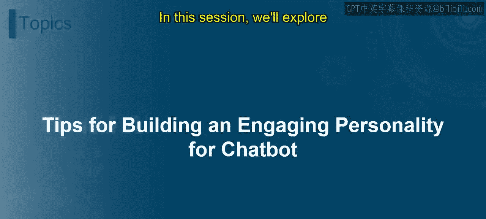
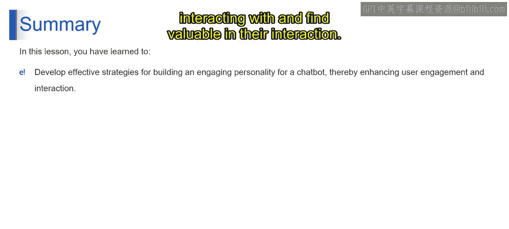
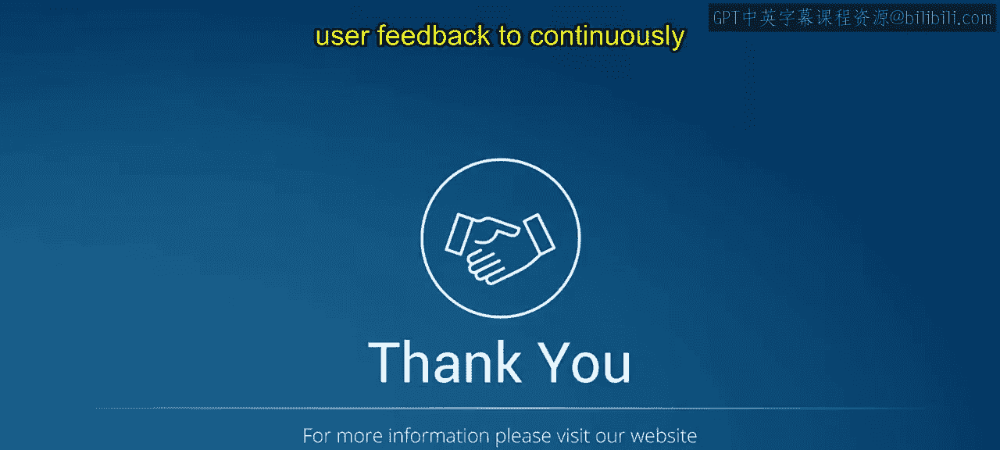

# Edureka《通过LLMs学习生成式AI（基础、应用开发、流行工具，第2、3、4课／共4课）｜Learn Generative AI with LLMs》中英 - P111：4_为聊天机器人构建引人入胜的个性的技巧.zh_en - GPT中英字幕课程资源 - BV1ym421V7gx

Welcome to the immersive journey into the world of generative AI applications and popular tools。😊。

Building an engaging personality for your chatbo in this session。

 we'll explore effective strategies to develop a chatbo personality that enhances user interaction and experience。

 By the end of this lesson， you'll have the knowledge and skills to create a chat board that users enjoy engaging with。

😊。

Now， let's explore some tips for building an engaging personality for a chatbot。

 So tip1 is provide relevant suggestions to the user。

 One of the cornerstones of building an engaging chatbot personality is to facilitate seamless interaction by providing relevant suggestions。

 This involves asking relevant questions from the user and providing simple tap to answer suggestions as message buttons。

😊，By enabling users to easily navigate through conversation options。

 you not only leverage the chatbot's capability to the fullest。

 but also gain valuable insights into areas where the board requires further training， Additionally。

 offering a suggested list of tasks when users are unsure of what to say ensures that the conversation flow smoothly。

 keeping users engaged and satisfied。😊，Tip 2 is personalize the conversation to create a truly engaging chatbot experience。

 It's essential to infuse the personalized touch into the conversation。

 Start by addressing the user by their name frequently。

 greeting them warmly or even congratulating them on achievements。

 This personalization helps in building a rap with users， making them feel valued and appreciated。

 by tailoring responses to match the users's preferences and communication style。

 You can create a more humanlike interaction that resonates with users on a deeper level。

 Ultimately enhancing engagement and satisfaction。😊，Tip 3 is manage response time effectively。

 Eff response time management is critical for maintaining user engagement and satisfaction。

 While it's natural for chatbots to take some time to process user requests。

 It's essential to keep users informed and engaged during these brief intervals。

 Incorporate fillers of progress updates to reassure users that their query is being addressed。

 However， be mindful not to keep users waiting for too long。

 as this can lead to frustration and disengagement。

 Str the right balance between promptness and thoroughness is key to ensuring a seamless conversation flow and a positive user experience。

😊，Tip 4 is emphasize emotions based on context。 Emotions play a significant role in human communication。

 and the same holds true for chatbots。 Emphasizing emotions based on the context of the conversation adds depth and authenticity to their interaction。

 making it more engaging and relatable for users， For instance。

 if a user successfully completes a task， respond with enthusiasm and encouragement to celebrate the achievement。

 Conversely， if a user encounters difficulties of fails to accomplish a task。

 express empathy and understanding to conveys support and reassurance。😊。

By mirroring and appropriately responding to users emotional cues。

 you can foster a stronger connection and trust thereby enhancing engagement and satisfaction。

Crafting an engaging personality for your chatbot is essential for enhancing user engagement and interaction by implementing strategies such as machine dialogue interaction。

 personalized conversation， effective response time management and context based emotions。

 you can create a chatbot that users enjoy interacting with and find valuable in their interaction。

 Thank you for joining us in this lesson on building an engaging personal for your chatbot。

 We hope you found the tips and strategies helpful in creating a chatbo that enhances user engagement and interaction。

 As you continue to develop your chatbot。 remember to prioritize user experience and itT rate based on user feedback to continuously improve and refine your chatbot's personality。

😊。

