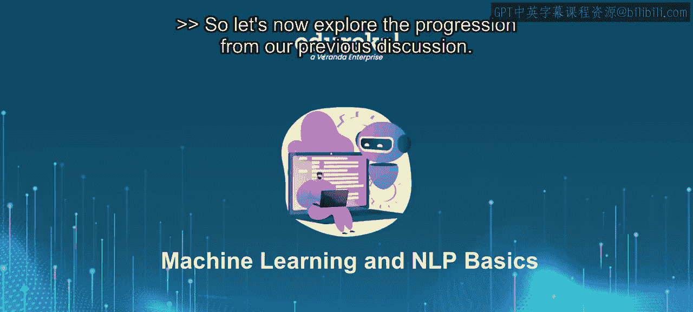
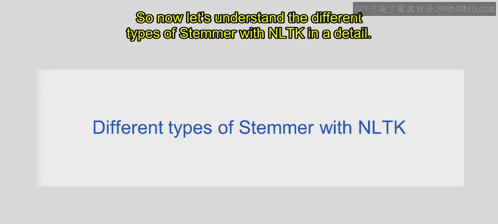
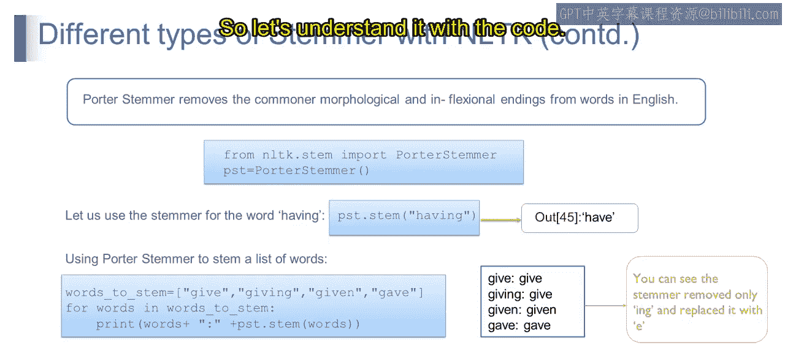

# Edureka《通过LLMs学习生成式人工智能（机器学习和NLP基础，第1课／共4课）｜Learn Generative AI with LLMs》中英字幕 - P112：111_不同类型的词干提取器.zh_en - GPT中英字幕课程资源 - BV1q4421Q7qh

So let's now explore the progression from our previous discussion。

 So now let's understand the different types of stama with N LTk in a detailed。😊。

As I mentioned， the first one is of Porter stemmer。

 The porter stemmer is a popular algorithm used in the NLP for stemming English word。

 it operates by truncating word suffixes to reduce them to their base form for example。

 the word running would be stemmed to run by removing the suffix ink here。

 so that is what a porter stemmer will do， so coming to the lancaster stemmer。

 the lancaster stemmer is an aggressive stemming algorithm available in NLTK it aims to truncate words to their shorter possible root form often resulting in more drastic reductions compared to this other sts For example。

 in contrast to the portertmer the lancaster stmer may further reduce running to run or even are also that is about lancaster stemmer。

😊，Then the next one is of snowball Stmer。 The snowball stemmer is also known as Porter2tmer。

 It is an improved version of the Portertmer。 It offers better performance and language support making it a preferred choice for many applications。

 So these all are the main three different types of stemmer techniques。

 Stming plays a vital role in NlP by normalizing the words into their base forms。

 Faacilitating text processing and analysis tasks。 while stemming algorithms like Porter Lancaster and snowball provides valuable tools for this purpose。

 It's essential to understand their limitations and choose the most suitable algorithm based on specific requirements and language characteristics。

 So that is all about the different types of stemmer。

 So now it's understand the practical approach have to do it with the code。 So let's。😊。

Understand it with the code。