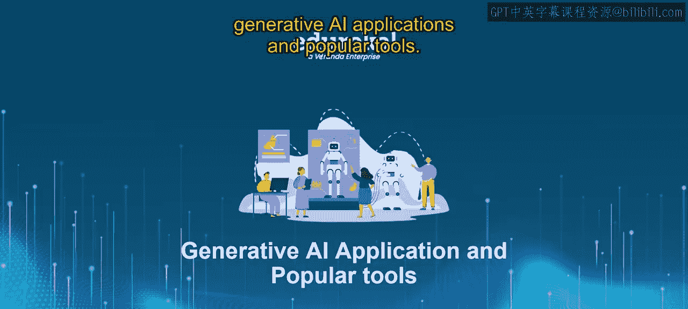
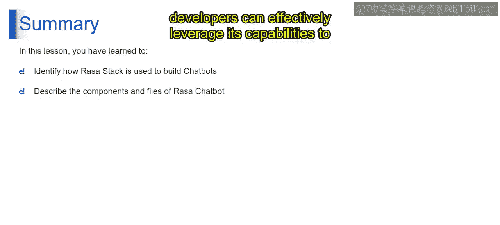

# Edureka《通过LLMs学习生成式AI（基础、应用开发、流行工具，第2、3、4课／共4课）｜Learn Generative AI with LLMs》中英 - P112：5_Rasa聊天机器人介绍.zh_en - GPT中英字幕课程资源 - BV1ym421V7gx

Welcome to the immersive journey into the world of generative AI applications and popular tools。😊。

Introduction to Rasa Chadbot in this video， we have covered the importance of leveraging Raa's open source nature。

 which enables seamless deployment， customization and optimizationization of chatbot functionalities。

By the end of this lesson， learners will grasp the significance of integrating Rasa chatbot into their projects and understand the essential components and necessary files required for its implementation。

 You will appreciate how Raa chatbot empowers developers to create intelligent conversational agents tailored to specific needs offering flexibility customization and control over the chatbot's behavior。

 You will also become familiar with the key files required for building a Rasa chatbot。

 including the NluU training file， Sties file， domain file and policy file and comprehend how each contributes to the chatbot's functionality and performance。

😊，Overall， learners will be equipped with the knowledge and understanding necessary to effectively utilize RASat's abot in their projects。

 enhancing user interaction and engagement through intelligent conversational interfaces。😊，Now。

 let's move on to the introduction of Raa Chadbot。 Rasa Chadbot。

 part of the Rasa stack is an open source AI tool designed for building。

 deploying and hosting chatbots with complete control over the environment。

 It offers a customizable solution， allowing developers to tailor the chatbot's behavior to specific requirements。

 Rasat's open source nature enables flexibility in deployment and customization。

 making it suitable for various use cases。 The chatbot's default set up efficiently handles background tasks such as deploying and creating server even with limited data。

Now let's take a look at components of Rasa， the Rasa stack comprises of two essential components。

 Rasa N L Liu that is natural language understanding and Rasa ch。

 Each component plays a crucial role in the development and functioning of a Rasa chatbot。

First component is Rasa NL。 That is Rasa natural language understandingstand。

 So this Rasa NLu is responsible for understanding and interpreting user inputs or messages。

 It primary task is to extract the intent the user's intention or purpose and entities that is specific pieces of information from the user' messages Ins represent the goal or action that the user wants to perform while entities provide the specific details necessary to fulfill that intent。

 For example， in a weather chatbot， the intent might be get weather forecast and the entities could include the location and date for which the forecast is requested。

 Rasa NL uses machine learning algorithms to process and classify user messages based on the provided training dataDevelop train the NL model with annotated examples of user messages indicating the intent and entities associated with。

Each message， these examples allow the model to learn patterns and correlations between different words and phrases and the corresponding intents and entities。

 As a result， Rasa and Llu enables the chatbot to understand user inputs accurately and determine the user' intentions。

 So the second component is the Rasa core。 So Rasa core is responsible for managing the dialogueg flow and generating appropriate responses to user queries or actions。

 Unlike traditional rule based chatbots which follow predetermined scripts or decision trees。

 Rasa core employs a machine learning based approach known as reinforcement learning This approach enables the chatbot to learn from interaction data and make decisions about what actions to be taken based on the current conversation context。

 Rasa core maintains a dialogue management model that predicts the next best action for the chatbot to take at each step。

😊，Of the conversation， the model considers the current state of the conversation。

 including the users intense previous messages and the chatbot's responses to make informed decisions about how to proceed For example。

 if a user asks for the weather forecast Rasa core may determine that the appropriate action is to fetch the weather data for the specified location and provide the weather forecast to the user by combining Rasa and's understanding of user inputs with Raa course's dialogueg management capabilities。

 the Raa stack enables developers to build sophisticated chatbots capable of engaging in natural and contextually relevant conversations with users。

 This approach allows for greater flexibility and adaptability in chatbot development as the chatbot can learn and improve over time through interactions with users。

 These components work independently although Raa recommends using both for optimal。😊。

Now let's take a look at the required files for building a RAA chatbot。

 First one is NLO training file This file contains training data including user inputs mapped to Ins and entities providing a diverse range of examples improves the bot's NL capabilities so the second file is To file the St file comprises sample interactions between the user and the bot RaA core utilizes this data to create a probable model of interactions for each story。

The third fileless domain file， the domain file lists all intense entities， actions。

 templates and other relevant information templatelates contain sample bot replies that can be used as actions during conversation and the fourth fileless policy file the policy file determines the bot's actions at each step of the conversation Raa's policy class selects the appropriate action based on the context of the conversation So in conclusion。

 RaSA stack provides a powerful framework for building chatbots offering developers the flexibility to customize and deploy AI drivenn conversational agents By understanding the components and files of RasA chatbot developers can effectively leverage its capabilities to create intelligent and user friendly conversational interfaces Thank you for joining this session Stay tuned for more insights in the upcoming videos。

