# Edureka《通过LLMs学习生成式人工智能（机器学习和NLP基础，第1课／共4课）｜Learn Generative AI with LLMs》中英字幕 - P113：112_词干提取演示.zh_en - GPT中英字幕课程资源 - BV1q4421Q7qh

Hello everyone welcome back So now let's understand the coding part for portt So let's see how it is going to work。

 So as we discussed Portesttmer is a stemming algorithm commonly used in NLp to reduce the English words to their base or root forms by removing common morphological and infleal endings right so now let's understand the coding part first we need to perform from Ntk dot stem import pottmer So what this line will do it will import the porttmer class from the NtK library allowing us to use it for stemming English words then we are initializing the porttmer PSt is equal to porttmer this line initializes an instance of the portertmer class creating a stemmer object named PSt that we can use first stemming operations then first let's perform stemming。

😊，Single word having so Howard is going to work PSD dot stem off the word you can provide stemming This line applies the porter stemmer to the word having the stemmer removes the common morphological ending ink that is nothing but I G resulting the base form that is nothing but have then now the next line stemming a list of words here we provided the words underscore to underscore stem is equal to give given given gave this line defines a list of words to be stemmed。

😊，Now we are performing a loop for word in words to stem。

 This loop its over each word in the provided list that is words to stem and then print the words plus colon post stem words means this line stems each word in the list using the porter stem and print the original word along with its stemmed form。

 let's execute it Now you can see the word having is now converted it into the have festival then give converted it there is no extension for this So it is in a stable form and given it is converted into the give and given again it is going to be the given you can see and gave is going to be the gave again means give remains unchanged because it is already in its base form and giving is stem to give。

😊。

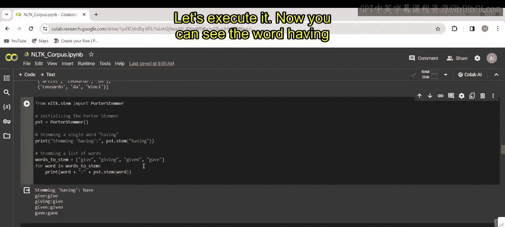

By removing the ink suffix and then given remains unchanged as it is already in its base form and gave remains same unchanged because it is also in its base form means the poster demo effectively remotes common morphological and infleexal endings from the English words resulting in their base or root forms。

 it simplifies word variations to their common base forms。

 addingiding in various NLP tasks such as text analysis and information retrieval。

 So that is about the postert。 Now let's understand the lancaster st。 So again， it is also。

 first of all， we need to import Lancastert from in NlTk dot stem。

 the first line imports the lancastert from the class Nltk then initialize the lancaster st here。

 LST is equal。😊，Lncaster tu open in close parenthesis。 it will create an instance of the Lancastert。

 then stemming a list of words using the Lancastert on the word to stem。

 we are taking the same list again。 but now we are utilizing the Lancastert than the Portert。

 So let's understand how it is going to perform it will loop through each word in the provided list and then applies the Lancastert to each word in the list and prints the original word and its stemmed form。

 So let's say with an example， So now you can see the output here。

 the stemming reserve demonstrate how the Lancaster tu behaves differently from the portert Give remains unchanged give is converted it into the give as you mentioned。

 even running can be converted it into the running or even run same likewise giving。😊。

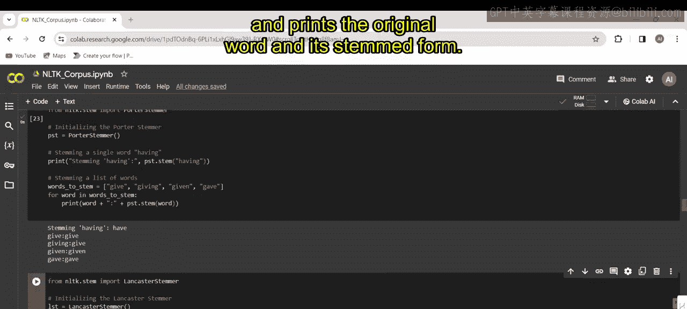

Stemmed to give consistent with the lancaster stem aggressive nature in truncating the suffixes。

 then given should ideally be stemmed to give。 That is what it is now converted and then gave。

 now it is stemmed into the gave。 This is how lancaster stemmer will work。

 So now let's understand the snowball stemmer。 Hoard is going to work。 First first of all。

 we are importing the snowball stemmer。 The first line imports the snowball stemmer class from Nltk。

 Then SPST is equal to snowballtmer。 of the string English。

 This line initializes an instance of snowball stemmer class Further English language。

 The snowball stemmer is a stemming algorithm that supports multiple languages and by specifying English we indicate that we want to perform stemming on English words。

 So now。

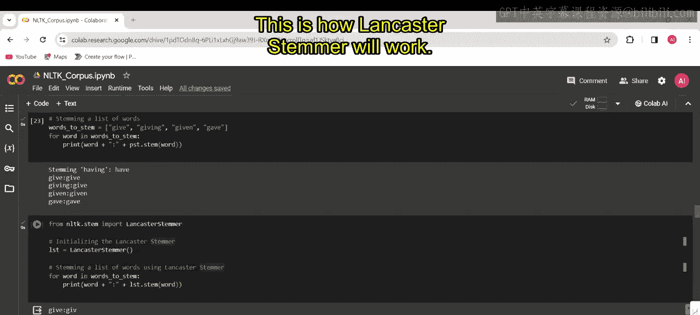

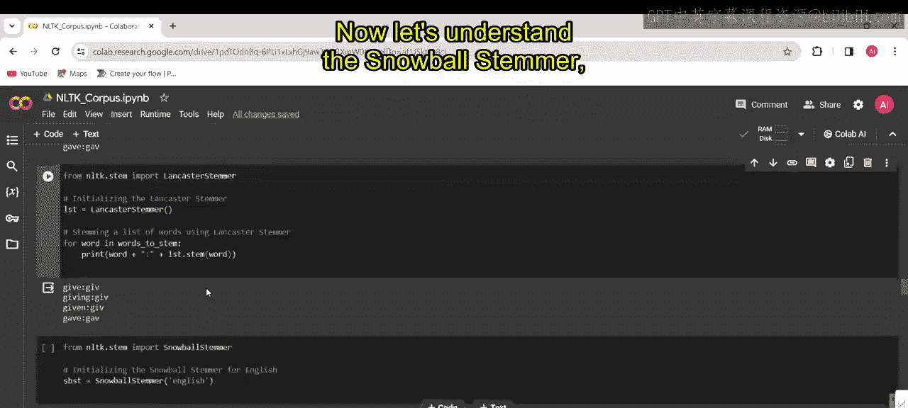

Lets examine the list of language supported by the Snowball Stemer lets click let's execute this cell。

 It is done and now I am going to print it Can you all see this means the snowball Stemer supports various languages。

 including Arabic Dutch English， French， German， Italian， Portuguese， Russian， Spanish。

 Sweden and many more。😊。

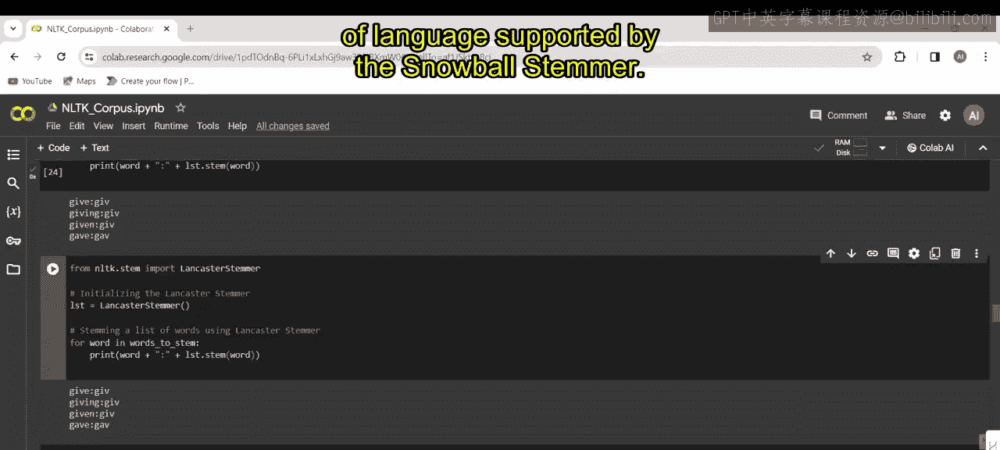

Each language has its own stemming rules and algorithms tailored to its linguistic characteristics means snowball stemming is versatile stemming algorithm that supports multiple languages including English by specifying the desired language we can perform stemming on text data in that language addingiding in various natural language processing tasks such as text analysis and information retrieval。

 Now let's try the snowball stemmer on the same provided list that is word to stem we are having these words given given cave so let's perform this by using the snowball stemming here in this code also we are initializing the snowball stemmer and then we are stemming a single word of having this line applies the snowball stemmer to the word having and prints its。

😊。

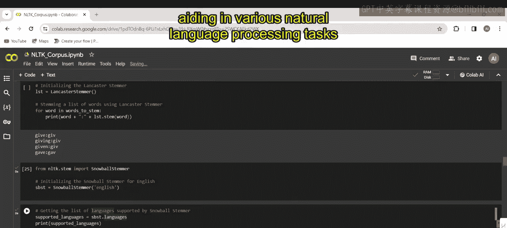

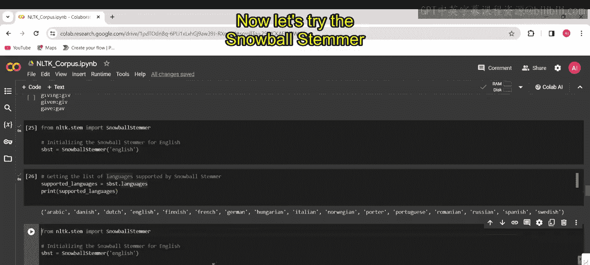

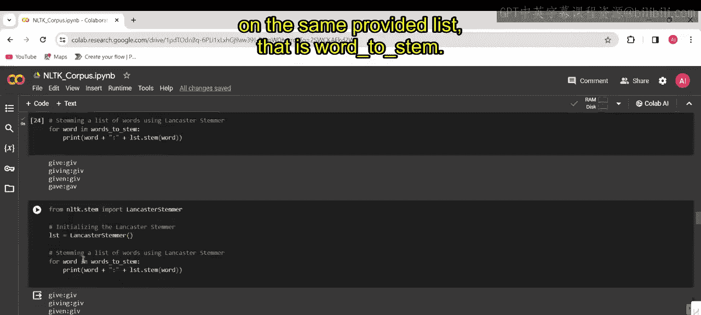

Stammered form in this case， having is stemmed to have。

 then stemming a list of words containing bag to stem。

 So this loop its over each word in the list of word to stem， then it will print within the loop。

 the snowball stmer is applied to each word and both the original word and it stemmed form are printed。

 Let's see with with an output here you can see this is a snowball stemmer output。

 the stemming results demonstrate how the snowball stmer operates on different words give remains unchanged。

 which is expected。 and now you can see giving it is stemmed to give consistent with snowball Stemers rule。

 and then given is remains unchanged as it is already in its base form。

 and now the gave remains unchanged， which is expected means。

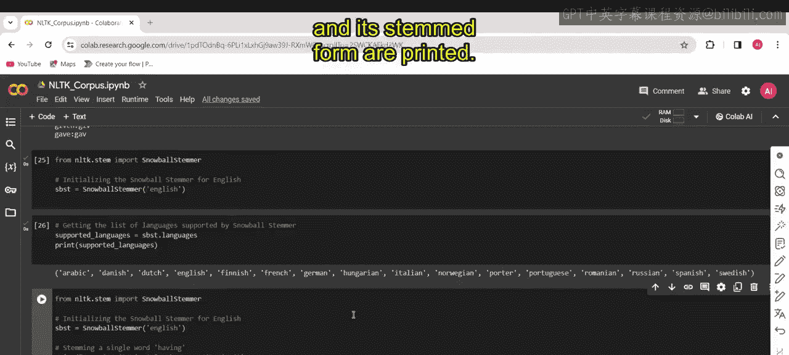

Sowble stmer effectively reduces words to their base root form。

 aiding in various natural language processing tasks such as text normalization and analysis。😊。

That is all about the different stemming processes Now you can see the examples here we provided those we discussed now so finally the summary in this lesson you have comprehend the significance of stemming in the nLP understanding its role in normalizing the words and we have also explored and utilized different stemming algorithms provided by nLTk enabling effective text processing and analysis Thank you。

😊。

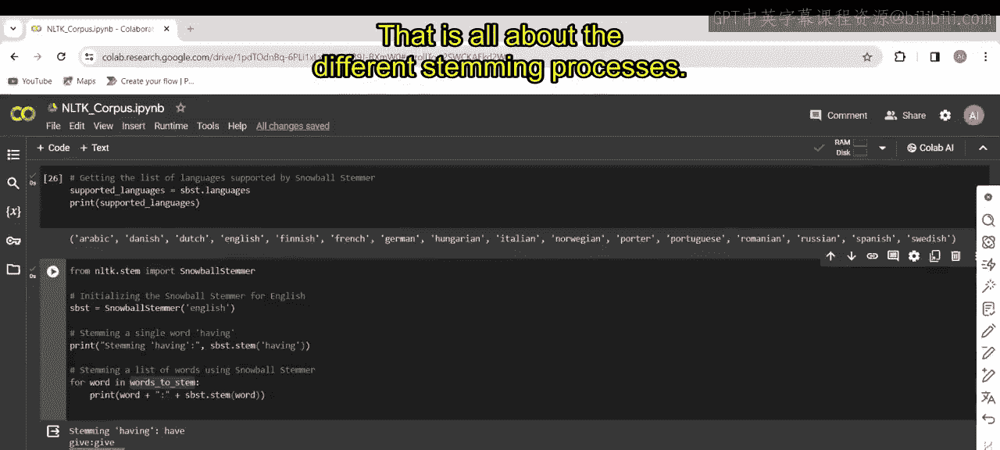

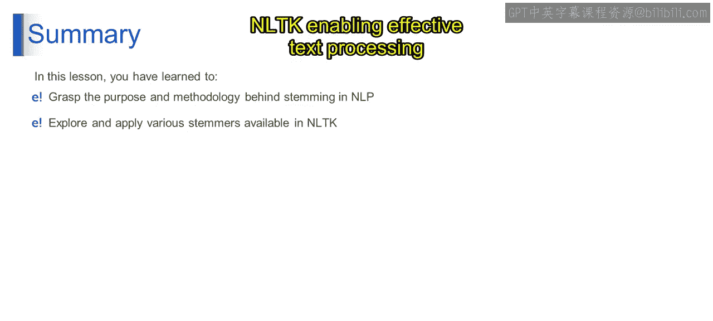