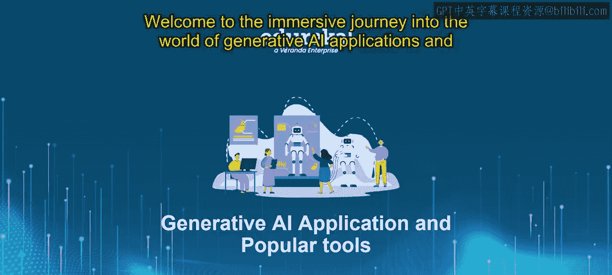
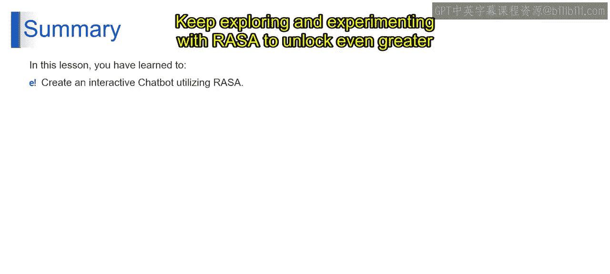
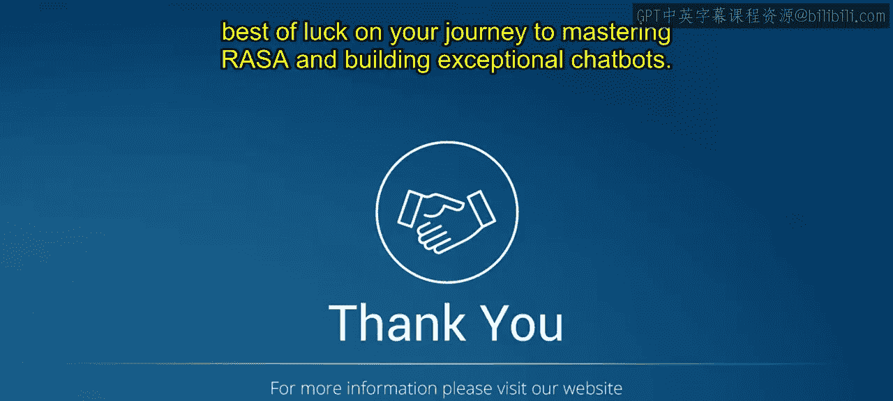

# Edureka《通过LLMs学习生成式AI（基础、应用开发、流行工具，第2、3、4课／共4课）｜Learn Generative AI with LLMs》中英 - P113：6_使用Rasa构建聊天机器人.zh_en - GPT中英字幕课程资源 - BV1ym421V7gx

Welcome to the immersive journey into the world of generative AI applications and popular tools。😊。

Building a chatbot using Rasa。Throughout this course。

 you will learn how to harness the power of RAsa and open source framework to construct engaging conversational experiences。

 Get ready to dive into the world of conversational AI and unlock the skills needed to create interactive chatbots that can engage users in meaningful interactions By the end of this lesson you will have acquired the skills necessary to construct an interactive chatbot using Rasa a powerful open source framework for building conversational AI applications So let's get started with the demonstration。

😊，So to run the code successfully you need to ensure that you have Python installed on your system。

 Additionally， you need to install the required Python libraries based on the code provided you likely need the following libraries。

 First one is OS module This module is part of the Python standard library so it's usually included by default second one is PIP packages and third one is Raa This is a popular Python library for building conversational AI chatbots It provides tools and utilities for training and running chatbot models you can install these packages using PIP the Python package manager open a terminal or command prompt and run the following comment。

So ensure that you have administrative privileges if you encounter permission issues during the installation。

 so once you have Python installed and the necessary packages installed。

 you should be able to run the provided code successfully to set up the chatbot project。

Let's understand the code in detail。First one， defining files and content。

 so the code starts by defining a dictionary named project files。

 Each key represents a file path related to the project directory and its corresponding value is the content that should be written to that file。

 For instance， this sentence here。Dot/ datata/nlu。yMl represents the Nnuu that is natural language Understand file and its content includes examples of greetings。

 goodbyes and weather related queries。The second part is creating folders and writing files。

 the code iterates through each key value pair in the project files dictionary for each file it extracts the directory path using OS。

path。bir name function to ensure the directory exists if not it creates a necessary directory structure using OS。

mbis function。It then opens each file in write mode using a context manager and writes the corresponding YMl content to the file using f dot write function。

 Once this loop completes all the specified YMl files are created and populated with the predefined content。

 This code essentially automates the initial setup process for a chatbot project。

 It creates and organizes the necessary files and folders。

 ensuring that they contain the required content， this automation simplifies the project setup。

 making it easier to start developing the chatbot without the need to manually create and populate each file。

 it streamlines the process and helps maintain consistency across different projects。

So this Python code snippet is responsible for creating a configuration file that is confi dot YMl for a chatbot project the configuration file specifies how the chatbot should process and understand natural language input so here is a breakdown of what the code does so pipeline configuration the code defines a multiline stringd pipeline underscore confit which contains yMl formatted text This text represents the configuration settings for the chatbot's processing pipeline the pipeline consists of several processing steps that transform raw text input into structured data that the chatbot can understand and respond to。

So the second part is language setting within the pipeline configuration the code sets the language parameter to EN indicating that the chatbot is configured to process text in English the setting ensures that the chatbot's language processing components are optimized for English input。

So the next part is pipeline components， the pipeline configuration specifies various components that make up the chatbots processing pipeline。

 these components include tokens， futurizers， classifiers and response selectors each component performs a specific task such as splitting text into individual words that is tokenization。

 then extracting features from text， classifying the intent of user messages and selecting appropriate responses。

The next part is training settings， the configuration includes training settings for certain components。

 for example， the DIET classifier component is configured to undergo00 training epochs。

 which helps improve the accuracy of the chatbot's In classification model。

Now the next part is writingri configurationration to file Finally the code writes the pipeline configuration to a file named Confit dotyML。

 it opens the file in write mode using a context manager and writes the YML formatted configuration text to the file using F dot right method。

So in summary， this code sets up the configuration for a chatbot project。

 specifying how the chatbot should process natural language input；

 it ensures that the chatbot is configured to understand English text and saves this configuration to a file for later use during training and inference。

So the command RasA train is a command line interface command provided by RasA and open source framework for building conversational AI chatbots This command is used to train the machine learning models required for your chatbot project based on the configuration and training data provided in your project directory so the first part is model training when you run Rasatrain Rasa initiates the training process for your chatbot models this includes training models for NLU and dialogueog management based on the project and configuration files present in your project directory RasA uses the training data provided in the data s nlu。

ml and data s rules doMl files to train the nL model which is responsible for understanding user messages and extracting intents and entities so additionally Rasa uses the training data and the configuration specified in the config do YMl file to train the dialogueg management model which determines how the。

Got should respond to user messages based on the current conversation context。

Now the Rasa shell command is a command line interface command provided by Rasa and open source framework for building conversational AI chatbots。

 This command is used to interact with your trained chatbot models in a realtime conversation directly from the command line so here is what Rasa shell commanders first part is initiating the chatbot when you run Rasa shell Rasa loads the trained chatbot models from the models directly within your project folder these models include the NLU model and the dialog management model。

So the second part is interactive conversation once the models are loaded RASA starts an interactive session where you can have a conversation with your chat board directly from the command line。

 you can type messages as if you were chatting with the real user and the chat board will respond based on its stream models and the conversation context。

😊，Now here the third part is natural language understanding when you type a message。

 RASA's NLU model processes the text to understand the user's intent and extract any entities mentioned in the message based on the identified In and entities RASA's dialogueg management model determines the appropriate response for the current conversation context。

The next part is the response generation。 After processing the user's message。

 RaA generates a response and displays it in the command line interface。

 The response may include text， images， buttons or other interactive elements depending on how your chatbot is configured。

 The next part is conversation flow。 The conversation continues iteratively as you and the chatbot exchange messages back and forth。

 You can ask questions， provide information or trigger specific actions based on the chatbot's capabilities and training data。

 Now you can start using your chatbo。Throughout this lesson you have been provided with hands on demonstrations and practical exercises to guide you through the processs of building a chatbot using RaSA by following along with the demonstrations and completing the exercises you have gained valuable insights in practical experience in utilizing Rasa to create sophisticated conversational AI applications Congratulations on completing this lesson and mastering the art of building chatbots using RasA with your newfound skills you are well equipped to develop innovative conversational AI applications that enhance user experiences and drive engagement Keep exploring and experimenting with RasA to unlock even greater possibilities in the field of conversational AI Thank you for your participation and best of luck on your journey to mastering Rasa and building exceptional chatbots。

😊。

