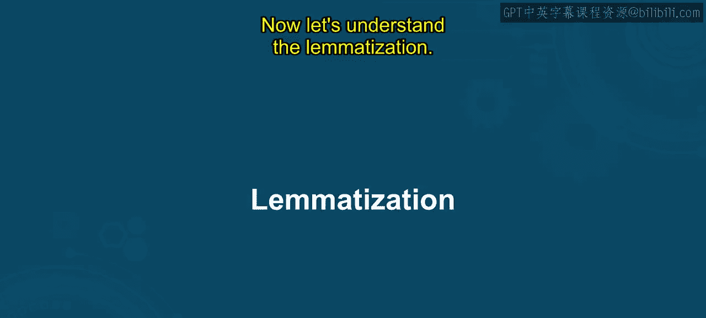
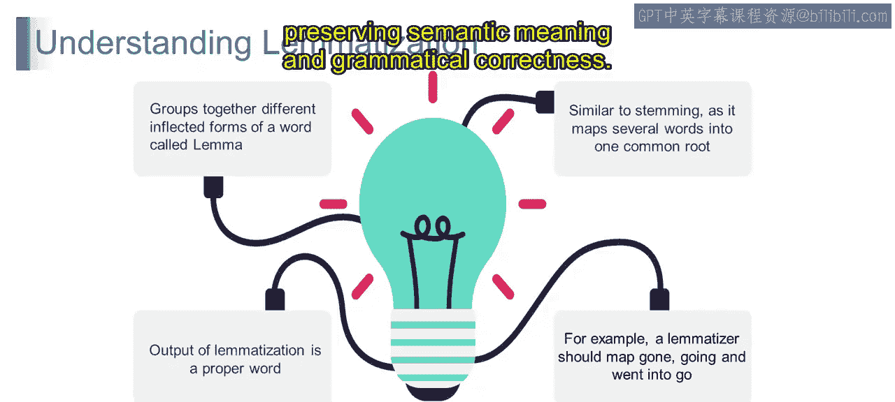

# Edureka《通过LLMs学习生成式人工智能（机器学习和NLP基础，第1课／共4课）｜Learn Generative AI with LLMs》中英字幕 - P114：113_词形还原.zh_en - GPT中英字幕课程资源 - BV1q4421Q7qh

Hello everyone welcome back to machine learning and NLP basics so now let's understand the limitmatization in this we are going to understand what exactly eliitization is all about and limititization using the NLTK by the end of the session you are able to comprehend the concept and significance of limititization in linguistic analysis and also able to implement limititization techniques using the NLTK for text normalization。

😊。

So let's get started first lets understand what is the definition of limititization Liitization is the process of reducing words to their base or root form known as lemma。

😊，Lematization is the process of reducing words to their base root form known as lemma with the global。

 with the goal of normalization。 So using stemming with simply shops of prefixes or suffixes to the derive prefixes or suffixes to derive the root form。

 leitization considers the meaning of the word and ensures that the resulting lemma is a valid word in the language。

 For example， if they can consider the example of running ran。😊，And runs。

The lemour for all these words is going to be the run。😊，Okay， so it is giving the output as run。😊。

Okay， consider the word running ran and runs the lemmo for all these words is run。

 you might wonder stemming also doing the same then what is the difference of having limititization here Well。

 so let's understand it with one more example， for example let's say I am working on the word of better in case if you are using the stemming the output should be the better only but what if if you are converting this word in the limititization process the output is going to be the good that is where the difference comes in so what is the difference that we understand here stemming reduces the words to their root form by removing the suffixes while limititization transforms the words to their base or dictionary form based on their meaning。

😊，So that's the reason here we are getting this output。😊。

So means technically limititization involves identifying the morphological variant of the word and mapping them to a single root word known as lemma。

😊，Technically， limititization。Technically， limititization involves identifying the morphological variance of the words and mapping them into a single root word known as lemma based on its intended meaning in the language based on its intended meaning in the language leitization takes into account the parts of speech that is nothing but the Pvos of the word and applies linguistic rules and dictionaries to perform the normalization process accurately。

😊，For example， let's take one more example， the foxes are running Leitization would convert running into run right while preserving the grammatical context of the sentence For example。

 in the sentence the foxes are running leitization would convert running into run while preserving the grammatical context of the sentence means leitization aims to standardize the words to their canonical form facilitating more accurate analysis and interpretation of text data in natural language processing so now let's understand the leitization more brief The first thing is that group together different inflected forms of the word called lemma means leitization identifies the base or dictionary。

😊，For of a word known as the lemma by grouping together its inflected variance， for instance。

 as I mentioned runningran and runs all map to the word as I mentioned， for instance。

 running ran and runs all map to the lemma run that is about the grouping together different inflected forms of a word called lemma。

 then similar to stemming， as it maps several words into one common root like stemming limititization aims to reduce words to their base or root form。

 however， unlike stemming which applies heuristic rules to chop of prefxes or the suffixes。

 leitization employ linguistic analysis to ensure the resulting lemma is a valid word in the language that is about similar to stming then。

Output of limititization is a proper word means one key distinction between leitization and stemming is that leitization produces valid words in the language this ensures that the output of limititization retain a semantic meaning and grammatical correctness。

 as we understood one key distinction between limititization and stemming is that leitization produces valid words in the language I said right So how exactly。

 let's see here， for example， we are having a word went stemmed form is going to be the same that is going to be the went where liitization form converts it into the rootbased form I said so it is now converted it into the go So when is same in stemmed format。

 but it is go in the limititization along with that now you can see the other word here we are。😊。

Having a word mice， the stemmed form of the provided word is going to be the MC means it is。

 as we discussed。 it will focus on chopping of prefaxes as well as suffixes。

 but it will not understand the proper word meaning。

 but where leitization form produces it as a mouse means this ensures that the output of leitization remains semantic meaning and grammatical correctness。

 that is where output leitization a proper word。 Then， for example。

 elimatization should map gone going and went into go means what exactly in the example provided the alimatization would correctly map the inflected form of gone going and went to the base form of go this consolidation of variance into a single lemma aids in textt。

ization and improve the accuracy of linguistic analysis means considering all these leitization is a valuable technique in natural language processing that groups together in forms of words into their base or root form known as lemmas means leitization is a valuable technique in natural language processing that groups together inflicted forms of the words into their base or root forms known as lemmas unlike stemming leitization ensures that the resulting output is value word in the language preserving semantic meaning and grammatical correctness。

😊。

