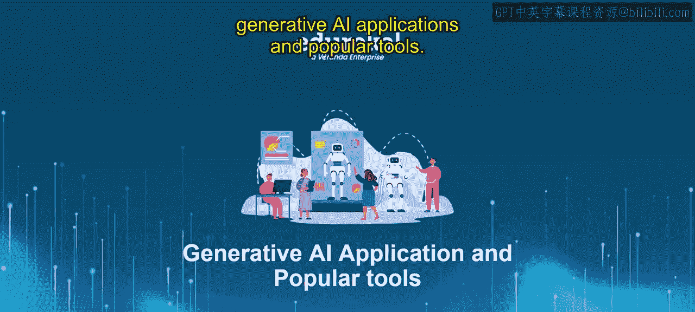
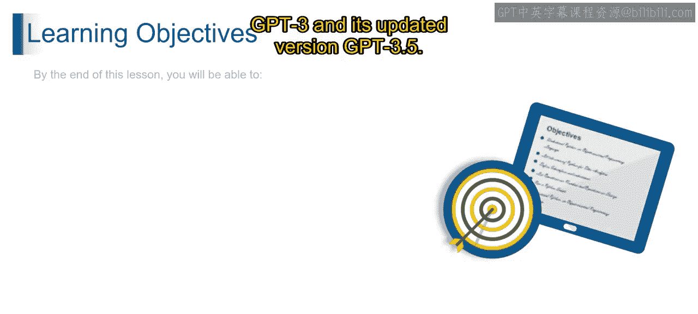

# Edureka《通过LLMs学习生成式AI（基础、应用开发、流行工具，第2、3、4课／共4课）｜Learn Generative AI with LLMs》中英 - P114：7_使用ChatGPT API开发自己的聊天机器人.zh_en - GPT中英字幕课程资源 - BV1ym421V7gx

Welcome to the immersive journey into the world of generative AI applications and popular tools In this comprehensive course。

 well delve into the transformative capabilities of cutting edge technologies like G3 and G 3。5。

 as well as explore the practical implementation of powerful tools such as Rasa Chabo and Opens。😊。

By the end of this lesson， you will have gained valuable insights into GPT3 and its updated version GPT 3。

5。

