# Edureka《通过LLMs学习生成式人工智能（机器学习和NLP基础，第1课／共4课）｜Learn Generative AI with LLMs》中英字幕 - P115：114_使用NLTK进行词形还原.zh_en - GPT中英字幕课程资源 - BV1q4421Q7qh

Hello everyone， welcome back。 So based on the understanding of how the limititization works。

 now let's perform the limititization using the NlTK by practical approach。

 I'm going to open my Google Collab notebook here。😊。

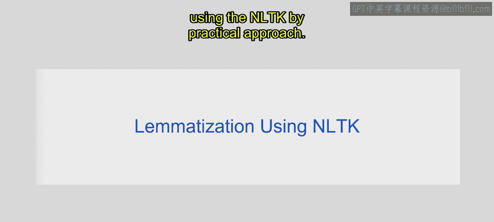

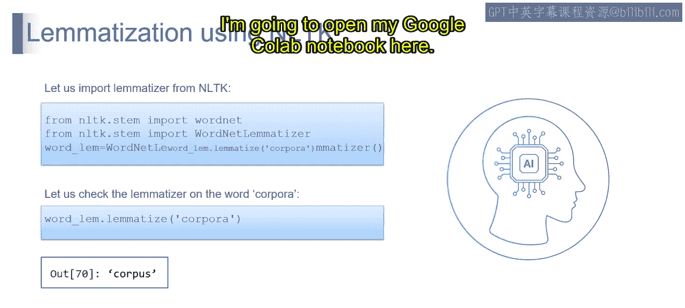

The first line from nlTk dott import wordnet leitizer， so what exactly it will do。😊。

This line imports the wordnet lematizer class from NLTK which is used for leitization So what exactly this wordnet lemitizer it is a tool used for natural language processing to leitize the words based on the wordnet eical database of English then again the next thing is initialization Similarlyly however we have done in the previous steps this line initializes an instance of the wordnet leitizer then leitize the word corpora so here this line the leitize method whatever we have provided word underscore La taught leitize of corporatera the leitized method is applied to the word of corpora using the wordnet leitizer this method returns the base or root form of lemma of the word then we are printing the results so let's see what is the output that we are going to get here。

😊。

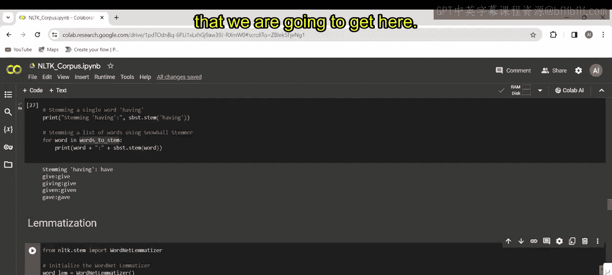

So， it is telling we are not having it wait a moment now you can see the output here so lets perform some different examples let's say I am going to give vent here and lets see what we are going to get so when we are giving my mice it is providing the output as mouse。

😊，If Im going and providing one more example geese it should be expected to give goose you can see this right so let's give it geese in the stemming and we'll see what we are going to get can you see this again we are getting let's try it with the staming okay I'm doing the snowball sta and here you can see we are getting as it is but when you are giving it to the leitization process now you can see the difference we are getting the goose as an output so that's where the main difference comes in byin the stemming as well as liitization As mentioned lematization will try to convert the provided word into at least the meaningful format that is what about the leitization now let's check with the other example of the same word that is word to ST let's print it first what we are having in it and then we'll see okay。

😊。

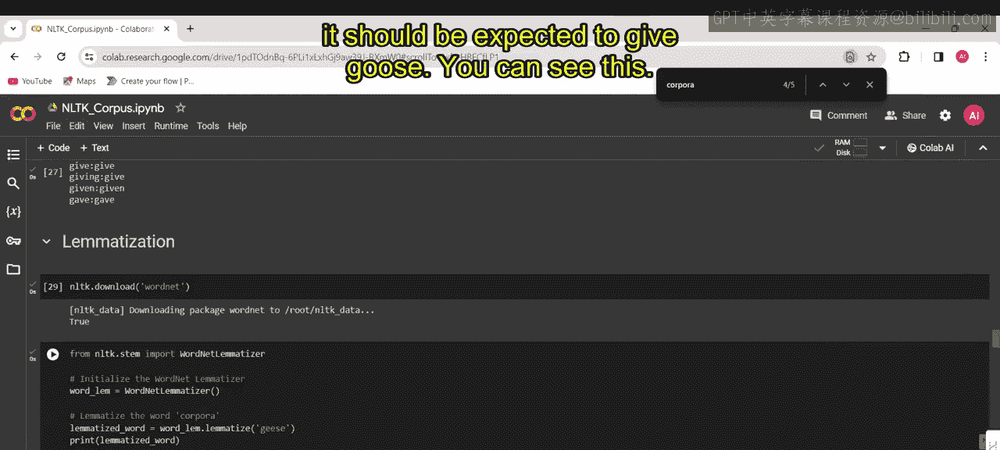

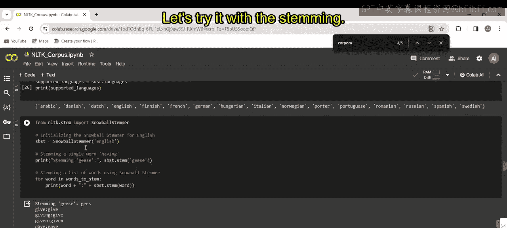

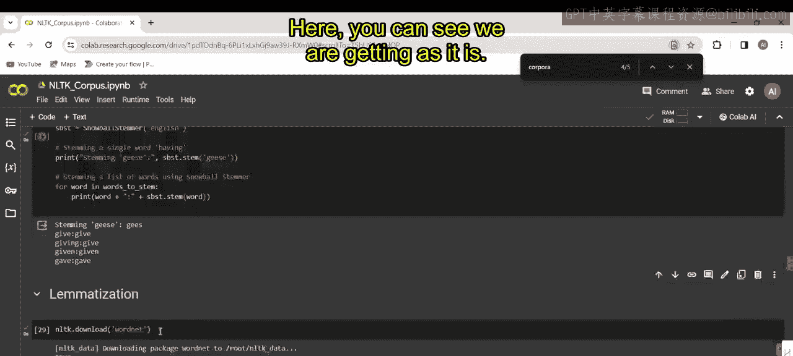

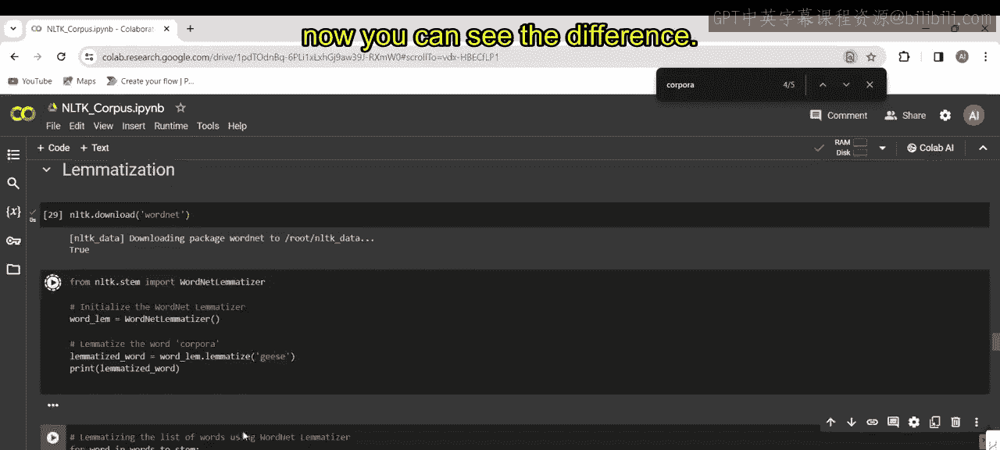

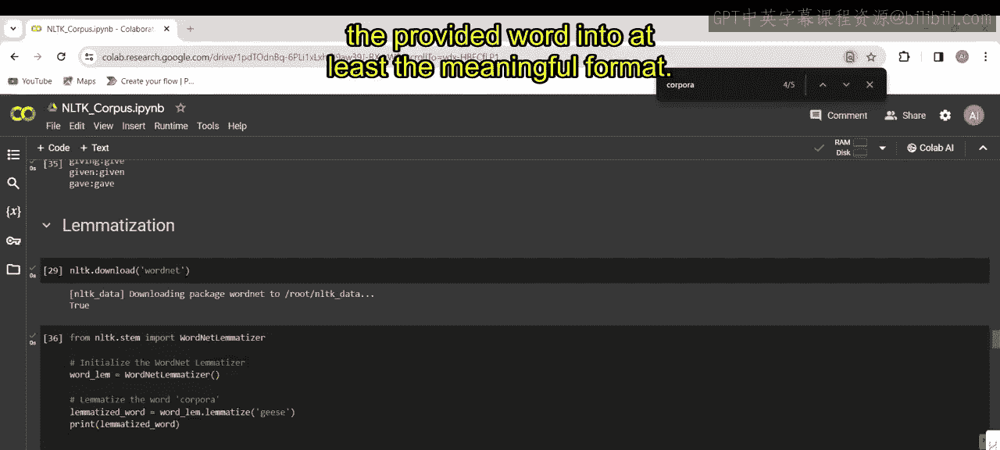

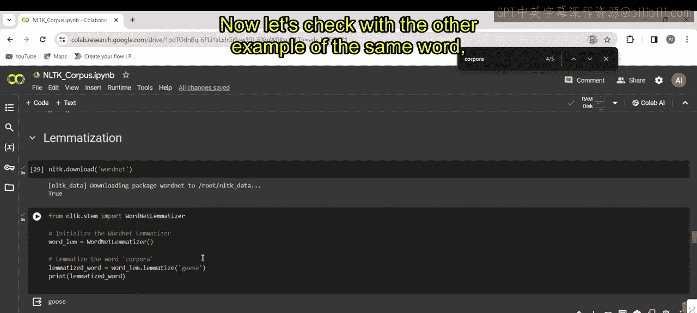

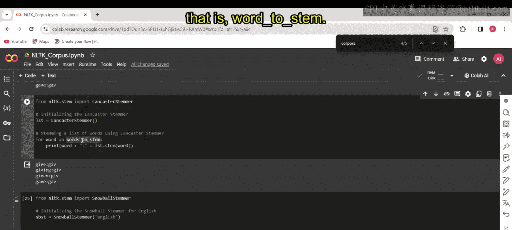

So now in this， we are having given gave。 So now let's perform this operation on this particular thing。

😊，So this line， this loop iterates over each word in the list that is word to stem and then word underscore La dot lemmatization of the provided word we are taking means these are the provided words means for each word in the list the word net limitits lematize the method means it will apply the lematize method to update the lemma so let's print it and well see what we are going to get can you all see this。

😊。

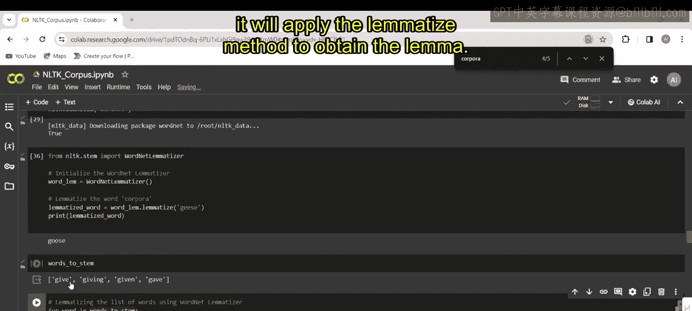

The limititizer has kept the words unchanged why because no parts of speech that is nothing but poOSs tags were provided by default the wordnate limititizer assumes that the words are nouns since give giving given and gave are already in their base or root forms the limititizer preserves them as they are means without explicit pos tagging the wordnate limititizer defaults to assuming that the words are nouns therefore retaining the words unchanged if they are already in their base form。

 so that is all about the limititization process Now you can see here also we are having the same examples whatever I explained now so now the summary in this lesson we have gain insights in。

😊。

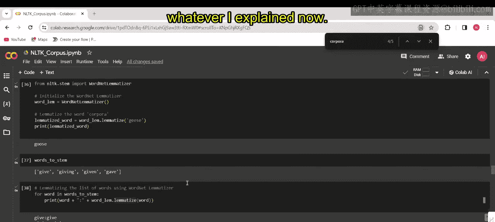

The significance of lematization using linguistic processing。

 understanding its role in obtaining base form of words additionally。

 we have leveraged NLTK to implement effective limititization techniques enhancing text analysis capabilities Thank you。

😊。

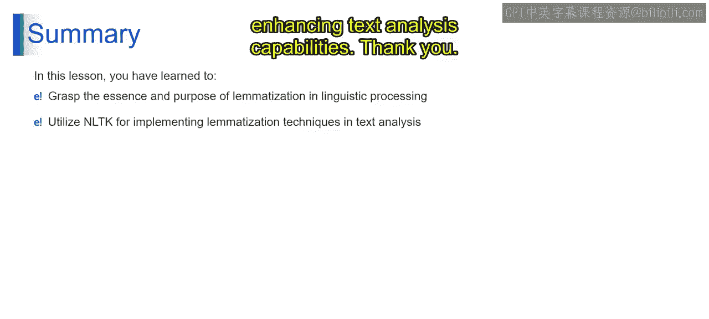