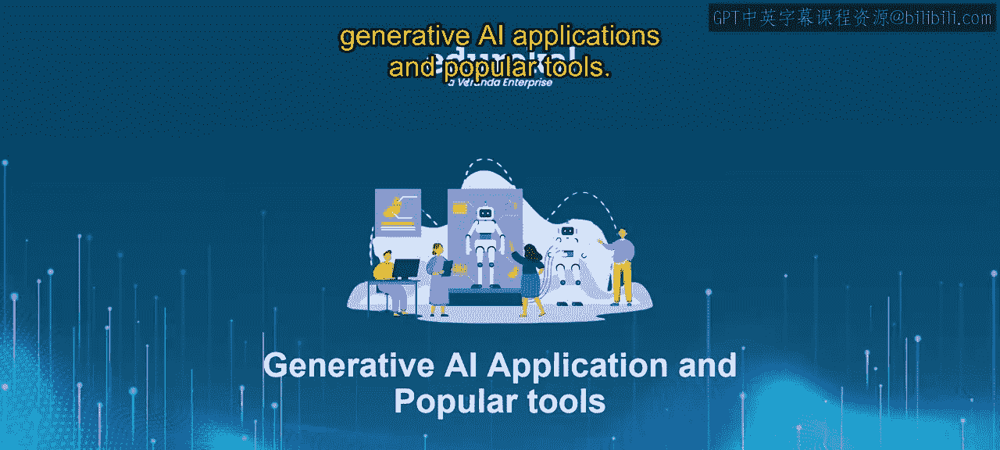
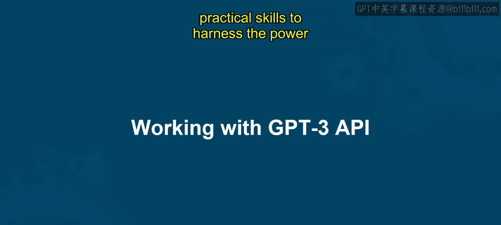
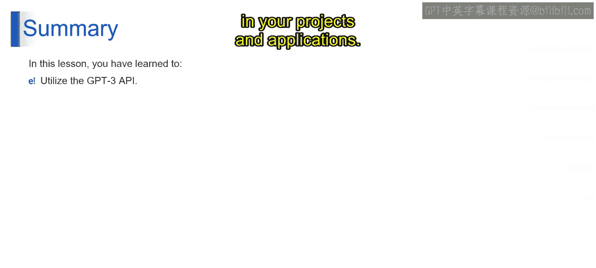

# Edureka《通过LLMs学习生成式AI（基础、应用开发、流行工具，第2、3、4课／共4课）｜Learn Generative AI with LLMs》中英 - P115：8_使用ChatGPT API.zh_en - GPT中英字幕课程资源 - BV1ym421V7gx

Welcome to the immersive journey into the world of generative AI applications and popular tools throughout this course。

 you'll gain invaluable insights and practical skills to harness the power of state of the art natural language processing。

 enabling you to revolutionize your applications。 Get ready to embark on an immersive learning experience that will unlock new possibilities in AI driven text generation。

 By the end of this lesson， you will have gained the expertise to effectively utilize the G3 API。

 unlocking the potential to generate answers of every question and leverage the power of state of the art language models in your applications。

 So let's get started with a demonstration。😊。

So in this demo， you will be creating a chatbot to generate creator story prompts based on a given input with the help of GPT3 API okay we are using Python programming language because of its simplicity and its readable syntax。

😊，So the Open AI package provides Python bindings to the Open AI API。

 allowing developers to easily interact with Open AI's various AI models including GPT models directly from Python code。

 so specifying is equal to is equal to 0。28 ensures that this specific version is installed。

 which can be important for compatibility with certain code bases or to ensure consistent behavior across different environments。

😊，So the provided code snippet showcases a secure method for incorporating the Open AI API into a Python script。

 emphasizing the importance of safeguarding sensitive data such as API keys。

 by importing the OS model， this script gains the ability to interact with the operating systems' environment variables。

 a feature that it utilizes to securely retrieve the Open AI API key。

This is accomplished through the OS dot get environment function which fetches the value of an environment variable named OpeneI API key。

 This approach effectively decouples sensitive credentials from the code base。

 ensuring they are not hardcodeded within the source code。

 This practice not only enhances security by preventing accidental exposure of the API key in version control systems。

 but also facilitates flexibility in key management and deployment environments。

 Additionally importing the openeI library， enables the script to interact with the OpeneIs API leveraging its powerful EI models while ensuring that the API key a prerequisite for such interactions is handled in a secure and efficient manner。

😊，This code snippet defines a python function named generate creative pros that generates creative responses from the open AI API using the G 3。

5 turbo model。 The function accepts a prompt。 that is a string that serves as the creative input for the AI and numb responses and integer indicating how many creative responses to generate。

 So here's a step by step breakdown of how it works。 First one is a function definition。

 Generate underscore creative prompts is defined to take a prompt for creativity and a number indicating how many responses are desired。

 Second parts response collection。 It initializes an empty list responses to collect the AI generated prompts。

 Third part loop for responses。 The function then enters a loop iterating numb underscore responses times to generate the requested number of creative responses the next。

😊，Part is generating responses inside the loop， it calls openaiI do chat completion do create function with the model parameters set to G 3。

5 turbo specifying the use of the G3。5 turbo model for generating responses。

 The message parameter is a list of dictionaries Each representing a message in the conversation with the AI。

 The first message sets the role of the AI as a creative assistant and the second message is the user' prompt for a creative idea。

 Now， the next part is appending responses for each iteration。

 it extracts the generated message content strips any leading or trailing whitespace and appends it to the responses list。

 The next part is the return value。 After looping through numb underscore responses iteration。

 the function returns the list of stripped generated responses。😊。

So finally the function is called with a specific prompt that is generate a unique story idea about a mysterious island and a request for three responses the variable generated underscore story underscore ideas will hold the list of generated ideas returned by the function。

So this code here is designed to print out each idea generated by the generate creative prompts function prefixed by its respective number in the sequence。

 So this is how this works for I comma idea in enumerate bracket generated story ideas come a start is equal to one。

 So this code starts a loop that iterates over generated story ideas。

 which is a list of creative prompts returned by the previously mentioned function。

 The enumerate function is used here to keep track of both the index I and the value idea for each item in the list by setting start is equal to one。

 the enumeration will begin at one instead of the default0 making the numbering more intuitive for nonprogramming context where lists are typically indexed starting from one。

 Now this print bracket F idea is to idea。 So this constructs a formatted string for each iteration。

😊，The loop where I is replaced by the current index and idea is replaced by the text of the current idea。

 This formatted string is then printed to the console So this is the output now you can see here idea。

Titan。😊，And the context or the text first idea here you can see the second idea and the text。

In the same way， you can see the third idea， the title and the text。😊。

This snippet is particularly useful for presenting the generated ideas in an organized and numbered list making it easier for users to read and evaluate each one so here comes the end of this demonstration。

😊，In this lesson you have learned to utilize the GPT3 API through hands-on exercises and practical examples。

 you have mastered the process of working with the GPT3 API from obtaining API keys to crafting prompts and interpreting generated text you have gained the necessary skills to harness the capabilities of GPT3 in your projects and applications。

Thank you for your participation and best of luck as you continue to explore the possibilities of GPT3 in your projects and endeavors we will cover the next session in the upcoming videos。

😊。

