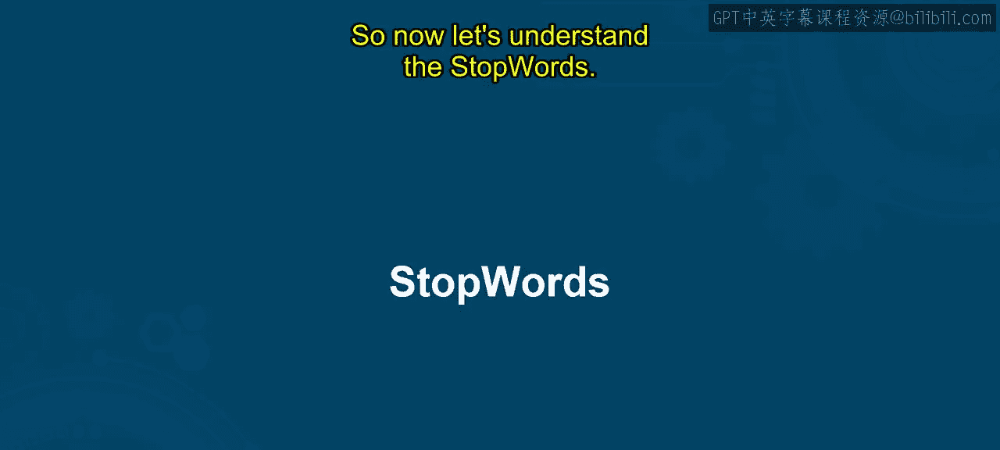
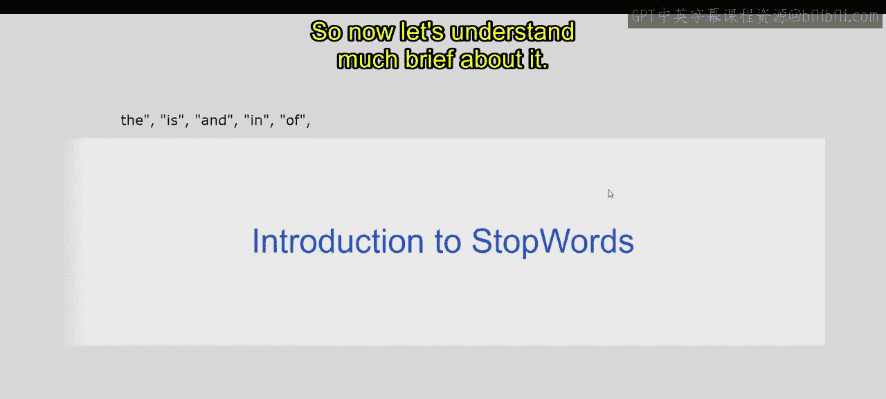
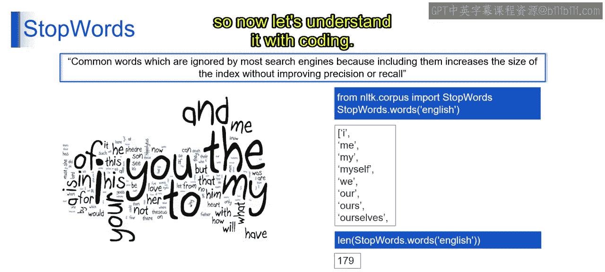
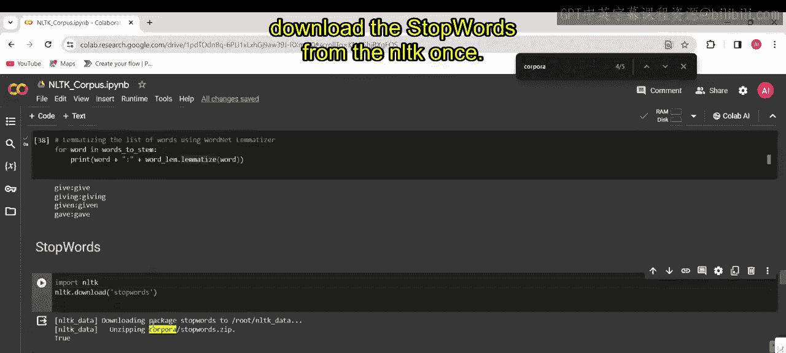
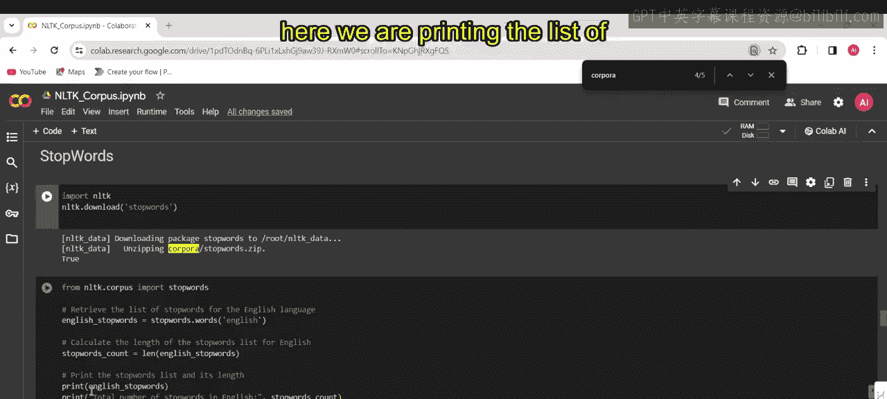
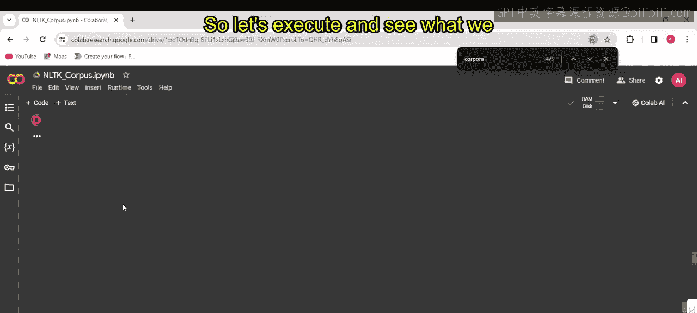
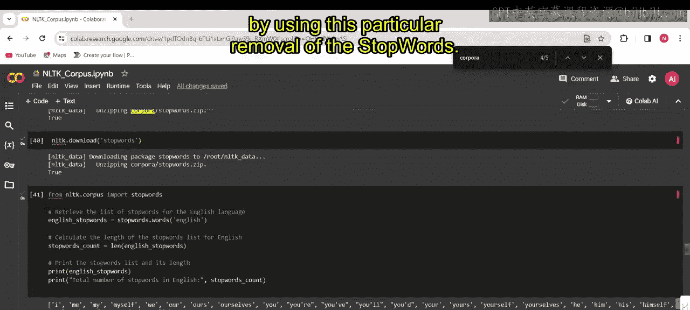
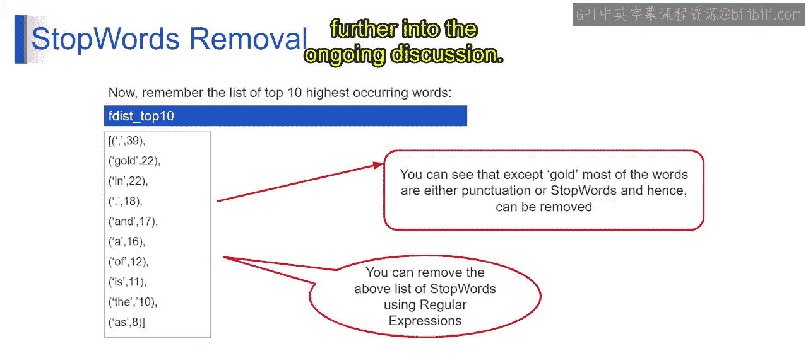

# Edureka《通过LLMs学习生成式人工智能（机器学习和NLP基础，第1课／共4课）｜Learn Generative AI with LLMs》中英字幕 - P116：115_停用词.zh_en - GPT中英字幕课程资源 - BV1q4421Q7qh

Hello everyone， welcome back to machine learning and NLP basics。

 So now let's understand the stop wordss in this we are going to understand the introduction to stop wordss and stop words removal by the end of the session you will be able to identify what stop wordss are and their impact on the text analysis tasks and also able to explore methods for stop words removal from the text data so let's get started introduction to stop words first of all。

 let's understand what exactly these stop words so stop words are commonly used words in a language that typically do not carry significant meaning or contribute much to the overall semantics of a sentence these words are often filtered out during the text processing to improve the efficiency and accuracy of text analysis tasks for example in English。

😊。

Stop words may include words like the is and in of etc。 These words occur frequently in text。

 but do not provide much valuable information about the content means technically stop words are words that are considered in significant or non-esents of text analysis tasks。

 such as natural language processing and information retrieval。

 they are often removed from the text data to focus on more meaningful words and improve the efficiency of the text processing algorithms means stop words are the common words in a language that are filtered out during the text analysis to reduce the noise and improve the accuracy of natural language tasks。

 So now let's understand much brief about it。 Now you can see here So common words。😊。

which are ignored by most search engines because including them increase the size of the indexs without improving precisional recall so this statement highlights rationally behind ignoring the stop words in the text analysis tasks such as search engine indexing so stop words are commonly disregarded by search engines because including them would enlarge the index size without significantly enhancing search precision or recall by filtering out stop words search engines can focus on more meaningful terms to improve the search relevance and efficiency here you can see we are having a coding part so now let's understand it with coding here you can see first of all as usual we need to import the NLTK and then we need to download the stop words from the。

😊。

KSo once if it is done from NLTK do corpus imports stop words。

 So this line imports the stop words module from the NLTK corpus allowing access to predefined the list of stop words for different languages then we are retrieving English stop words This line stop words stored words of English So this line retrieves the list of stop words for the English language from NLTK corpus it assigns the list to the variable English underscore stop words then calculate the stop word count what exactly this line is doing here stop words underscore count is equal to length of English stop words this line calculates the length of the English stop words list providing the total count of stop words present in the English Then we are printing here we are printing the list of。

Dwards for English to the console。So let's execute and see what we are going to get here。

 Can you all see this This code snippets demonstrates how to retrieve the list of stop wordss for English using the NlTk and obtain total count of stop wordss in the English stopboard list here you can see first of all along with the English words we are printing the count of the stop wordss you can see here we printed the stop wordss as I we my myself we are etc you can see all this and total number of stop wordss in this particular thing is 179 now you can imagine or understand how many index positions we can reduce by using this particular removal of the stop wordss that is what we are having as 179 so now let's understand how to work on removal of the stop wordss。

😊。

So for removing the stop word first of all we need to understand the context in the provided context there is a list of 10 highest occurring words extracted using a frequency distribution of FT stop 10 let's see how is going to perform so the upcoming video will delve further into the ongoing discussion。

😊。

