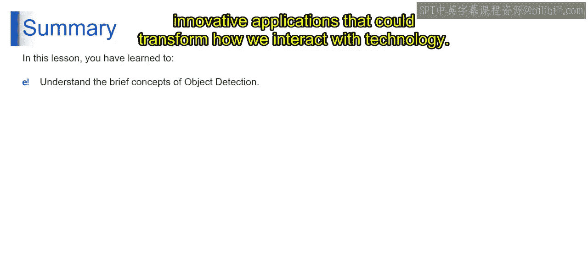

# Edureka《通过LLMs学习生成式AI（基础、应用开发、流行工具，第2、3、4课／共4课）｜Learn Generative AI with LLMs》中英 - P116：9_什么是目标检测.zh_en - GPT中英字幕课程资源 - BV1ym421V7gx

Welcome to the immersive journey into the world of generative AI applications and popular tools。😊。

Today， we embark on a journey to unravel the complexities and understand the foundational concepts of object detection。

 By the end of this session， you gain insights into how machines interpret the visual world to recognize and locate objects within it。

So what is object detection。Object detection is a sophisticated computer vision technique that aims to identify and locate objects in images or videos。

 It's about more than just recognizing that an object is present。

 It's about knowing what that object is and where exactly it is located within the visual space。

 This capability is crucial for machines to interact with their surroundings。

 understand scenes and ultimately perform tasks in a way that mimics human perception。 At its core。

 object detection develops algorithms and techniques that allow machines to accurately detect and position objects。

 This involves processing worst amounts of visual data and making sense of the complex patterns within。

 whether it's a crowded street seen or serene landscape。

 objectject detection algorithms strive to pinpoint various objects present from the most conspicious to the easily overlooked。

😊，The journey of object detection is fraught with challenges。 The diversity in object appearances。

 variations in scale differences in orientation make object detection a particularly tough nu to crack these factors contribute to the complexity of designing algorithms that are both accurate and efficient in recognizing and locating objects under varying conditions。

 Despite its challenges， Ob detection remains a highly engaging and intellectually stimulating field。

It sits at the crossroads of technology and creativity， requiring not just technical powers。

 but also a deep understanding of how to mimic the intricacies of human sight and cognition as we wrap up this introductory lesson。

 remember that understanding object detection is a stepping stone to more advanced concepts in computer vision and AI。

 It's about equipping machines with the eyes to see and the intelligence to understand paving the way for innovative applications that could transform how we interact with technology。

 Thank you for joining this video on object detection you have taken the first step towards understanding this fascinating area of AI as you continue your journey remember that the fields of computer vision and AI are ever evolving and staying curious is key to unlocking the full potential。

 we will continue this session in the upcoming videos。😊。

