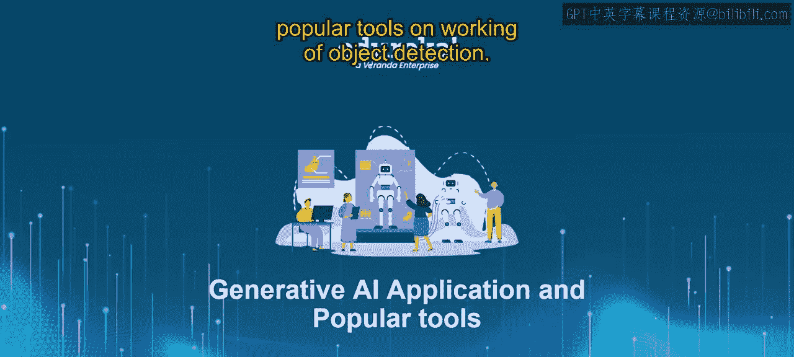
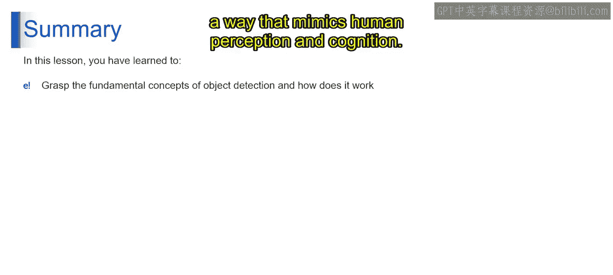

# Edureka《通过LLMs学习生成式AI（基础、应用开发、流行工具，第2、3、4课／共4课）｜Learn Generative AI with LLMs》中英 - P117：10_目标检测是如何工作的.zh_en - GPT中英字幕课程资源 - BV1ym421V7gx

Welcome to the immersive journey into the world of generative AI applications and popular tools。😊。

On working off object detection by the end of the session。

 you'll have a foundational understanding of how object detection works and its significance in interpreting and understanding visual data through the lens of MlP and generative AI models。

 Let's get started。 So object detection stands as pivotal technology in the domain of computer vision。

 which is itself a specialized branch of artificial intelligence。

 aimed at granting machines the ability to interpret and understand visual data from the world。

 This technology is not just about identifying the presence of objects within digital images or videos。

 a task known as classification， but also about pinpointing their precise locations and extends within the image space。

 a process referred to as localization。😊，The amalgamation of these tasks enables object detection systems to recognize multiple objects in a single image or video frame and to delineate each object with a bounding box or rectangular outline that specifies the objects's spatial boundaries categorization so the process begins with identification of objects within a visual input such as an image or a video frame This step is crucial for understanding the content of the visual data by determining what objects are presentant。

Each object is classified into predefined categories， example vehicles， pedestrians。

 animals based on its appearance。😊，Spatial localization beyond merrily identifying the presence of objects。

 object detection also involves pinpointing their exact locations within the visual field。

 This is typically achieved through the creation of bounding boxes rectangular outlines that specify the position and extent of each object。

Spatial localization allows for a precise understanding of where objects are situated related to each other and the overall scene layout。

😊，Next ROIs a key technique in object detection is the identification of regions of interest or ROI。

 which are segments of the image believed to potentially contain objects。

This preliminary step focuses the processing on specific areas。

 reducing the computational burden and improving the efficiency of the detection process。

 refinement into bounding boxes。 Once R Ois have been identified。

 further analysis refines these regions to accurately defined bounding boxes around the actual objects。

 This refinement process involves adjusting the size， shape and position of the initial Ris。

To fit the contours of each detected object， thereby improving the accuracy of both localization and categorization。

 Next， traditional feature based approaches， before the advent of deep learning。

 object detection relied heavily on feature based techniques。

 these methods involved manually designing and extracting features from images such as edges。

 the corners textures that were indicative of objects， Con deep learning approaches。

 the revolution in object detection has been largely driven by deep learning。

 particularly through the use of convolutional neural networks。Unlike traditional methods。

 deep learning automates the feature extraction process。

 learning optimal features directly from the data through training on large annotated data sets。

 this results in significantly improved accuracy and robustness across a wide range of object detection tasks。

So today you have gained an insight into the fascinating world of object detection。

 you have learned about its foundational concepts， its integration with MLP and generator AI and the technologies that make it possible。

 Object detection is more than just recognizing objects。

 It's about understanding the context interpreting the scene and making sense of the visual world in a way that mimics human perception and cognition。

 Thank you for joining this lesson as you continue to explore the rims of AI MlP and computer vision。

 remember that the understanding of object detection is a significant step towards building intelligent systems that can see Under and interact with the world around them in complex and meaningful ways。

 Thank you and we will continue the session in the upcoming videos。😊。

