# Edureka《通过LLMs学习生成式人工智能（机器学习和NLP基础，第1课／共4课）｜Learn Generative AI with LLMs》中英字幕 - P117：116_停用词演示.zh_en - GPT中英字幕课程资源 - BV1q4421Q7qh

So let's now explore the progression from our previous discussion。😊。

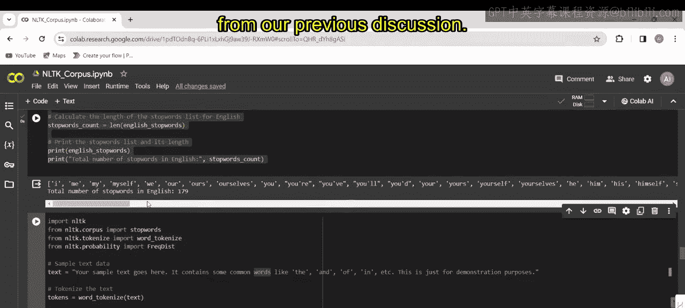

Now in continuation to the previous one now let us understand the coding example here， first of all。

 we are importing the necessary modules from the NLTK library so。😊。

Here N LTK we all know that this is a natural language toolkit which provides various tools and resources for natural language processinging task tasks the next one is of stop words this module contains a list of common stop words for different languages then word underscore tokenize this function is used to tokenize nothing but split a text into individual words and then we are importing NLTK or probability import frequency distribution this class is used to ca the frequency distribution of items in a sequence so here we are taking a sample data that is yes sample text goes here it contains some common words like the and of in etc。

 this is just for the demonstration purpose consider it as a sample text data that you are working on。

😊，Now the next word is tokens is equal to word underscore tokenize of text。

 This function is use to split the text into individual words。

 nothing but tokens and store them in the tokens variable。

 So then once tokenization is done we are trying to remove the stop words So stop words is equal to set stop words dot words English this function call retrieves a set of common English stop wordss means here we are using filtered tokens is equal to word for word in tokens If word dot layer not in the stop words means list comprehension form word for word in token if word dot layer is and stop words it filters out stop words from the tokenized text that is nothing but from this tokens。

While ignoring his differences， the filtered tokens are stored in the filtered tokens variable。

 That is what we are doing。 Once it is done， we are calculating the word frequency。 First of all。

 a disk is equal to frequency distribution of filtered tokens。

 This function is used to create a frequency distribution object from the filtered tokens that is filtered tokens。

😊，Which counts the occurrences of each unique word。

 And then we are trying to guide the top 10 most common words means let's first execute it。

 and then we'll see what we are going to get。 Let's print the Eest how many we are having can you all see this we are having these things。

 Now let's try to print the Eest top 10 means the most common 10。

 this method is used to retrieve the top 10 most common words along with their frequencies from the frequency distribution object that is nothing but Eest。

 and we are going to print the results here you can see now means now it is printing the top 10 most common words after stop word removal of the console。

 Now you can feel the difference when compared to the initial Now let's perform it with gold were tokenized。

 So we will take this。

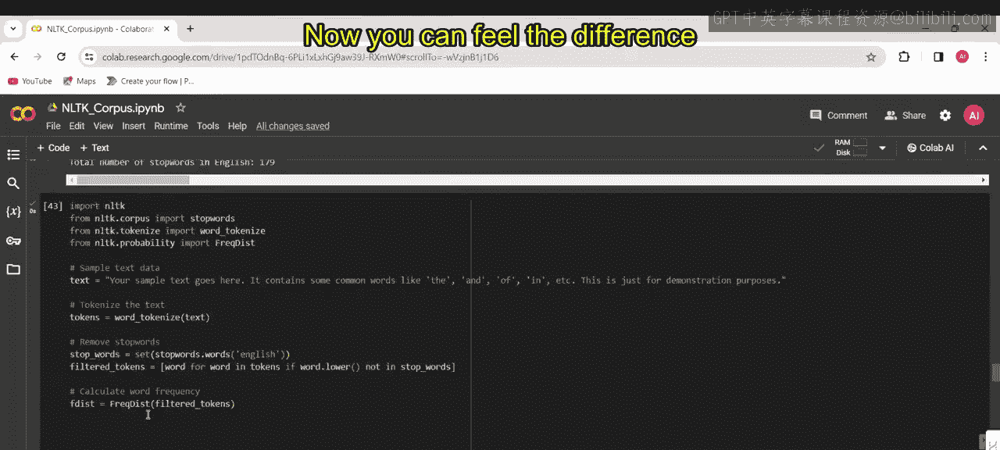

This a sample sentence with punctuations，ma， kma stop wordss like the and off in removed full stop。

 It is just for demonstration purpose， pull stop Now。

 let's try to remove the stop wordss from this And this。

 what is the observation upon examining this list， it is noted that apart from the word gold。

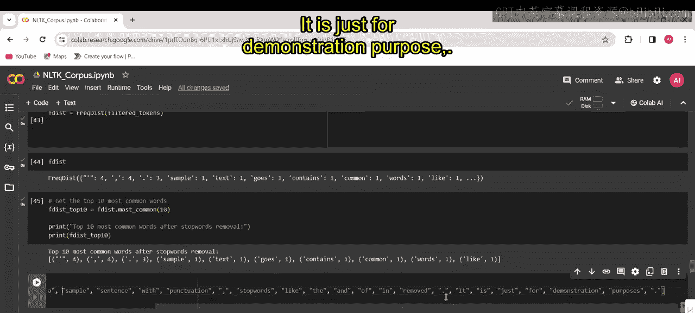

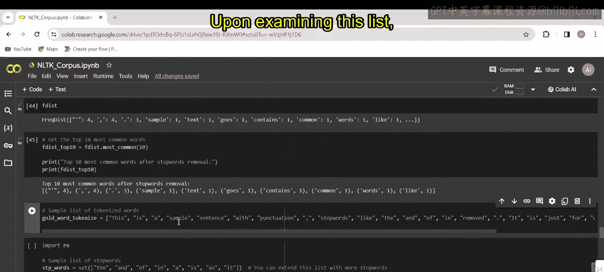

So here we took the sample list of tokenized words and now we are performing import re this imports the Python regular expression module R which is used for pattern matching operation then we are listing out this sample list of stop words the and of in a is as it and now we are providing the punctuation telling that re dot compile the special symbols as well as characters and numbers this creates a regular expression pattern that matches common punctuation maths numbers and symbols then we are providing a sample list of tokenized words that is gold underscore word underscore tokenized is equal to we are providing the text information as a sample this is a sample list of tokenized words with punctuation。

😊。

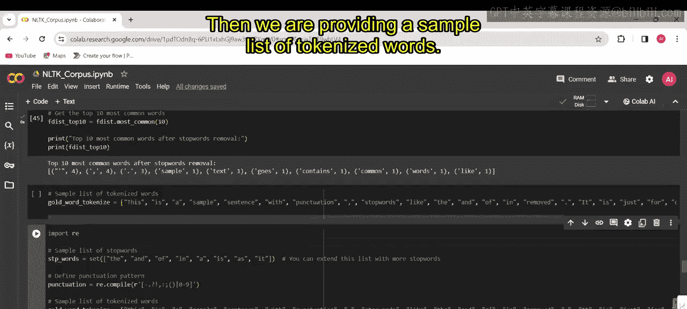

And stop words included。 Now you can see that。 Okay。

 so now post punctuation is equal to we are creating empty list means here this initializes an empty list to store the words after removing the punctuation。

 then we are performing iterate through each word in gold word tokenise means this loop iterates through each word in gold word tokenize we contains this information in it。

 right， and removes punctuations using the regular expression pattern and happens the cleaned word to the post punctuation list。

 If it's not empty。 Let's try to print it now we can see the words after removing both punctuations and stop words。

 So previously we were having E a now these two are removed from the output and now we are not having comma explicitly。

😊，And now it is removed the n of n like this now you can go and check what is the output of this。😊。

Finally， the code prints the list of words after removing both punctuations and stop words to the console means what happen here in this entire code。

 it involved identifying and eliminating common words like stop words and punctuation marks from the text data thereby improving the quality and accuracy of text analysis result。

 So now let's understand the length of the original list obtained after the tokenization。

 So here I am trying to get the length of the original data and then the length of post stop words and post punctuations。

 let's try to execute it so that you are able to get the clear understanding Let's execute it can you all see this initially the total length of the provided sentence this one Okay is having total 23 words tokens and then。

😊。

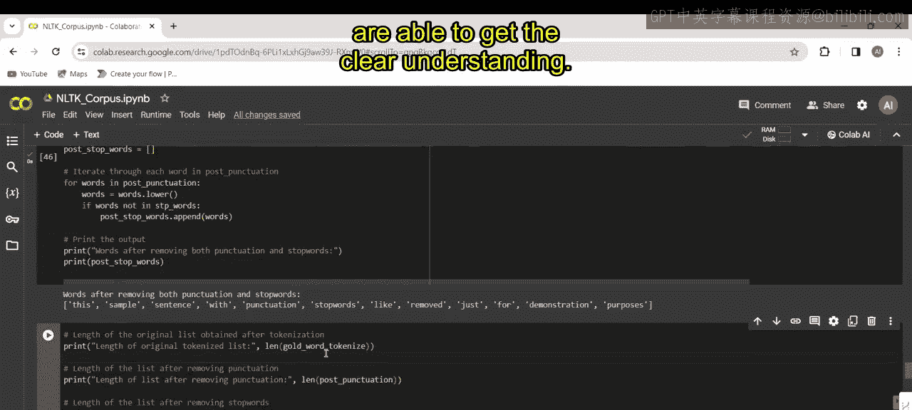

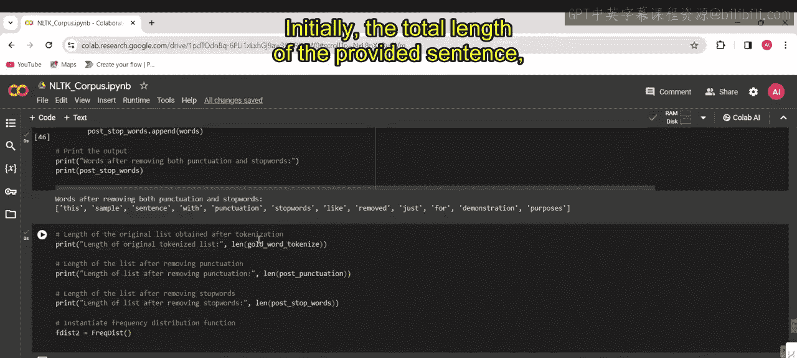

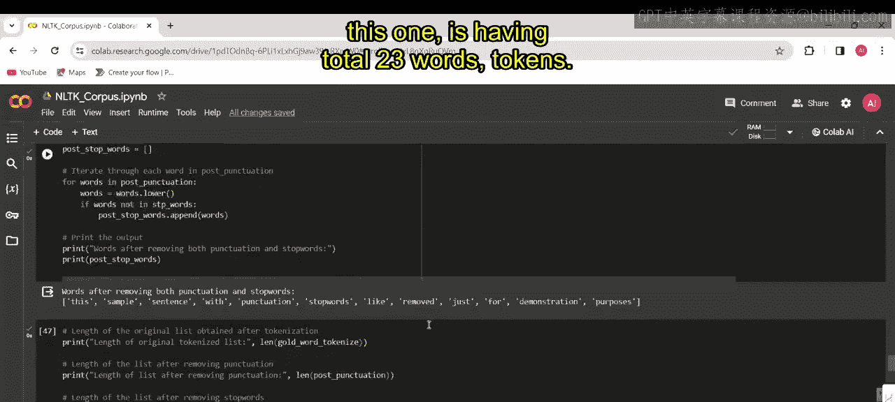

Remov the punctuations we are having 20 and then after removing punctuations followed by the stop words now we are having total 12 words now you can feel the difference 23 to 12 more than almost half amount of the words are reduced means we are saving 50% of index by removing the noise from the provided sentence。

😊。

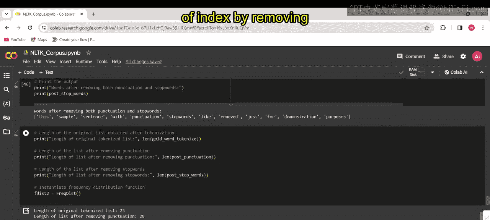

So now the summary here， the observations are by comparing the length of this list。

 you can observe the changes in the number of words by different stages of preprocessing removing punctuation reduces the list size by eliminating the punctuation marks further removing the stop wordss reduces the list size even more by excluding common and less meaningful words after preprocessing。

 you can instantiate a frequency distribution F disk2 to analyze the distribution of unique words in the text data post stopward removal also this frequency distribution can provide insights into the most common words present in the text after cleaning you know we are doing it now and let's even print this。

😊，This comparison helps in identifying the impact of stopboard removal on the text data and facilitates further analysis and interpretation of the preprocessed text。

😊。

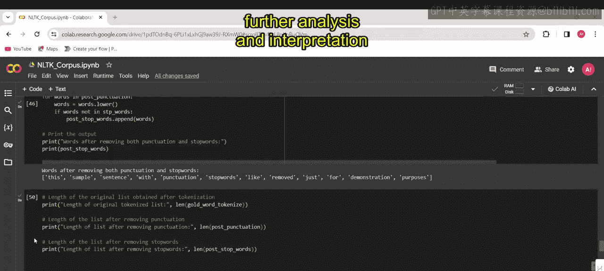

Now the summary in this lesson you have explored the role of stop wordss in the text analysis understanding their significance。

 Additionallyly you have implemented top word removal as a crucial processing step in text analysis task with a coding example thank you。

😊。

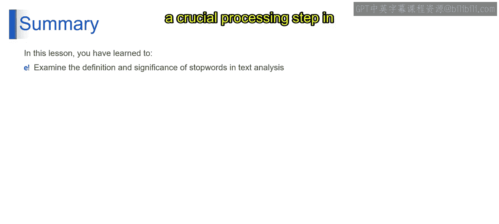