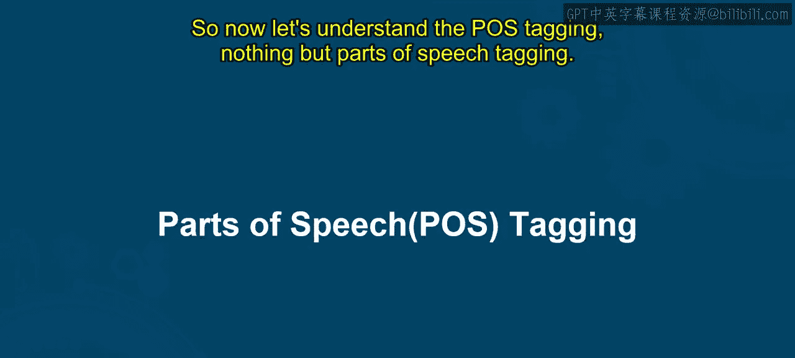
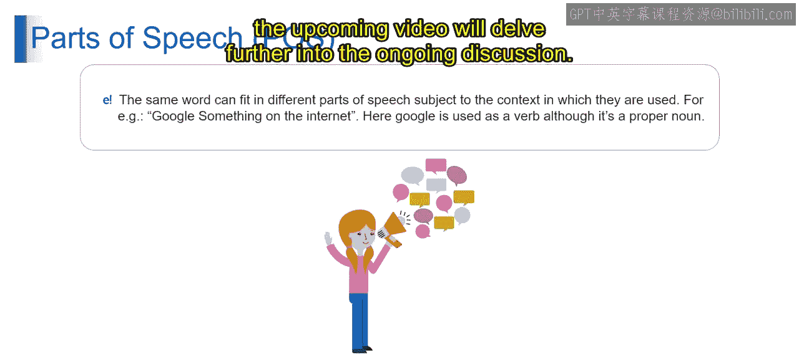

# Edureka《通过LLMs学习生成式人工智能（机器学习和NLP基础，第1课／共4课）｜Learn Generative AI with LLMs》中英字幕 - P118：117_词性标注.zh_en - GPT中英字幕课程资源 - BV1q4421Q7qh

Hello everyone welcome back to machine learning and NLP basics So now let's understand the Pvos tagging。

 nothing but parts of speech tagging in this we are going to understand what exactly a Pvos tagging is all about means parts of speech and what is the need of Pvos tags by the end of the session you will be able to recognize the common tags of Pvos and also able to identify the need of Pvos tags so let's get started parts of speech nothing but POSs so Pvos tagging is a fundamental task in NLP that involves labeling each word in a sentence with its corresponding grammatical category or part of speech such as noun noun verb adjective adverb and etc so this labeling provides insight into the syntax。

😊。

structure and meaning of a sentence， aiding in various NLP tasks like passing information extraction and sentiment analysis。

 For example， let's say we have a sentence Gaurro likes to eat P。

 Now let's understand the Pvos tagging for each word in the provided sentence。

 So you guys can see the garo is represented as noun and likes is represented as verb and two is represented as preposition that is iron and E is represented as verb again。

 and then again， pis is going to be the noun。 So means technically Pvo tagging involves the use of statistical models or rulebased algorithms to assign a specific tag in a text carpus based on its context and grammatical role within the sentence。

 These tags follow a。😊，fin tag set such as Ptry bank tag set。

 which categorizes the words into various parts of speech Pvo is tagging is essential for tasks like synthetic analysis。

 text generation and machine translation as it provides valuable linguistic information about the text data。

 so now let's understand more about it here。😊，You can see the same word can fit in different parts of speech subject。

 subject to the context in which they are used here。

 they provided the example Google something on the internet here Google is used as a verb although it's a proper noun。

 So generally in the natural language processing， the parts of speech refer to the grammatical categories that words belong to in a sentence。

😊，These categories include nouns， verbs， adjectives， adverbs， pronouns， prepositions。

 conjunctions and interjunctions means Pvos tagging involves assigning these categories2 words in sentence based on the syntactic function。

 So in this example of Googles something on the internet in this sentence。

 the word Google is typically a proper noun referring to a company。 However。

 in this context it is used as a verb， meaning to search for something online。

 This demonstrates how the same word can take on different parts of speech。

 depending on the context in which it is used means Pvos tagging is essential in NLP because it helps capture the shapes of language uses words can have。

😊，Multiple meaning and functions， depending on their context within a sentence。

 therefore Pvo is tagging allows us to understand the grammatical structure of sentences and extract meaningful information from the text data in the example provided Google is tagged as a verb instead of noneun because of its usage in the sentence as an action rather than a name。

 so now let's understand some common tags and their descriptions。😊。

So the upcoming video will delve further into the ongoing discussion。😊。

