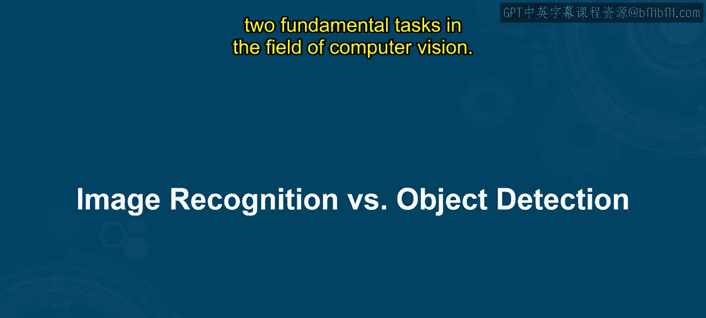
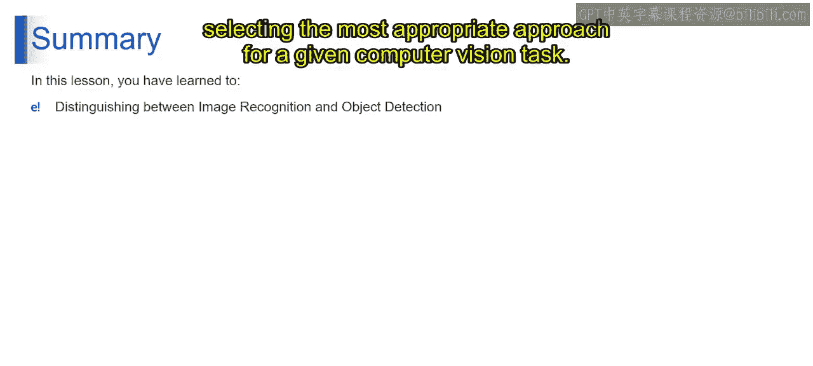

# Edureka《通过LLMs学习生成式AI（基础、应用开发、流行工具，第2、3、4课／共4课）｜Learn Generative AI with LLMs》中英 - P118：11_图像识别vs目标检测.zh_en - GPT中英字幕课程资源 - BV1ym421V7gx

Welcome to the immersive journey into the world of generative AI applications and popular tools。😊。

Image recognition versus object detection， two fundamental tasks in the field of computer vision throughout this video will delve into the intricacies of each task examining the distinct characteristics。

 methodologies and applications By the end， you have a comprehensive understanding of the differences between image recognition and object detection and also their respective roles in computer vision。

Let's begin by understanding image recognition image recognition。

 also known as image classification is the task of identifying objects within an image without providing their specific locations。

 It involves training machine learning models to recognize patterns and features and images and categorize them into predefined classes or labels。

 In a sense， image recognition answers the question what objects are present in the image。

 without specifying where they are located。😊，Now let's move on to object detection Object detection is a more comprehensive task than image recognition。

 it not only identifies the presence of objects within an image but also provides additional information such as classifying these objects into predefined categories and providing precise bounding box coordinates for each detected object。

These bounding boxes denote the exact spatial locations and extents of the objects within the image。

Object detection therefore answers the questions。 What objects are present in the image and where are they located。

 Now， moving on to the key differences。 First one， level of detail。

 the primary difference between image recognition and object detection lies in the level of detail provided。

 image recognition focuses solely on identifying objects within images while object detection provides additional information about the spatial locations of these objects through bounding box coordinates。

 Second difference。 applications。 imageage recognition is commonly used in tasks when knowing the specific locations of objects is not necessary。

 such as image classification content based image retrieval and scene understanding。

 On the other hand， object detection is preferred when precise localization of multiple objects within an image is required。

 making it applicable to tasks like object tracking， counting。And understanding complex scenes。

The third difference is complexity， Object detection is generally more complex than image recognition due to the additional task of localizing objects within images。

 it requires algorithms capable of accurately detecting objects classifying them into categories and precisely delineating their spatial boundaries。

 often in the presence of occlusionions and weighing scales。

 in conclusion while both image recognition and object detection involved identifying objects within images。

 they differ in the level of detail provided and the applications they serve。😊。

Image recognition focuses solely on identifying objects while object detection provides additional information about the spatial locations of these objects through bounding box coordinates understanding these differences is crucial for selecting the most appropriate approach for a given computer vision task。

 Thank you for joining us in this comprehensive exploration of image recognition versus object detection We hope this lesson has provided you with a deeper understanding of these fundamental tasks in computer vision and their respective roles in analyzing and interpreting visual data remember to keep exploring and experimenting with these concepts as you continue your journey in the exciting field of computer vision。

 Stay tuned for the upcoming videos。😊。

