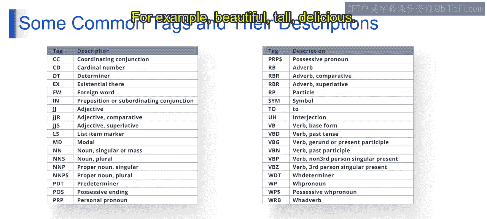
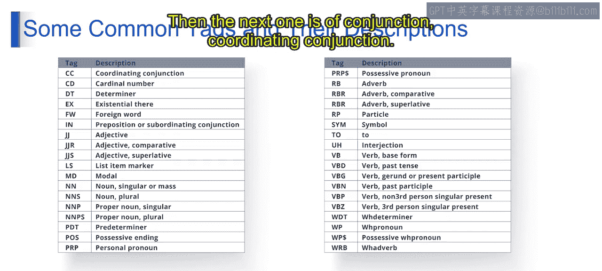
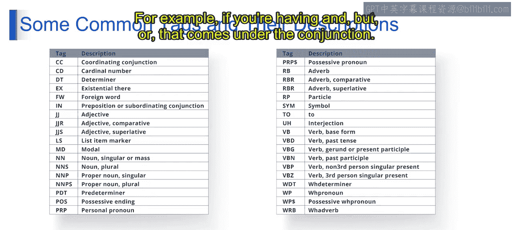
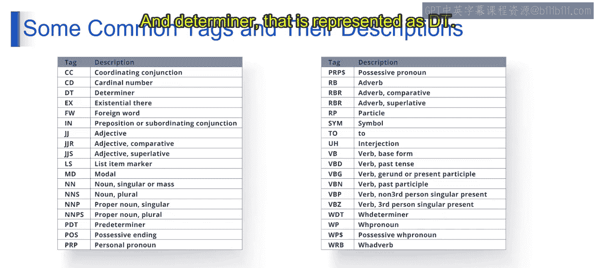
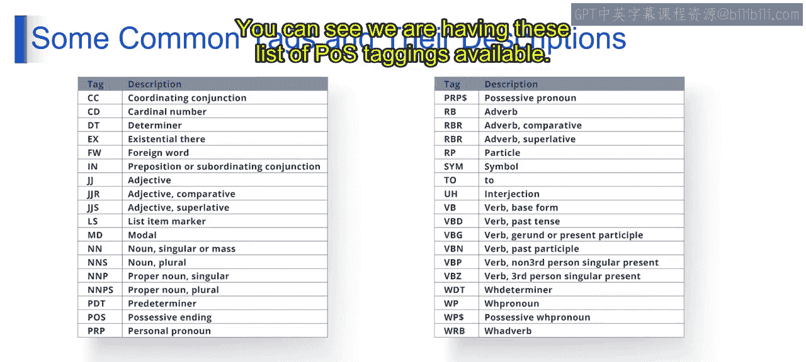
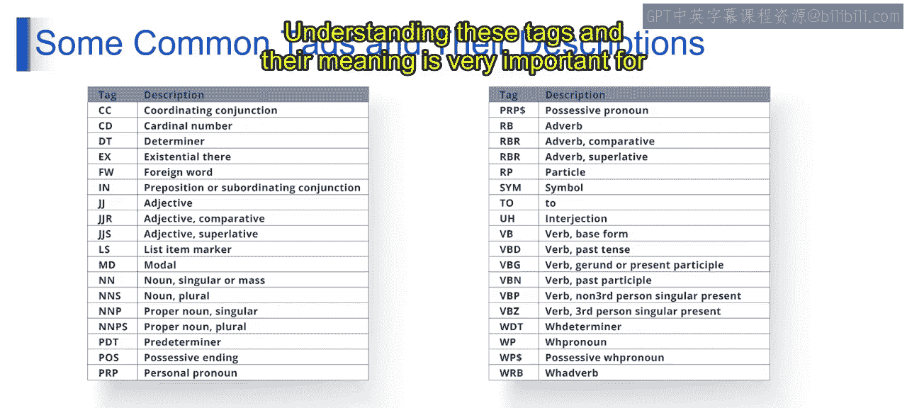
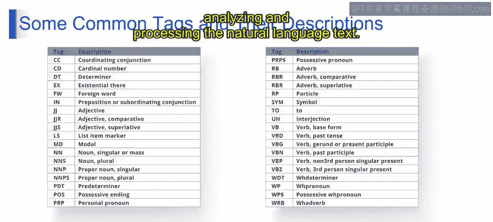
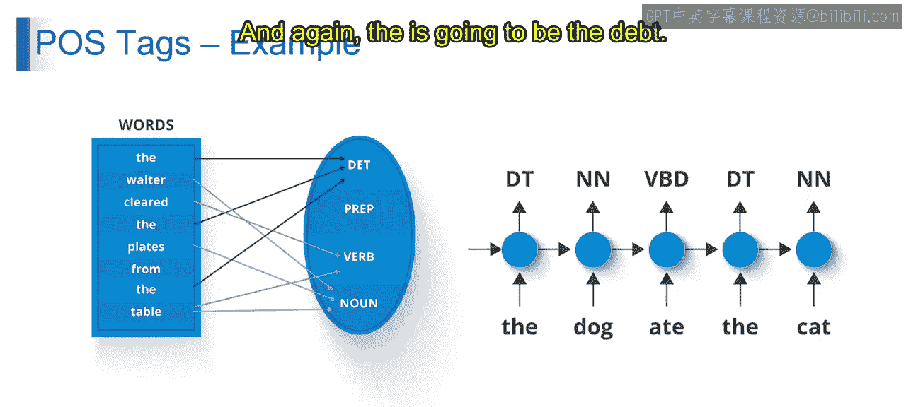
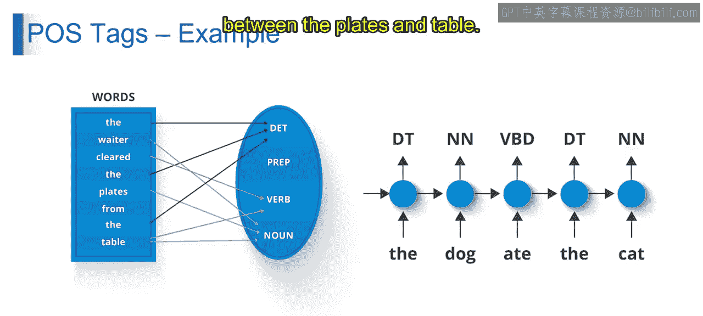
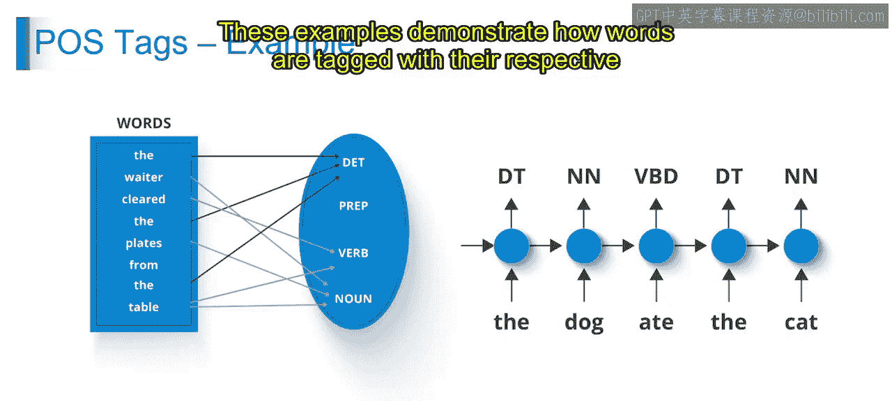

# Edureka《通过LLMs学习生成式人工智能（机器学习和NLP基础，第1课／共4课）｜Learn Generative AI with LLMs》中英字幕 - P119：118_词性的常见标签和描述.zh_en - GPT中英字幕课程资源 - BV1q4421Q7qh

So let's now explore the progression from our previous discussion。😊。

Here we can see some most common things like Nn， nothing but noun。😮。

Means a word that represents a person， place， thing or idea。 For example， let's say car house book。

 These are represented as noun。 Then verb that is represented as webe。

 A word that expresses an action occurrence are stable of being。 For example。

 let's say we are having words run， eat， sleep。 These are known as verbs。 and coming to the aive。

 It is represented as J J。 a word that describes or modifies a noun or pronoun indicating its quality or attribute。

 For example， beautiful， tall， delicious。 These all are known as adjectives， because they are。😊。

Modifying a noun or pronoun and then let's say， for example， adverb， a word that modifies a verb。

 adjective or other adverb indicating manner place， time degree etc， for example。

 quickly very here these all comes under the adverb， then pronoun personal pronoun。

 it is represented as PR P means a word that substitutes for a noun or noun phrase referring to a person or a thing。

 for example， if I am telling that he is eating he is referring a person like that he。

 she it these all comes under the pronoun， then the next one is of preposition preposition that is represented as I N so a word that shows the relationship between。

😊，A noun or pronoun and other words in a sentence。 for example。

 if I am telling that I am in a classroom the in here represents as preposition。

 the cat S on the mat here in this particular sentence on represents a preposition likewise at in on at。

 these all are represented as preposition， then the next one is of conjunction。

 coordinating conjunction， So a word that connects words phrases or clauses in a sentence。

 for example， if you are having and but or that comes under the conjunction and then interjunction Interjunction is represented as U a word or phrase that expresses emotion。

😊。

feeeling or reaction like for example， wow ouch like this and determiner that is represented as Dt a word that introduces or specifies a noun such as articles the A and or demonstrs like this tat they can be represented as Deteror that is represented as Dt for example wherever you are seeing a words this the sum these comes under Determinor so these are just few examples of common Pvo tags used in the NLP you can see where are having these list of POS tags available understanding these tags and their meaning is very important for analyzing and processing the natural language text here we are having the examples of the waiter cleared the plates from the table they provided it as。

😊。

Individual words the waiter cleared the plates from the table the waiter cleared the plates from the table in this。

 the tagging with Pvos in here the is represented as debt nothing but determiner and waiter is represented as noun because he the person here and clear is represented as verb and again。

 the is going to be the dead wherever you are having the word called the it can be represented as dead and wherever you are having the name of a person or the thing you can see that they are represented as noun in our case waiter plates and tables are represented as noun and now you can see the work like you know clear and table are determined as verb from is not represented with。

Anything， but it should be。From is going to be the preposition。

Table is going to be the noun Yeah so we covered almost means the is tagged as determiner because it specifies the noun precedes and waiter is tagged as noun because it represents a person and cleared is tagged as a verb because it represents an action and plates are tagged as noun as it represents objects and from is tagged as preposition as it indicates a relationship between the plates and table and the is tagged as determiner again because it specifies the noun table and then the table is tagged as the noun as it represents an object that is all about the first example the waiter cleared the plates from the table So now it's understand the next one the dog a the cat in this based on the understanding of previous exam。

😊。

Let's consider this The is tagged as determiner because it specifies the noun it precedes and dog is tagged as noun because it represents a living being then8 is tagged as verb because it represents an action and the is tagged as determiner again because it specifies the noun cat and finally the cat is tagged as noun because it represents a living being these examples demonstrate how words are tagged with their respectivevos tas based on their grammatical function and role in the sentence。

😊。

So the upcoming video will delve further into the ongoing discussion。😊。

