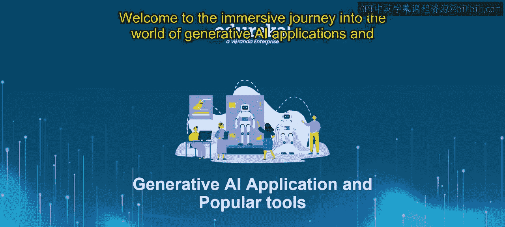
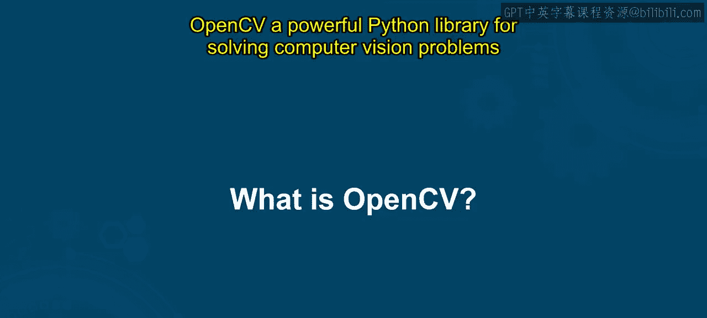
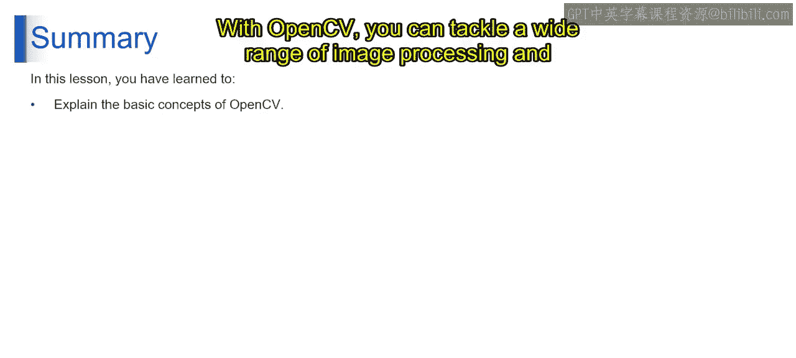
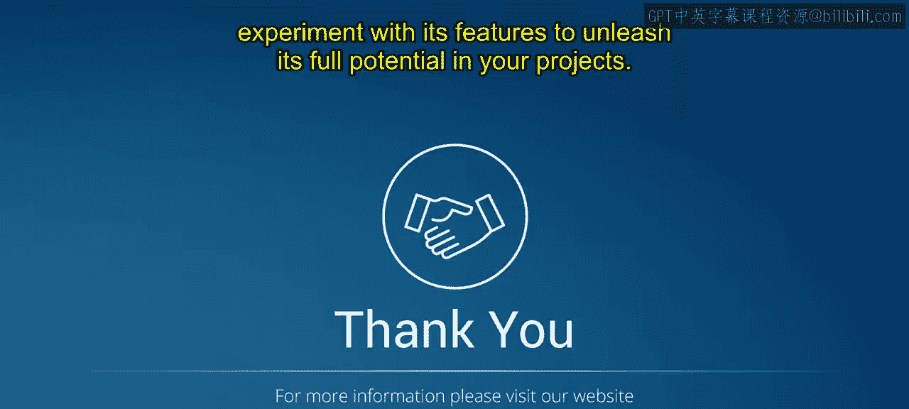

# Edureka《通过LLMs学习生成式AI（基础、应用开发、流行工具，第2、3、4课／共4课）｜Learn Generative AI with LLMs》中英 - P119：12_什么是OpenCV.zh_en - GPT中英字幕课程资源 - BV1ym421V7gx

Welcome to the immersive journey into the world of generative AI applications and popular tools。😊。

Open C， a powerful Python library for solving computer vision problems。

Throughout this session， we'll explore the core concepts of OpenC and its applications in image processing and computer vision By the end of this video youll have a solid understanding of OpenC and how to integrate it with other libraries to tackle real world computer vision tasks。

So what is Open Cv OpenCv short for open source Comp vision library is a Python library specifically designed for solving computer vision problems It provides a wide range of functions and algorithms that facilitate tasks such as image processing Object detection。

 facial recognition and more with OpenCDevelop and researchers can efficiently manipulate and analyze images and videos。

 making it an indispensable tool in the field of computer vision。

 One of the key advantages of openC is its seamless integration with other popular Python libraries such as Ny。

 si and Matpllib This interoperability allows users to leverage the strengths of different libraries for various tasks。

 For example， you can load an image using openC Con it into a Ny array for efficient manipulation and then use statistical libraries like Skipppy。

😊，For further analysis or Matlolib for visualization。

 key features of OpenC first important feature is image loading and manipulation OpenC simplifies the process of loading and manipulating images with its intuitive functions you can effortlessly read images from files。

 capture frames from video streams and perform operations like resizing cropping rotation and filtering。

Second is feature detection and matching。 OpenC offers a plehora of algorithms for detecting and matching features within images。

 These features may include corners， edges， key points and descriptors feature detection and matching are essential for tasks such as objectject recognition amid stitching and motion tracking Third one is object detection and recognition。

 OpenCv provides pretrained models and algorithms for detecting and recognizing objects within images or video streams。

 These capabilities enable a wide range of applications including facial recognition。

 Object tracking， gesture recognition and augmented reality fourth feature is integration with numpy and other libraries。

 One of the strengths of open CV lies in its seamless integration with other Python libraries。

 particularly Nmpy By converting images to nuy arrays， developers can。😊。

The array processing capabilities of Ny for efficient manipulation and analysis Additionally。

 OpenCv works well with other libraries such as Skypepi for advanced scientific computation and mathlolibb for visualization In conclusion OpenCv is a versatile and powerful Python library for solving computer vision problems It extensive collection of functions and algorithms combined with its seamless integration with other libraries makes it an invaluable tool for researchers。

 developers alike with OpenCv you can tackle a wide range of image processing and computer vision tasks with ease and efficiency。

 Thank you for joining us in this introductory lesson on openCv We hope you now have a solid understanding of its core concepts and its importance in the field of computer vision As you continue your journey with OpenCv remember to explore its。

😊。

Acumentation and experiment with its features to unleash its full potential in your projects。

 Stay tuned for the upcoming videos。😊。

