# Edureka《通过LLMs学习生成式AI（基础、应用开发、流行工具，第2、3、4课／共4课）｜Learn Generative AI with LLMs》中英 - P11：10_使用ChatGPT生成代码.zh_en - GPT中英字幕课程资源 - BV1ym421V7gx

Hello everyone， welcome to generative AI foundations。

 So now let's understand the core generation with the Chadgipi So in this we are going to cover the manual coding versus the coding with the Chad Gpi So by the end of the session you are able to understand the differences between manual coding and AI powered coding So let's get started So in the world of coding it's like choosing between handcrafting a masterpiece or having a helpful AI assistant imagine manually coding a program。

 It's like meticulously building a sand castle line by line it makes time precision and careful thought now enter into the Chadgipi let's imagine your coding genie with a simple command it can con a code in seconds like having a magic band so let's explore both sides of this coding tail whether if it is of the manual or the Chadg。

😊。

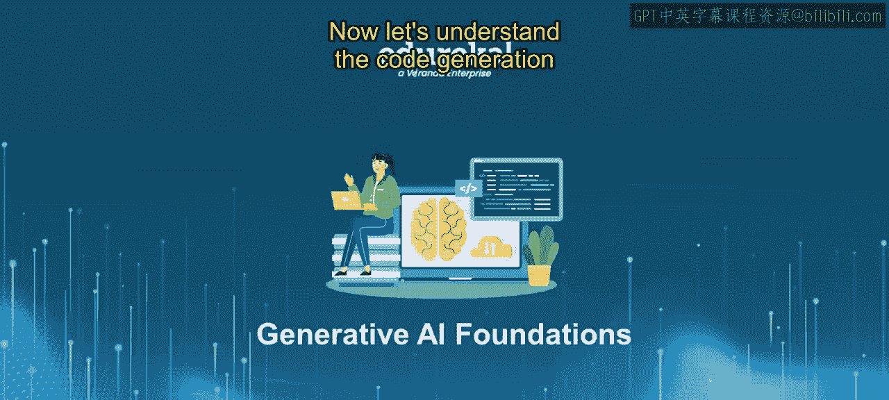

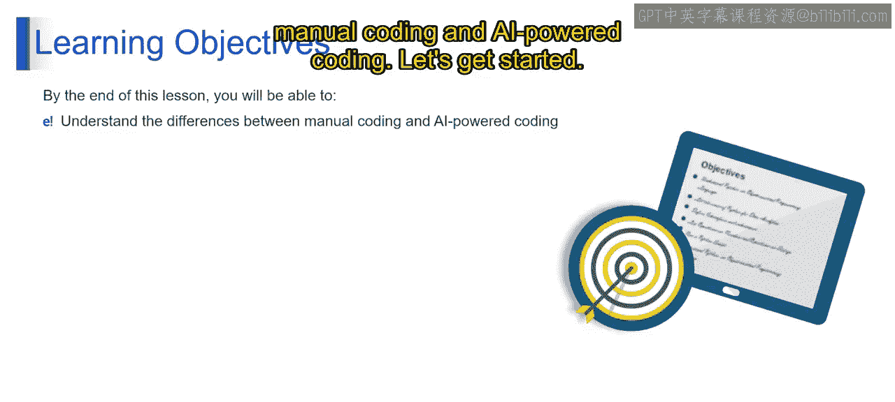

So just imagine the example， for example， if you want to create a python function to calculate the square of a number。

 So here I am going to make use of。😊，So here I' am using the Google collab to write the code。

 So here my question is let's create a python function to calculate square of a number So how much time do you take to complete this task so as I have to create a python function I'm just telling de Cal square so I may pass input as a number for this and now I want to return it the square so I'll have to say number square so now let's click on enter and I may have to perform the task so I will make use of this and then I will provide the number let's say I want to say two and let's click on enter it should give me four so it's working super good so how much time I took to complete this task hardly one or two minutes so now let's ask the same question to the chat Gp and let's see the answer for this so I'm asking the same question to the chat Gpi okay so now it has generated the code I'm simply copy。

😊。

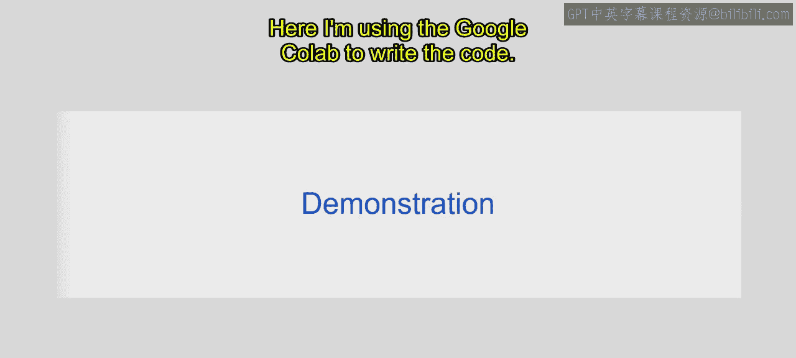

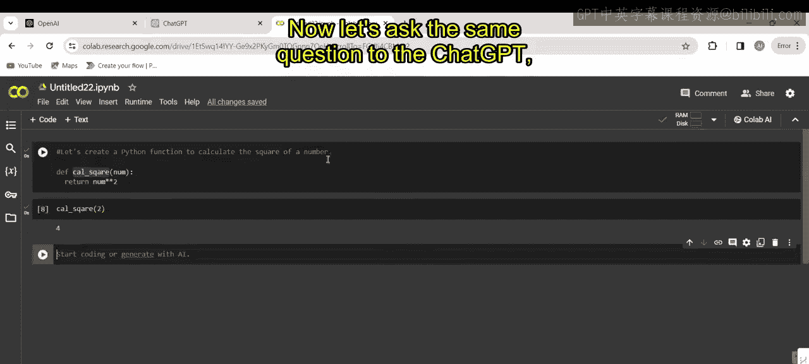

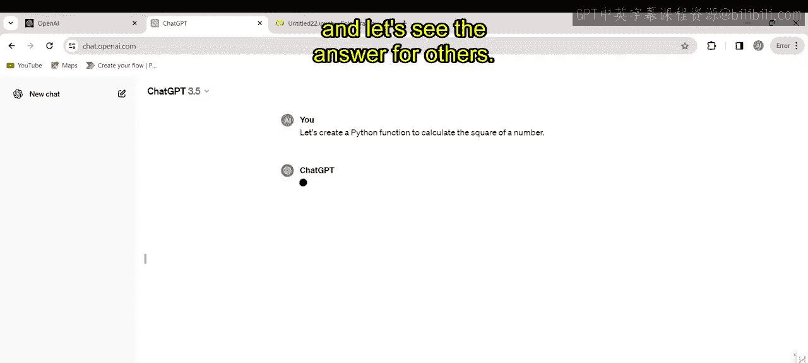

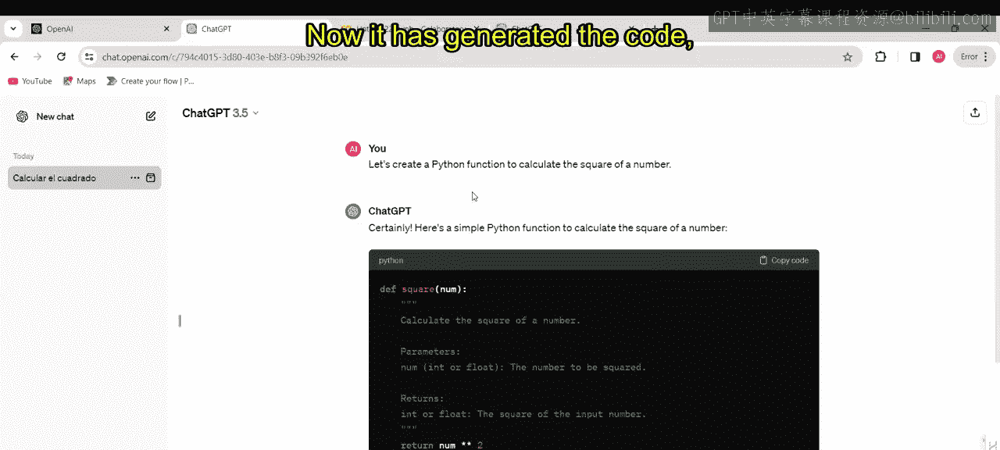

it and then paste it over here。 And then it is telling me to print the result。 So then。

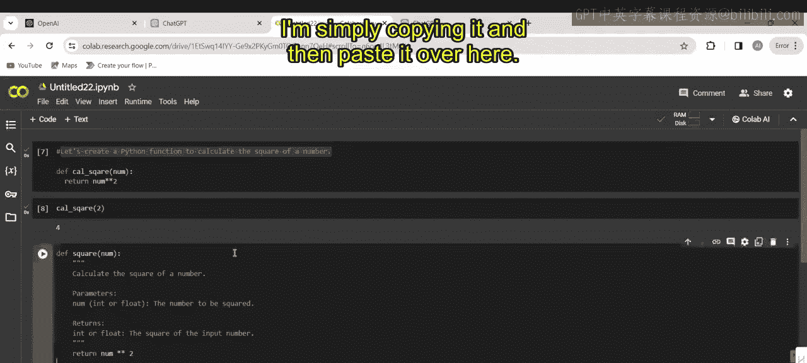

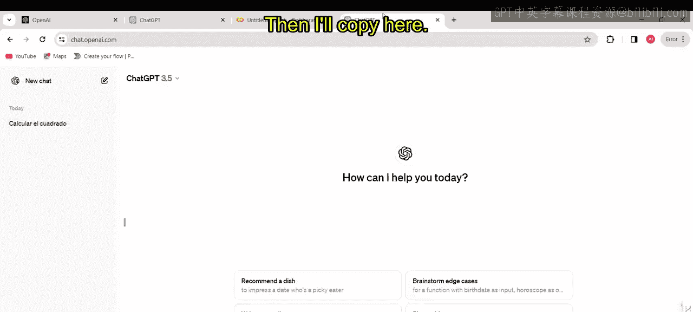

Ill copy here。 So how much time I took。To get it done by using the charge Gp so hardly seconds or a minute。

 So the answer is so perfect along with the comments。 So that's fine。 So as it is very simple code。

 we may take very less time for this。 Now let's explore a bit lengthy code。😊。

Now let's say I want to create a program to calculate the average grade of students in Python programming language。

 So in case if this is my task， if I will have to go for the manual process what are the steps I will have to do first I need to think about the logic to write or calculate the average grade of a student in Python code。

 then I will have to start writing the code step by step and then once if it is done。

 I'll have to debug and refine the code So how much time it will take to get it done around 30 to 40 minutes or let's say4 I to 6 minutes maximum okay you can take as1 R So the same one in case if I'm going to make use of Cha GT for the code generation I'm just going to chat GT and providing the same click here and let's see how much time it is going to take for me to get the task done So it started providing me the code with the question create a program to calculate the average grade of。

😊。

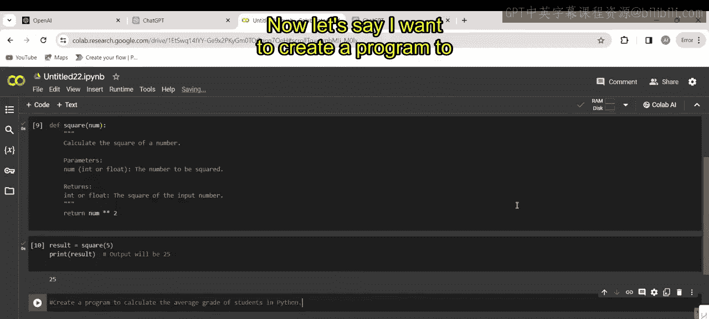

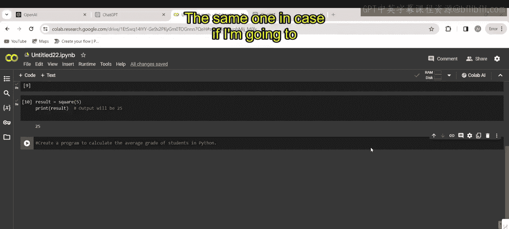

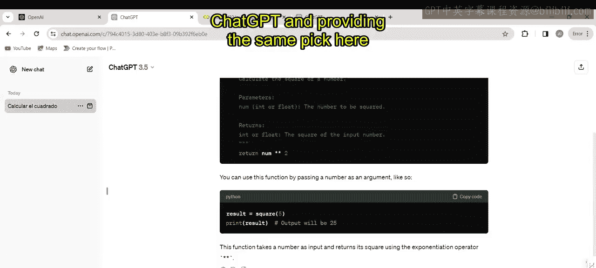

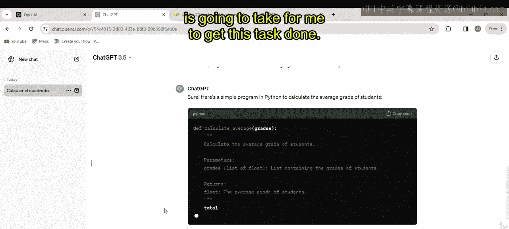

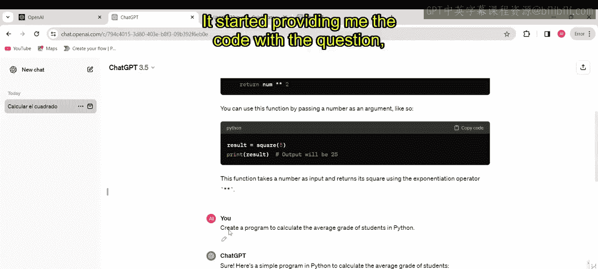

Students in the python so now the code is done， I'm simply copying it and going back here and also provide it here and click on enter。

 So let's see what it is going to generate enter the number of students I'm just telling three students enter the grade of student1 I'm just telling 85 and 95 and then again 90。

 So now you can see the average grade of students is 90。

 So it is providing so perfect answer you can even play with that。

 So what we did here by using the G process simply we asked G but the code receive generated code instantly and you copied pasted it and also in case if you want to fine tune it you can even fine tune with a prompt hardly the estimated time would be like you know maximum of5 minutes like right means in manual coding you are writing each in。

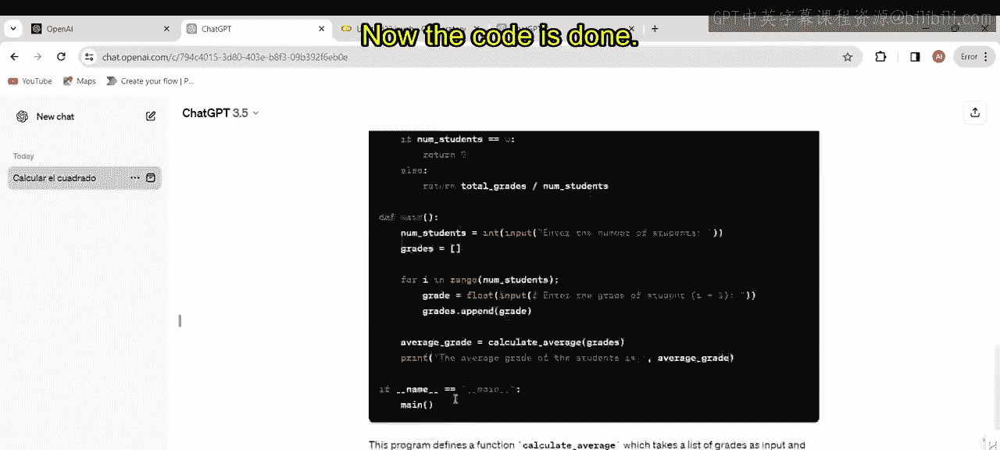

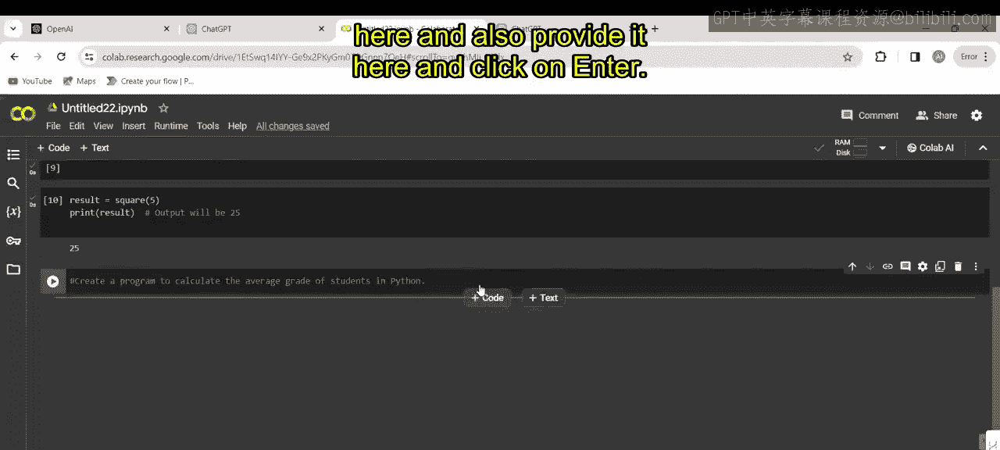

line of the code crafting every detail with care。 It's a process that demands time and skill。

 Now if we are switching to chat ChipT， which is your coding assistant。

 it's like having a wizard that understands your request and cons up the code swiftly so whether you choose the coding manually or you want to choose with the chat Cp or magic of AI it's all about finding the perfect balance between craftsmanship and effectively and efficiently in the coding realm。

😊。

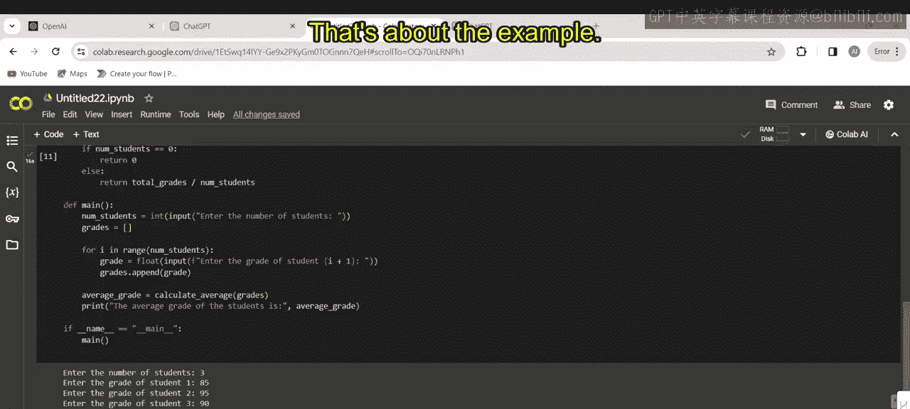

So that's about the example。😊，So in this lesson we have seen how much time it will take in case if we want to go for the manual coding and also in case if we are going for charge coding and you have seen the difference between the time consuming and also efficiency of the coding standards including their respective pros and cons thank you。

😊。

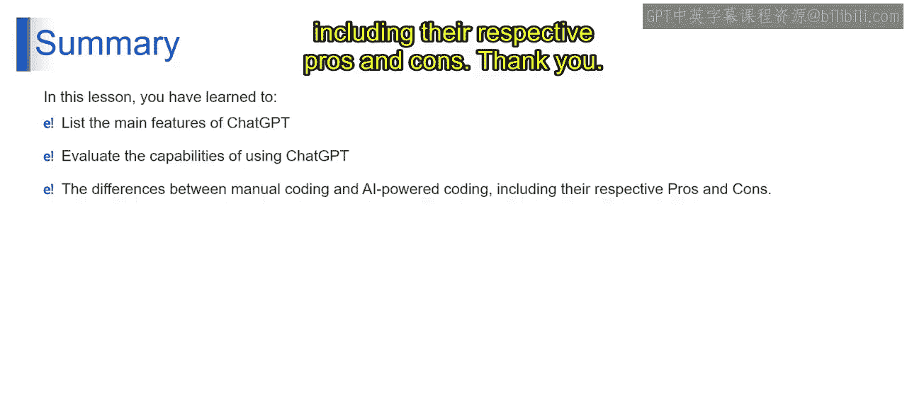