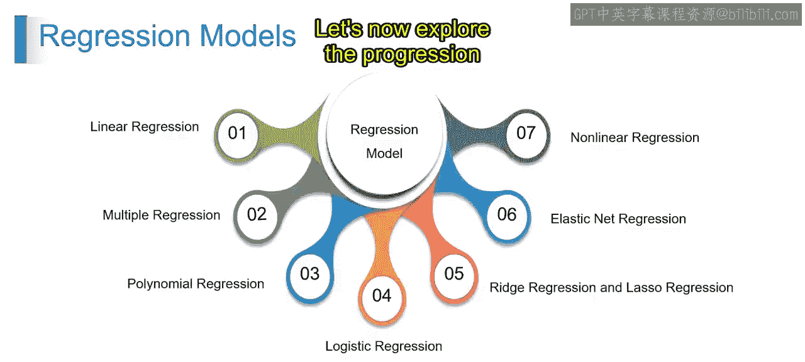
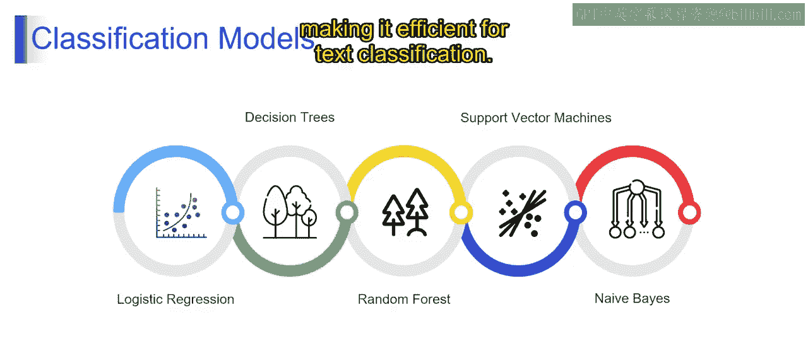
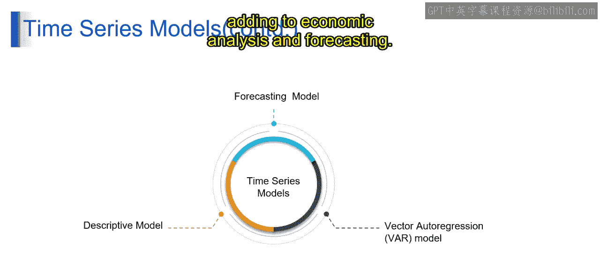
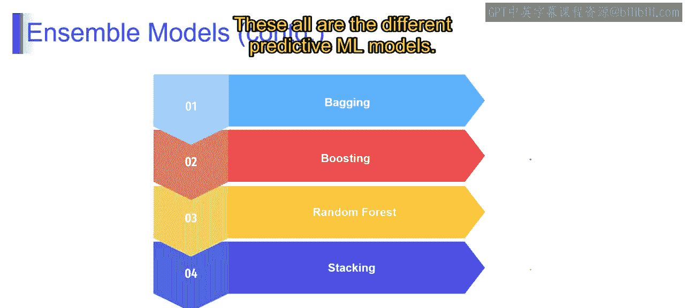
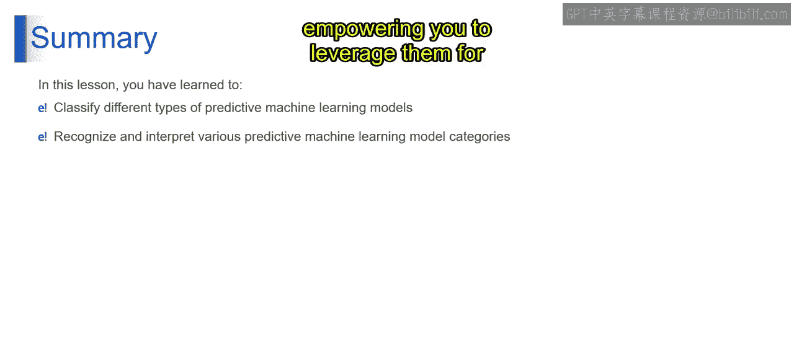

# Edureka《通过LLMs学习生成式人工智能（机器学习和NLP基础，第1课／共4课）｜Learn Generative AI with LLMs》中英字幕 - P11：10_分类和其他模型.zh_en - GPT中英字幕课程资源 - BV1q4421Q7qh

So let's now explore the progression from our previous discussion so for example deciding if the email is spam or not logistic regression models the probability of binary outcomes using the input features ideal for tasks with two possible outcomes then coming to the decision trees decision trees partition the feature space into regions based on the feature values aiming to minimize the impurity or maximize the information gain for classification and regression tasks then the next one is of random forest random forest bes multiple decision trees and aggregates predictions reducing variances and overfitting by introducing randomness through the data and the feature sampling then the next one is of support vector mission so sVM finds the optimal hyperplane to separate the。

😊，Sances of different classes in feature space minimizing classification errors， then nave biasas。

 So in the considering the same example of classifying emails as spam or not based on the word occurrences nave bias assumes words are independent means words independent simplifying the text classification nave bias calculates the class probabilities using the bias theorem and assumes conditional independence between the features making it efficient for text classification So these all are the different types。

 Now， the types of predictive Ml models continuation with the descriptive model。

 So descriptive models summarize and describe the patterns or relationships within a data set without making future predictions。

 they focus on understanding existing data and providing insights into its structure。😊。

or the behavior means analyze the sales data from the retail store to identify the trends or correlation between the product categories。

 then forecasting models， for example predicting a company's monthly share time series data So the forecasting models predict the future values or the trends based on the historical data they analyze patterns within the data to make the predictions assisting business in planning and decision making。

 then vector autore model VR So here V models analyze dynamic relationship between the multiple time series variables。

 they extend autoregressive models to handle simultaneous analysis of interdependencies among variables means for example。

 using the VR model to understand how changes in GDP inflation and unemployment。

Rate affect each other over the time， addingiding to economic analysis and forecasting。

 then bagging bootstrap aggregation bagging combines multiple models to enhance the predictive performance。

 It trains several base models like decision trees on different data subsets and aggregates their predictions。

By averaging for regression or majority o for classification in bagging。

 multiple decision trees are trained on random subsets of customer transaction data to predict the fraud liness。

 then coming to the boosting， boosting sequentially trains multiple weak learners to form a strong learner。

 It focuses on correcting the errors from the previous model with subsequent models。

 emphasizing misclassified instances， then coming to the random forest。

 random forest constructs decision trees and symbols by training each tree on random feature subsets and bootstrapped samples。

 it combines trees predictions for final output， often achieving better accuracy and robustness。

 then staing， so staging blend predictions， from driverbased models using a meta model。😊。

Trains the meta model on base model predictions， learning to combine them effectively。

 So these all are the different predictive M models。😊。

Now the summary in this lesson you have gained insights into different categories of predictive machine learning models。

 including regression classification， time series and ensemble methods by understanding these model categories you can effectively choose and interpret the appropriate model for your predictive analytics tasks enhancing decision making and problem solving capabilities this knowledge equips you with the tools to classify and interpret various predictive machine learning models。

 empowering you to leverage them for diverse applications across the domains Thank you。😊。

