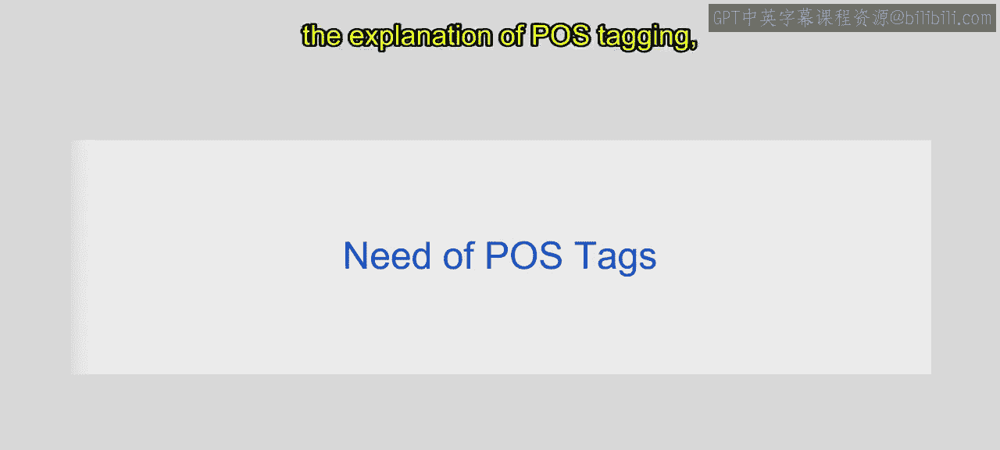
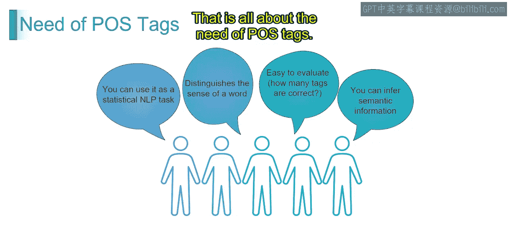
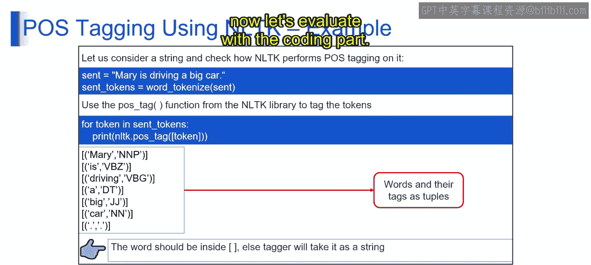

# Edureka《通过LLMs学习生成式人工智能（机器学习和NLP基础，第1课／共4课）｜Learn Generative AI with LLMs》中英字幕 - P120：119_词性标注的需求.zh_en - GPT中英字幕课程资源 - BV1q4421Q7qh

So let's now explore the progression from our previous discussion so based on the understanding of the explanation of Pvos tagging now let's understand the need of the Pvo tags So first thing is that you can use it as statistical NLP tasks means Pvos tagging serves as a fundamental task in statistical NLP models by assuming Pvos tags to words in a sentence statistical models can analyze the syntaactctic structure and patterns of language usage this information is crucial for various downstream NLP tasks such as passing machine translation and sentiment analysis and the next one is distinguishes the sense of word what exactly it is Pvos tags helps distinguish the。

😊。

or meaning of a word within different contexts。 For example。

 the word bank Pvos tags help distinguish the sense or meaning of a word within different context。

 For example， the word bank can refer to a financial institution that is noun or a edge of river that is nothing but noun。

 by tagging bank as either noun or verb， depending on its usage in a sentence， for example。

 if I' am telling that I want to go to a bank to draw some money in this situation。

 it represents as financial institution that is nothing but a noun。

 and when we are telling that I want some peace， I want to sit beside the bank in this particular situation it is going to be the river means again。

 it is going to be the noun by tagging。As either noun or a verb。

 depending on its usage in a sentence， Pvo tagging helps disambiate such harmonies。

 enabling accurate interpretation of the text。 Now， let's understand ease of evaluation。

 Pvo tagging provides a structured framework for evaluating the accuracy of NLP models Since each word in a sentence is tagged with specific Pvo tag。

 It becomes relatively easy to access the performance of a Pvo tagging algorithm by comparing the predicted tags with the ground proof tags。

 This evaluation metric helps measure the precision and recall of Pvo tagging systems。 Then finally。

 the inference of semantic information Pvo tags of。

val semantic information about the grammatical role and function of words in a sentence by analyzing the distribution of PvoS tags within the text corpus NLP systems can infer syntactic patterns semantic relationships and linguistic structures。

 this insight aids in tasks such as text summarization question answering and information retrieval means Pvos tagging plays a very important role in NLP by facilitating statistical analysis。

 disambviating word sense providing an evaluation framework and inferring semantic information from the text data this importance lies in enhancing the accuracy efficiency and interpretability of NLP systems。

😊，Across various language processing tasks。

That is all about the need of Pvos tags so okay based on the technical understanding now let's explore it with practical coding approach。

 how can we work on Pvos tagging by using the NLTK so based on the technical understanding now let's evaluate with the coding part so the upcoming video will delve further into the ongoing discussion。

😊。

