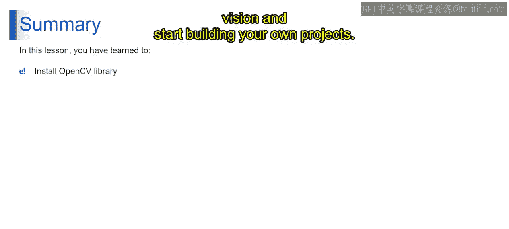

# Edureka《通过LLMs学习生成式AI（基础、应用开发、流行工具，第2、3、4课／共4课）｜Learn Generative AI with LLMs》中英 - P120：13_OpenCV库的安装.zh_en - GPT中英字幕课程资源 - BV1ym421V7gx

Welcome to the immersive journey into the world of generative AI applications and popular tools。😊。

Installing the Open CV library in this session， we walk through the step by step process of installing Open CVv on your system。

 By the end of this lesson， you have the knowledge and skills to successfully set up openC and start using it for your computer vision projects。

 Now let's take a look at the installation of OpenC library。

 So step1 is choose your installation method。 Before we begin。

 it's important to note that there are multiple ways to install OpenCv。

 depending on your operating system and preferences The two most common methods are using package managers like PIP for Python or built in from source for simplicity。

 will focus on the PIP installation method， which is suitable for most users step2 is install OpenCv using PIP Open your terminal or command prompt。

 or if you want to use Jupiter notebook or coag， you can do so。So run the command。

 Pip install open CV Python here I am using Google Colllab。So， the command is。Pip。

 install open CV Pyth。So this command will download and install the latest version of the Open CV library along with its Python bindings。

😊，Step 3 is verify the installation once the installation is complete。

 you can verify that OpenC is installed correctly by importing it in a Python script or interactive Python session。

 so open your Python environment or Google Col and enter the following command。Import C 2。

If you don't encounter any errors， it means that Open CV has been successfully installed。

Congratulations， you have successfully learned how to install the Open CV library on your system using PIP。

With OpenCv installed， youn now ready to explore the exciting world of computer vision and start building your own projects。

 Thank you for joining us in this lesson on installing OpenC。

 We hope you found it helpful and that you're excited to start using OpenC in your own projects。

 We will continue this session in the upcoming videos。😊。

