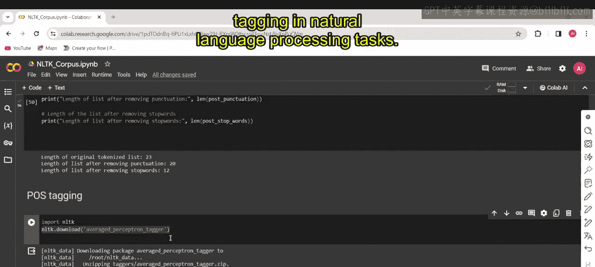
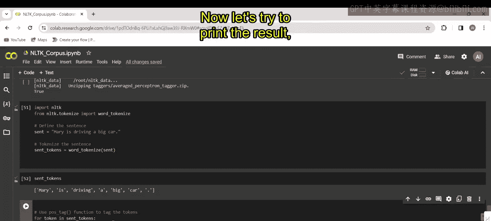
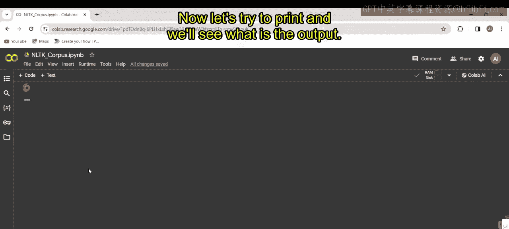
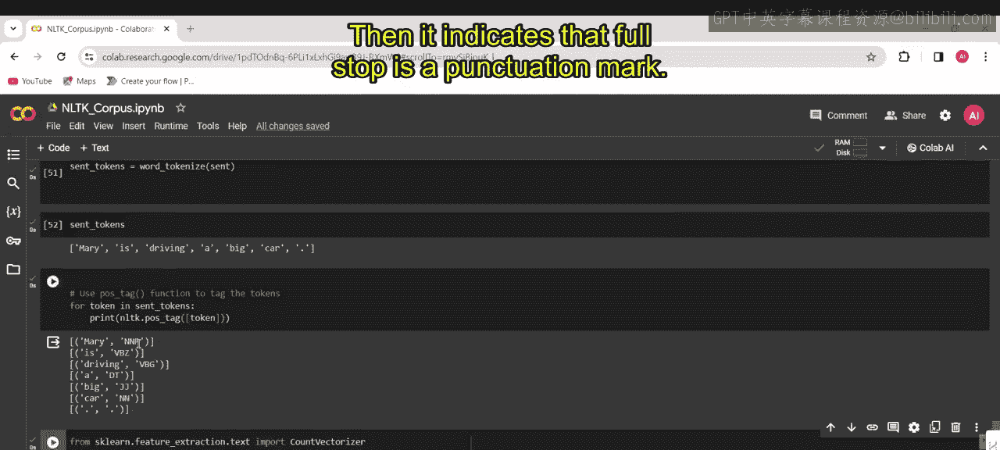
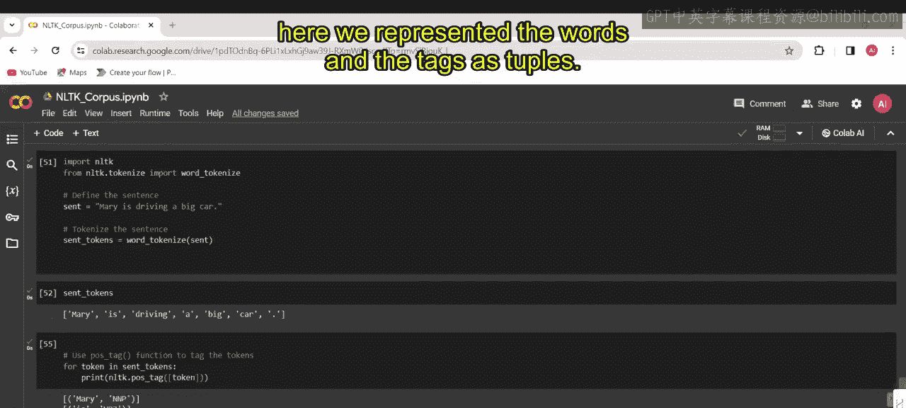
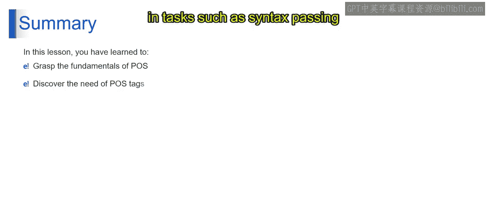

# Edureka《通过LLMs学习生成式人工智能（机器学习和NLP基础，第1课／共4课）｜Learn Generative AI with LLMs》中英字幕 - P121：120_词性演示.zh_en - GPT中英字幕课程资源 - BV1q4421Q7qh

So lets now explore the progression from our previous discussion here。

 first of all we are downloading average perceptron tagger so what exactly it is it is a pretrained statistical model used in NLTK for part of speech trackingging in natural language processing tasks so now let's understand the coding part of it as usual first of all import NLTK and then from NLTK do tokenize import word tokenise。

😊。

This library is used per。😊，Tokenizing the input sentence into individual words that we have seen previously。

 and then。Let's define a sentence telling that Mary is driving a big car and now we are performing the tokenization of a provided sentence。

 so let's first understand what we are going to get out of it send underscore tokens What is the expectation It should perform or it should print the provided sentence into individual tokens or words so let's print it okay now we are getting it now let's perform Pvo tagging on this so let's see how it is going to work in this what I have done so we know that send token is containing Mary is driving a big car full stroke so now let's perform Pvo tagging to understand it so here we are iterating through each token or word in the tokenized sentence using the for loop for each token we apply Pvo underscore tag function。

😊，From NLTK to obtain its corresponding PyS tag since Pvos underscore tag expects a list of tokens will pass the token as a single element list that is token in our case the function returns a list of tus where each tuL contains the word and its corresponding PvoS tag now lets try to print the result and we'll see what is the output for this。

😊。

So now let's try to print and we'll see what is the output so can you see the output here what exactly it is telling the output consists of tuL containing each word from the sentence along with its corresponding Pbo tag for example Mary it is telling that an NP indicates that Mary is a proper noun here and E is represented as V indicates that E is a verb in a present tense third person singular and then driving VBG it indicates that driving is a verb in present present participanticip form。

😊。

And a is represented as Dt， It indicates that a is a determiner and big is represented as JJ。

 It indicates that big is objective and then again car we know that it's a noun it indicates that car is a noun you can feel the difference car is represented as n n and Mary is represented as an N so what is the difference between these two car is object and it is indicated as noun where Mary indicates the person name it's a proper noun and then it indicates that full stop is a punctuation mark so that is all about Pvo tagging so here we are having the same explanation here we represented the words and their tags as stups Now the summary in this lesson we have gained a foundational understanding of pathos page and。

😊。

Their significance in language analysis understanding POs facilitates accurate linguistic analysis and aids in tasks such as syntax passing and semantic interpretation Thank you。

😊。

