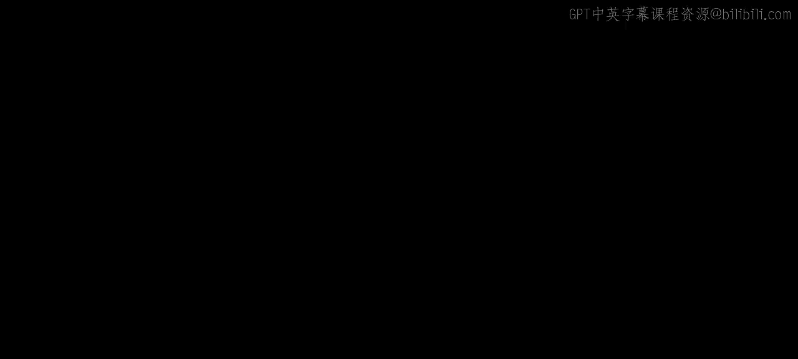
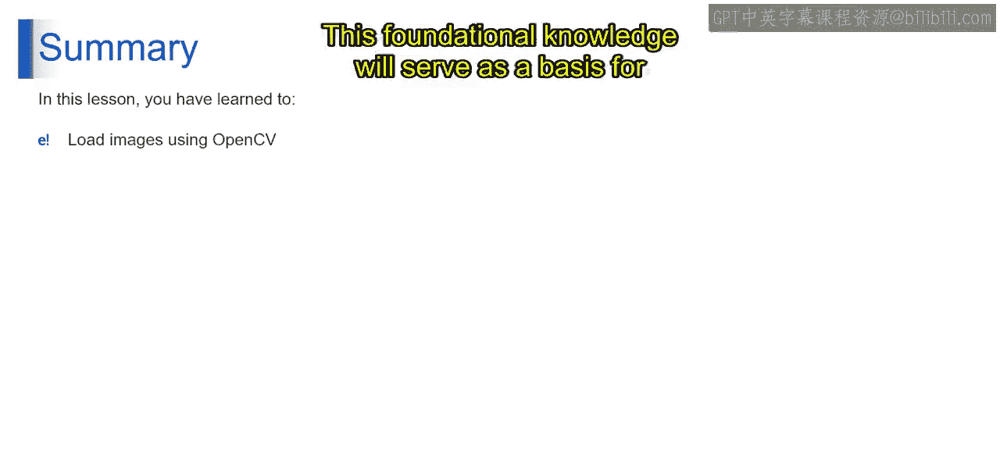
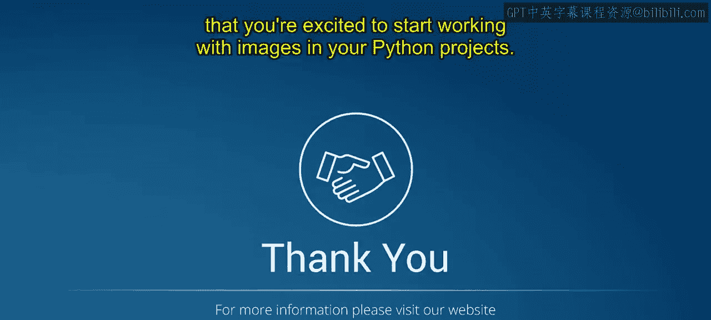

# Edureka《通过LLMs学习生成式AI（基础、应用开发、流行工具，第2、3、4课／共4课）｜Learn Generative AI with LLMs》中英 - P121：14_如何使用OpenCV加载图像.zh_en - GPT中英字幕课程资源 - BV1ym421V7gx

Welcome to the immersive journey into the world of generative AI applications and popular tools。😊。

On loading images using Open CVv in this session we'll explore the process of loading images into your Python environment using the open CVv library By the end of this lesson。

 youll have a clear understanding of how to load images as Ny arrays and access their pixel values for further processing so how to load images using open CVv Step1 is import open CV and Ny before we can start loading images we need to import the necessary libraries。

 OpenC will be used for image processing while Nmpy will be used for handling arrays efficiently so let's import them。

Step 2 is load the image Now let's load an image using the C2 dot Im read function。

 will specify the path of the image file as an argument。

 This function returns a nuy array representing the image。Step 3， check the image dimensions。

 It's essential to verify the dimensions of the loaded image to understand its structure。

 We can use the shape attribute of the Ny array to check the dimensions。

This code snippet is designed to check if an image has been successfully loaded into a variable named image it does this by checking if image is not none。

 if image contains data it prints the confirmation message that is image loaded successfully and displays the dimensions of the image by printing the value of image dot shape which typically includes the height width and number of color channels or just heightened width for grayscale images。

 if image is none which would happen if the image loading failed due to reasons such as incorrect file path or unsupported file format it prints an error message。

 error loading image。This code snippet a tailored for environments like Google Collab where traditional openC functions for displaying images such as Cv2 do IM show are not supported by importing Cv2 I show from Google do collab do patches it provides a compatible way to display images in line within a collab notebook but if you are using a Jupyter notebook。

 you can import Cv2 do I show directly the condition is check if image is not none verifies whether the image has been successfully loaded into the variable image If the image is successfully loaded Cv2 underscore I am show is called to display the image within the notebook This is particularly useful for visualizing images as part of data analysis or machine learning workflows in collab notebooks if the image is not loaded correctly that is images none indicating an issue with the image loading process it prints image not loaded。

To notify the user of the failure to load the image。

 this approach ensures that the code behaves robustly by handling both successes and failure scenarios of image loading。

So this image has been loaded。You have now learned how to load images using open CV and manipulate them as Ny asin Python。

 This foundational knowledge will serve as a basis for more advanced image processing and computer vision tasks。

😊。

Thank you for joining us in this lesson on loading images using Open CVv。

 We hope you found it informative and that you excited to start working with images in your Python projects。

 Stay tuned for the upcoming sessions on Open CV。😊。

