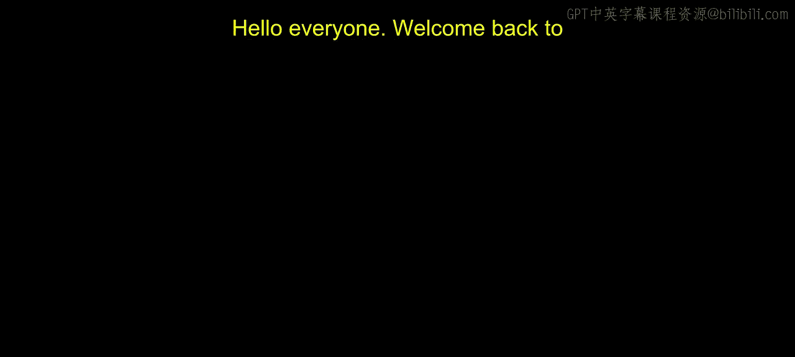
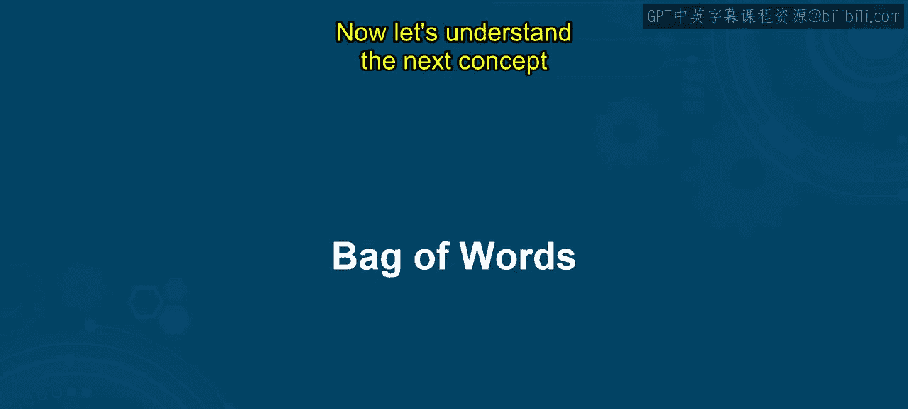
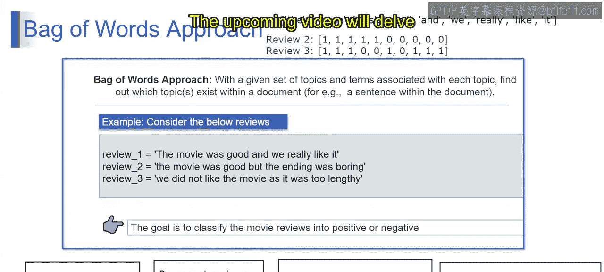
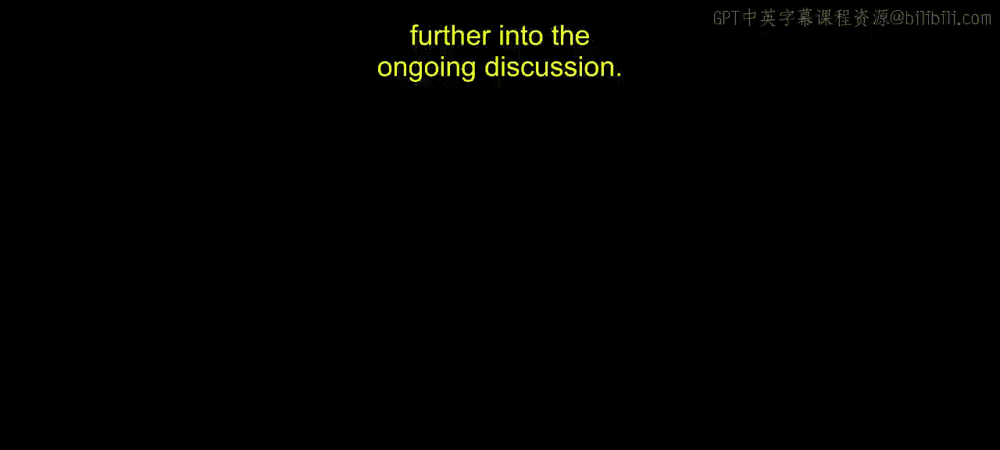

# Edureka《通过LLMs学习生成式人工智能（机器学习和NLP基础，第1课／共4课）｜Learn Generative AI with LLMs》中英字幕 - P122：121_词袋模型.zh_en - GPT中英字幕课程资源 - BV1q4421Q7qh

Hello everyone welcome back to machine learning and NLP basics so now let's understand the next concept that is bag of words in this we are going to cover what exactly a bag of word approach is all about and we are going to perform text processing by the end of the session you will be able to understand and grasp the fundamentals of concept of bag of words approach and able to explore the preprocessing steps necessary for NLP tasks。

😊。

So let's get started the bag of words approach the bag of words approach is a fundamental technique used in the natural language processing for text analysis and feature extraction it represents a document as a collection or bag of words disregarding grammar and word order and focusing solely on word frequencies let's say for example we are having two sentences sentence one and sentence two using the bag of word approach we first create vocabulary containing all unique words in the carpus so as I said using the bag of words approach first we create a vocabulary containing all unique words in the carpus in this case our vocabulary would be the cat sat on mat and then dog played in part means we are extracting only unique word。

😊，Out of the provided sentence Next， we represent each sentence as a vector where the dimensions correspond to the word in the vocabulary。

 the values in the vector indicate the frequency of each word in a respective sentence， for example。

 the vector representation form the first sentence is going to be the。The it should take one and cat。

 we are having the cat and sat Yes， we are having on yes and mat yes and dog we don't have it in the first sentence so it is going to be the zero and played is not present in the first sentence。

 so again it is going to be the zero and then in it is also not there in the first sentence。

 So again it is going to be zero and park Park is also not not part of first sentence。

 So this is going to be the sentence。 vector representation of a first sentence。

 So now let's see how it is going to be for second sentence。

 So now let's understand the vector representation of the sentence one is going to be the vector representation here you can compare and this entire sentence with the individual words if the words are matching then you can provide one if the words are not matching with this then you can place zero as simple as that So in the first。

😊，S we are having the cat。 Yes， S。 Yes on yes， again， math。 Yes。

 and then dog is not present in the first sentence。

 So make it0 and played is also not present in the first sentence。

 So make it zero again and next in and then park is also not present。 So make it 0。

 So this is going to be the vector representation of the sentence1 similarly。

 let's perform it for sentence2。 So here the vector representation would be again the we are having the cat no0 S no0 and on0 math again 0 and we have a dog in our second sentence。

 So make it as one and played Yes， we are having make it as one in yes。

 we are having so make it as one and then park。 Yes， we are having it。

 So this is how a vector representation looks like。😊。

These vectors capture the occurrences of words in each sentence。

 enabling quantitative comparison and analysis means technically bag of words approach treats each document as an an ordered collection of words disregarding grammar and word order it represents documents as high dimensional vectors where each dimension corresponds to a unique word in the vocabulary and the value at each dimension represents the frequency or presence of that word in the document means the bag of words approach simplifies the text data by focusing on word frequencies enabling various NLP tasks such as text classification sentiment analysis and information retrieval so based on this understanding let's dive deep into it so here。

😊，We are having the information about it with a given set of topics and terms associated with each topic find out which topics exist within a document for example sentence within the document so they provided one example so here to classify the movie reviews into positive or negative using the bag of words approach we first need to create a vocabulary based on the unique words present in the reviews then we represent each review as a vector indicating the frequency of each word in the vocabulary finally we can use these words to train a classifier such as logistic regression or a support vector mission to predict the sentiment of new reviews as mentioned here we are going to perform total three different things4 so let's understand all this the first one is going to be the create vocabulary。

😊，And then predict the sentiment of new reviews。 Okay。

 so this is the step by step process of how it is going to work。 The first thing， as I mentioned。

 create a vocabulary。 So here you need to identify all unique words across the reviews。

 these forms are vocabulary And then once if it is done。

 we need to represent reviews as vector means as is shown in the example for each review。

 create a vector indicating the frequency of each word in the vocabulary。 let's say for example。

This is our vocabulary， with the unique words。😊，And reviews would be like， for example。

 reviews can be represented like this means。Based on the vocabulary we are creating a vector indicating the frequency of each word in a vocabulary and then once if it is done。

 then we need to train a classifier we can use the vectors representing the review as input features and the corresponding sentiment labels like you know whether if it is of positive or negative as targets and then we will be performing training a classifier using the supervised learning algorithms such as logistic regression or support vector mission once if it is done then predict sentiment of new reviews。

 means given a new review， tokenize it and represent it as a vector using the same vocabulary。

 use the trained classifier to predict the sentiment of the new review based on its vector representation that is how the entire model will work so based on this。

😊，Understanding， let's explore it with practical coding part。

 so the upcoming video will delve further into the ongoing discussion。

