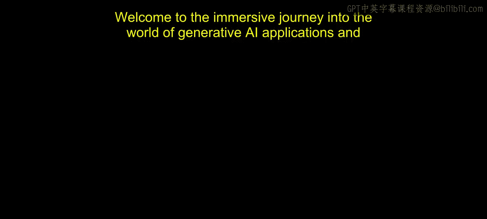
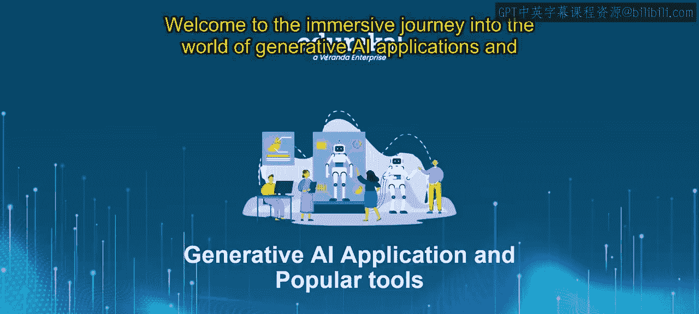
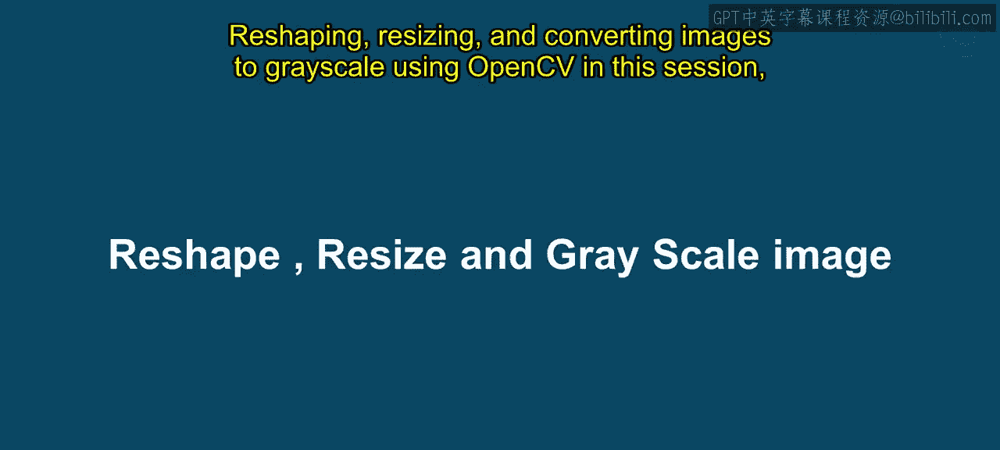
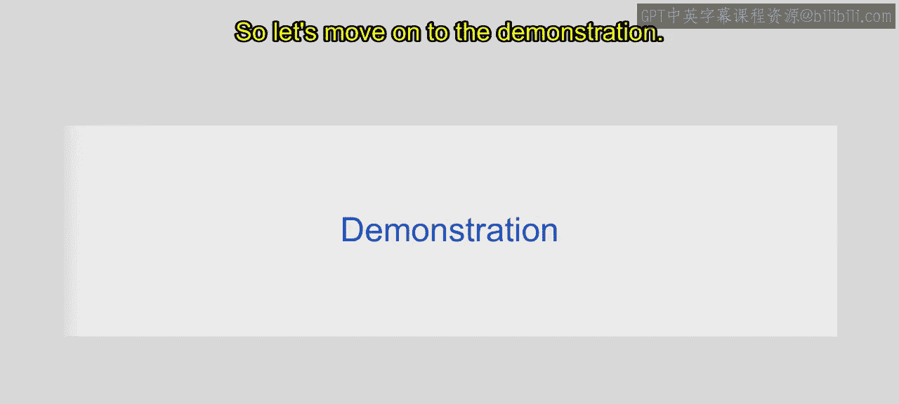
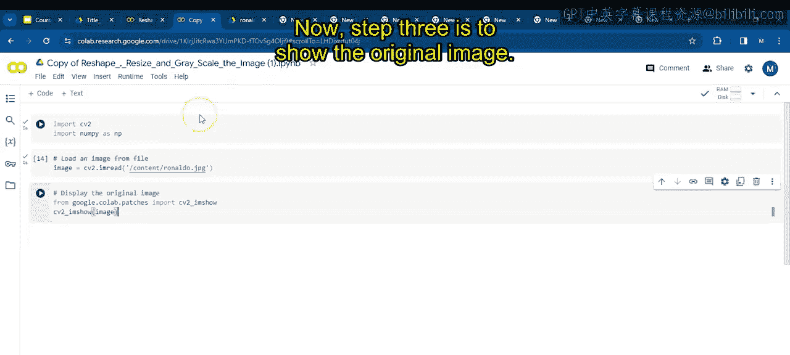
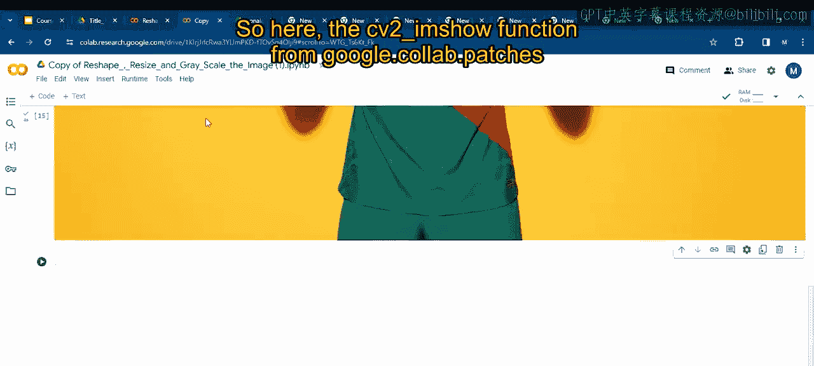
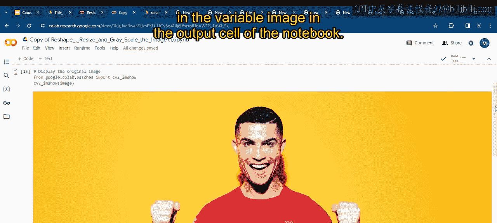
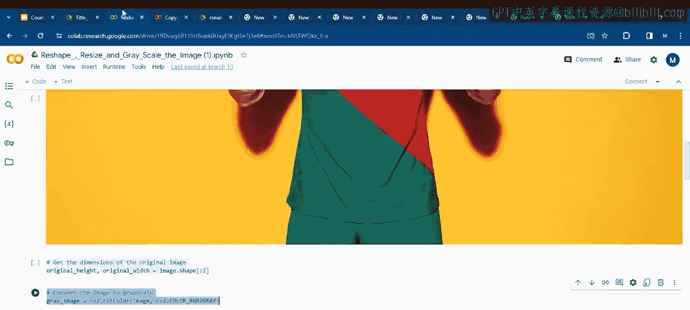
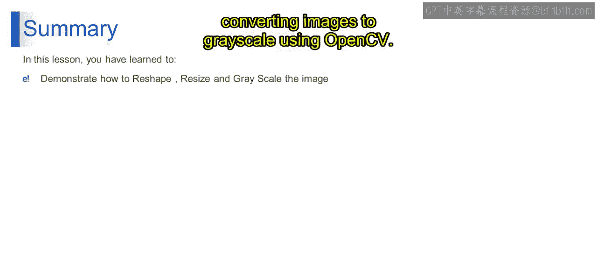
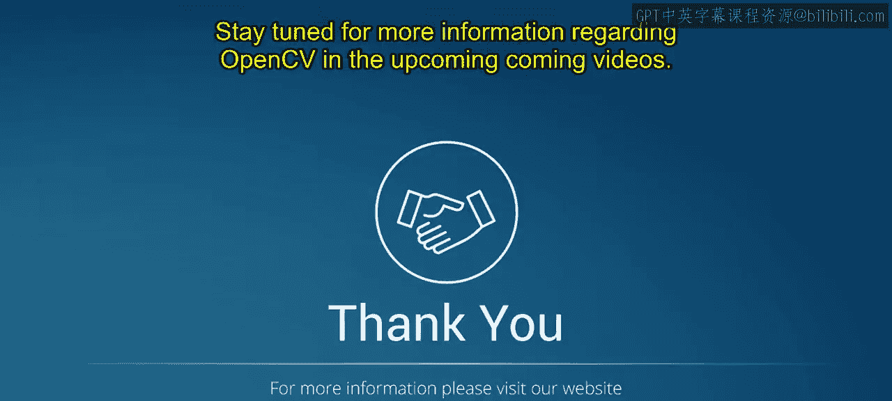

# Edureka《通过LLMs学习生成式AI（基础、应用开发、流行工具，第2、3、4课／共4课）｜Learn Generative AI with LLMs》中英 - P122：15_演示重塑、调整大小和灰度图像.zh_en - GPT中英字幕课程资源 - BV1ym421V7gx

Welcome to the immersive journey into the world of generative AI applications and popular tools。😊。

Reshaping， resizing and converting images to G scale using open CV。

In this session， well explore how to manipulate images to prepare them for further processing in computer vision tasks。

By the end of this lesson youll have the knowledge and skills to reshape。

 resize and convert images to grayscale effectively。So let's move on to the demonstration。😊。

Step1 is importing Open CVv First， let's import the two powerful libraries widely used in the field of computer vision and numerical computing with Python that is Open CVv and Ny。

Next step2 is loading the image， we load the image using the CV2 dot I read function。Here。

 the function C2 dot IM read takes a single argument。

 which is the path to the image file you want to load In this case。

 the image file is named Ronnaldo do JPG and is located in the content directory。

 The function attempts to read the image at the specified part and if successful stores the image data in the variable image as a Ny array。

Now， step 3 is to show the original image。

So here， the C2 underscore I am show function from Google dot collab do patches is used to display an image within a Google Collab notebook。

 This approach is specifically tailored for Google Collabs environment where traditionally open C window based functions like C2 do I am show do not work due to the lack of a Gi interface in web based notebooks。

 If you are working in the Jupyter notebook， you can directly use the C2 do I function。

 So the function C2 underscore I am show directly renders the image stored in the variable image in the output cell of the notebook。

 Now you can see the image。 Now， step 4 is dimensions of the original image。

So this line of code extracts the height and width dimensions of an image stored in the variable image。

 which is assumed to be a numpy array typically obtained from loading an image file using Open CVv CVv2。

Im Re function。😊，So in open TV， images are represented as nuy arrays with the shape height width channels where channels represent the color channels of the image。

 example 3 for a standard RGB color image。 so by using image dot shape。

The code islic the shape tu of the image array to only take the first two elements here。

 which correspond to the image height and width， the expression effectively ignores the number of channels making it applicable for both gray scale and color images。

 these dimensions are then stored in two variables that is original height and original width。Now。

 step 5 is converting the image to gray scale。😊，Let's display the gray scale image。

So this is the grayscale image。Step 6 is reshaping the grayscale image。

So here the dot reshape minus1 function called reshape the 2D array into a 1D。

The -1 argument tells Numpy to calculate the size of the new dimension in such a way that the total size of the array remains unchanged。

 essentially it's a way of saying make the array have only one dimension and figure out how long it needs to be to include all the original elements。

Step 7， convert it back to the original shape。This line of code reverses the flattering process done to a grayscale image。

 converting the one dimensional array back into its original two dimensional shape。

 effectively restoring its original height and width dimensions。

 so this step demonstrates the flexibility of numpy arrays in handling image data。

 allowing for seamless transformations between different shapes and forms which can be particularly useful in preprocessing steps for image analysis。

 Now step8 is displaying the reshaped image。Yeah， so this is the reshaped image。 Now。

 step 9 is a resizing the gray scale image to a specific width and height。

So here the resize function is a versatile tool in open CV used to change the dimensions of an image to a specified width and height here we are setting the target dimensions to 200 pixels in width and 150 pixels in height stored in the variables new underscore width and new underscore height。

Now， step 10 is to display the resized image。So now you can see the resized image now step 11 is saving the image。

 we can use cv2 do Im right function to save the image。

Here we have saved the grayscale image to a file named as resized grayscale image。

 and we have got the output true Now step 12 is close open CV windows Okay。

 at last we have to close the open CV windows。😊，Yes， now we are done。

You have now learned how to reshape resize and convert images to gray scale using OpenC these preprocessing steps are essential for preparing images for further analysis and processing in computer vision tasks。

Thank you for joining us in this lesson on reshaping resizing and converting images to grayk using Open CV we hope you found it informative and that youre ready to apply these techniques in your own computer vision projects stay tuned for more information regarding OpenC in the upcoming videos。

