# Edureka《通过LLMs学习生成式人工智能（机器学习和NLP基础，第1课／共4课）｜Learn Generative AI with LLMs》中英字幕 - P123：122_词袋方法演示.zh_en - GPT中英字幕课程资源 - BV1q4421Q7qh

So lets now explore the progression from our previous discussion so now let' us understand the practical coding approach how it is going to work first of all what exactly we are doing in this case we are importing the required libraries。

😊。

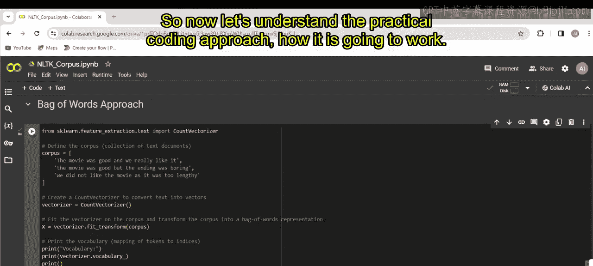

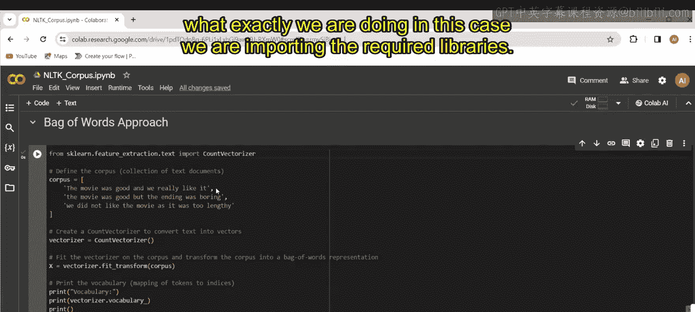

So in this import requires modules from psyitlan that is count vectorizer for converting the text data into numerical vectors and now we are having the corpus or collection of the documents like you know the movie was good and we really like it the movie was good but the ending was boring and we did not like the movie as it was too lengthy just understand based on the understanding we can explain whether the review is going to be the positive or not。

 but now let's understand how a machine going to understand this clearly。

 then we created vectorizer is equal to count vectorizer So this line vectorizer is equal to count vectorizer initiates a vector count vectorizer object then once if it is done here X is equal to vectorizer dot fit transform of corpus。

 So what exactly it is doing fit transform method of。😊。

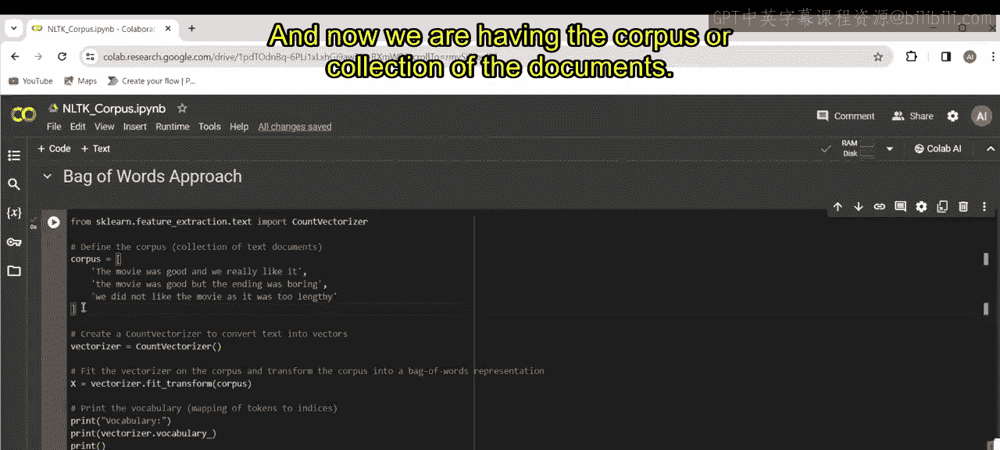

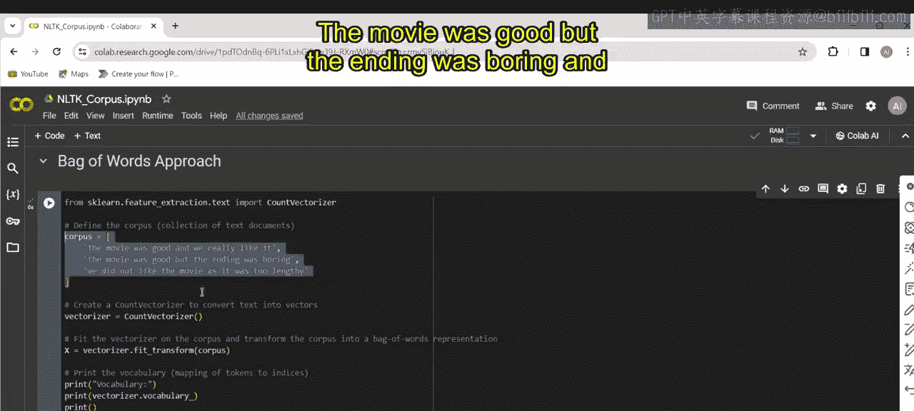

Count vectorizer first learns the vocabulary from the corpus。

 That is it constructs a dictionary of unique words。 That is what I was explaining， right。

 and then transforms the corpus into a matrix representation。

 Each row of the matrix represents each row of matrix corresponds to a document in the corpus。

 and each element corresponds to a unique word in the vocabulary。

 the value in each cell of the matrix represents the frequency of the corresponding word in the respective document。

 Now then we are simply printing the vocabulary。 let's see this first of all。

 So from the provided movie reviews。 Now you can see the is repeated three times13 times you can go and count it Okay so first。

 let's print the vocabulary and let's see what we are going to get。 Now you can see the output。

 This shows that the output provided。😊。

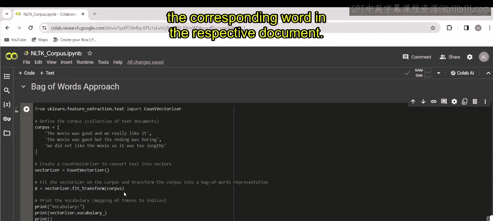

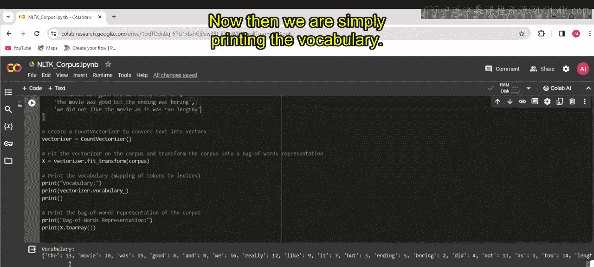

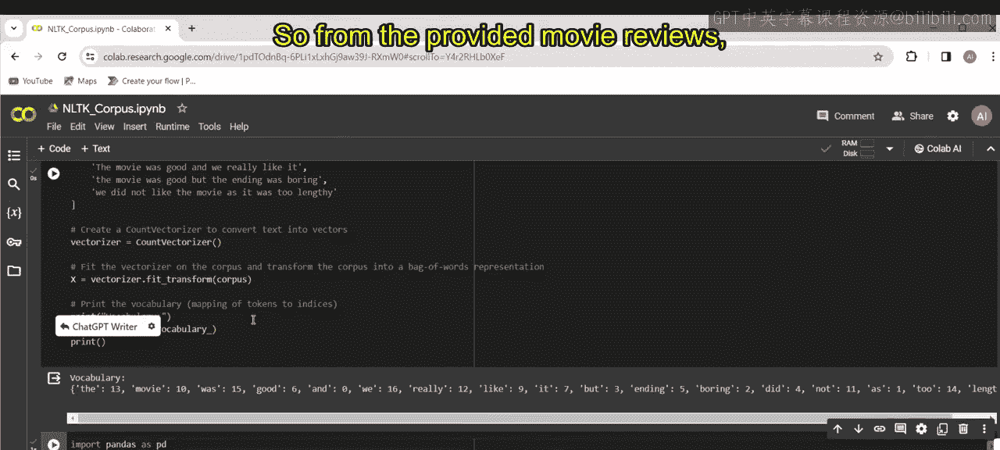

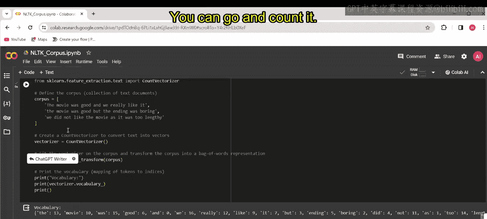

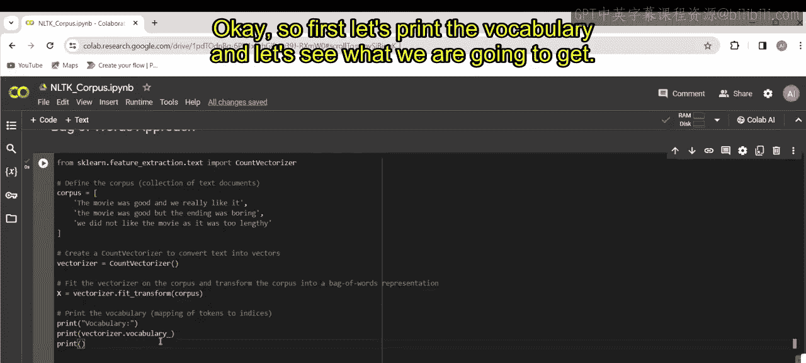

The learned vocabulary from the corpus of text document in this context vocabulary refers to set off unique words or tokens。

 That is what we were discussing right it is extracted from the text documents whatever we are having it here Also with their corresponding indices in the feature matrix so here is what it means the 13 means the word the has been assigned an index of 13 in the vocabulary then movie 10 the word movie has been assigned an index of 10 likewise words 15 index and good 6 likewise you can see the all words individually and now let's try to perform the bag of words on the provided representation Can you see this this is the output of bag of words。

😊。

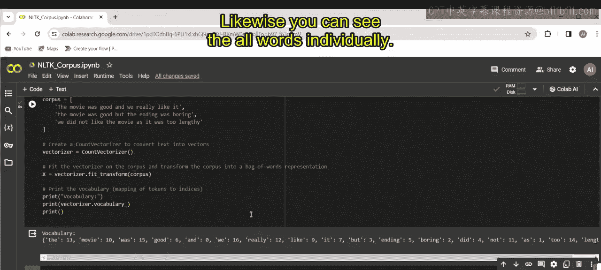

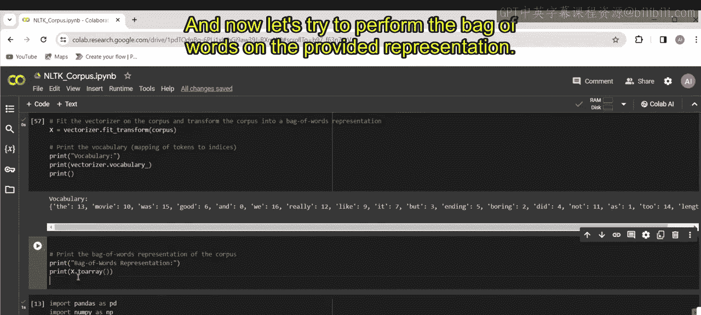

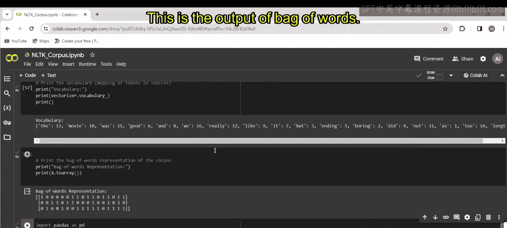

Same， however we have done for the previous example we will get the bag of words for the provided sentences by using the unique words so that is how bag of words work in this bag of words the output is going to contain all the repetitive words I mean to say in the vocabulary you can notice that wherever there is a word corresponds to the sentence they are represented as one and0 is represented of absence of that particular word。

😊。

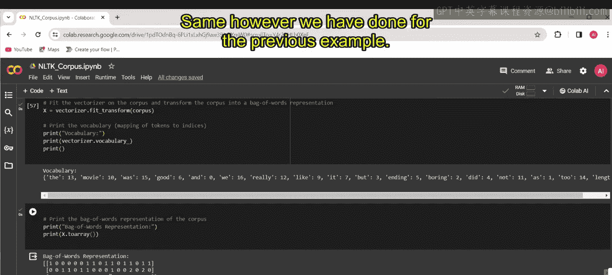

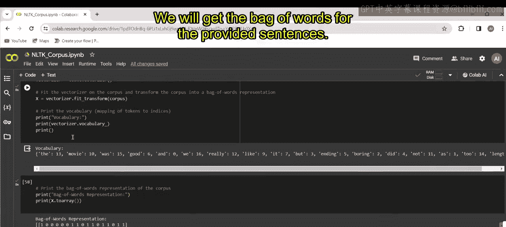

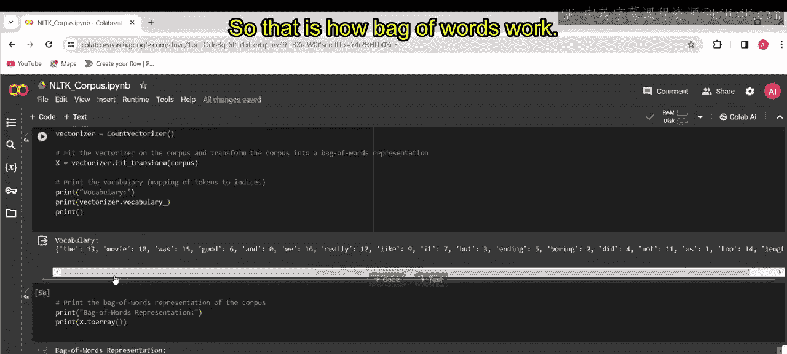

Means this code demonstrates the initial steps in text processing by tokenizing the reviews and creating a set of unique words which can be further utilized for tasks like sentiment analysis or text classification。

😊。

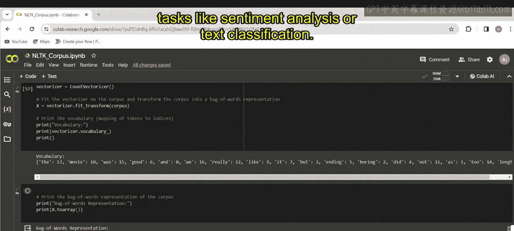