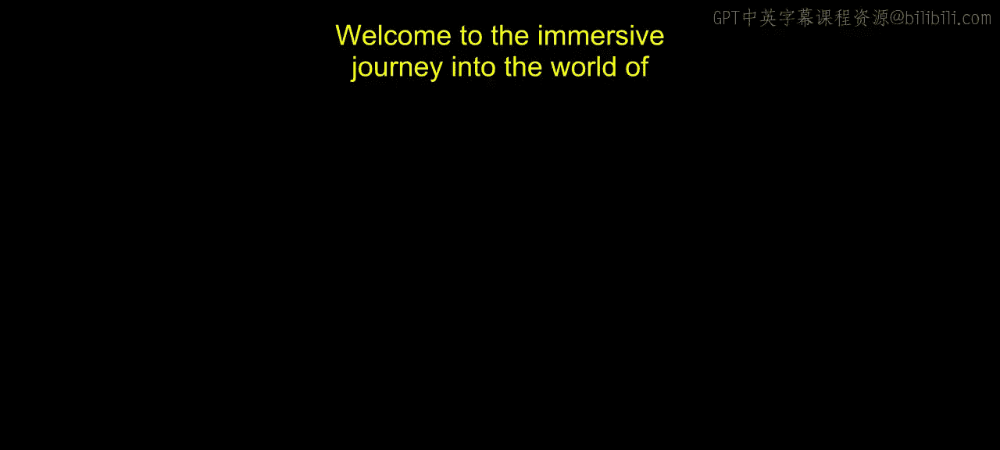

# Edureka《通过LLMs学习生成式AI（基础、应用开发、流行工具，第2、3、4课／共4课）｜Learn Generative AI with LLMs》中英 - P123：16_为什么使用OpenCV.zh_en - GPT中英字幕课程资源 - BV1ym421V7gx

Welcome to the immersive journey into the world of generative AI applications and popular tools。😊。

In this session we'll explore why OpenC is widely used and its essential role in various computer vision tasks by the end of this lesson you'll have a clear understanding of why OpenC is a Go to tool for many developers and researchers in the field of computer vision。

So why is OpenC used OpenC shot for Open source Comp Vision library is a powerful tool widely used for image and video processing tasks。

 it offers a comprehensive set of functions and algorithms designed specifically for solving computer vision problems。

But what makes OpenC so popular versatity is one reason OpenC provides a worst array of functionalities for tasks such as image processing。

 object detection， feature extraction， facial recognition and more its versatity makes it suitable for a wide range of applications from simple image editing to complex computer vision systems。

Second reason is efficiency， OpenCv is written in C or C++ and optimized for performance。

 making it highly efficient for processing large volumes of image and video data。

 It also provides Python bindings， allowing developers to access its functionalities from the Python programming language which is widely used for scientific computing and machine learning Another reason is ease of use despite its powerful capabilities。

 OpenCv is relatively easy to use with a welldoed API and extensive online resources。

 It simplifies complex image processing tasks enabling developers to focus on solving higherle problems rather than worrying about low-level implementation details。

 Another reason is community support。 OpenCv has a large and active community of developers。

 researchers and enthusiasts who contribute to its development share knowledge and provide support this vibrant community。

😊，Ensures that OpenC remains up to date with the latest advancements in computer vision and continues to evolve to meet the needs of its users Let's consider a scenario where a security guard at a mall needs to monitor CCTV camera feed to detect faces in a crowded environment with lots of moment and rapid action detecting phases manually would be challenging。

OpenC， renowned for its comprehensive suite of computer vision tools and algorithms。

 provides robust phase detection capabilities suitable for such scenarios。

 the integration of OpenC into surveillance system enables continuous analysis of live camera feeds。

 allowing the software to scan each frame for the presence of faces at the heart of OpenC's face detection functionality like pretrained models which have been trained on worse datasets to recognize spatial features accurately。

😊，These models utilize sophisticated machine learning techniques such as HAR cascades or deep learning based architectures like convolutional neural networks to detect faces even in challenging conditions such as varying lightning occlusions or densely packed crowds。

As a camera feeds stream live footage from different areas of the mall。

 OpenC's phase detection algorithms operate in real time。

 analyzingly each frame to identify phases upon detecting a phase within a frame。

 OpenCv triggers realtime alerts notifying the security guard of the presence of a phase in the monitored area。

 These alerts provide immediate feedback to the security personnel。

 enabling them to take appropriate action swiftly For example。

 upon receiving an alert the security guard can zoom in on the corresponding camera feed for a closer inspection or dispatch additional security personnel to the location of the detected face。

 This proactive approach allows security personnel to respond promptly to potential security threats or incidents。

 enhancing the overall security posture of the mall。😊。

By leveraging OpenCs phase detection capabilities， the surveillance system not only automates the process of monitoring camera feeds。

 but also enables security personnel to focus their attention on critical areas where phases are detected。

 This automation improves the efficiency and effectiveness of security operations contributing to the safety and security of patternss and staff within the mall environment。

 In summary， the integration of openC phase detection algorithms into the surveillance system。

 empowers security guards to automate the detection of phases in crowded environments。

 enhancing overall security measures and ensuring timely responses to potential security incidents。😊。

Thank you for joining us in this exploration of the role of OpenC in computer visionion。

 We hope you now have a deeper understanding of why OpenCv is widely used and how it enables developers to tackle complex image and video processing tasks effectively。

 We will continue this session in the upcoming videos。😊。

