# Edureka《通过LLMs学习生成式人工智能（机器学习和NLP基础，第1课／共4课）｜Learn Generative AI with LLMs》中英字幕 - P124：123_词袋方法演示II.zh_en - GPT中英字幕课程资源 - BV1q4421Q7qh

So lets now explore the progression from our previous discussion now let' us understand for individual movie review how it is going to happen first of all for movie review one so it will iterate through the tokens of each review and increments the count of each token in the respective review dictionary so let me execute it。

😊，And then review two and similarly review3。😊，Means what exactly it is doing whatever the loop that we provided it iterates through each token in the review one token lets see this。

😮。

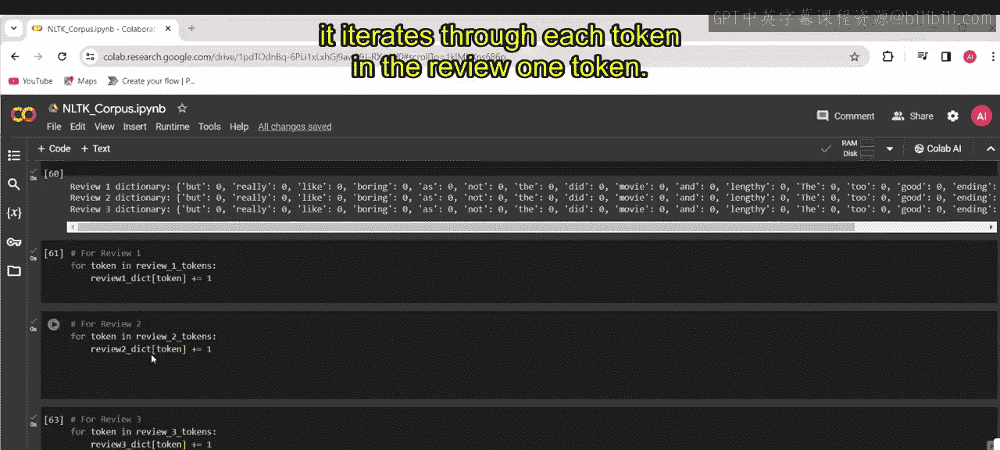

So in the review1 we are having the movie was good and we really like it So what happens in this particular case this loop its through each token in this particular movie1 review which contains the tokenized words of review1 this is what it is and then for each token the corresponding value in review one underscore dictionary means the dictionary created earlier is incremented by plus one if the token is encountered multiple times in the review its count will be increasing accordingly similarly we perform the same for review2 and review3 review token iterate over this particular review and review3 will iterate over this it will perform the same operation so these loops iterate through the tokens of review2 and three respectively and。

😊。

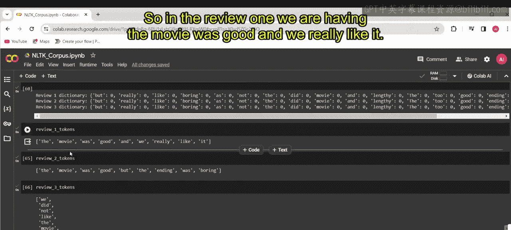

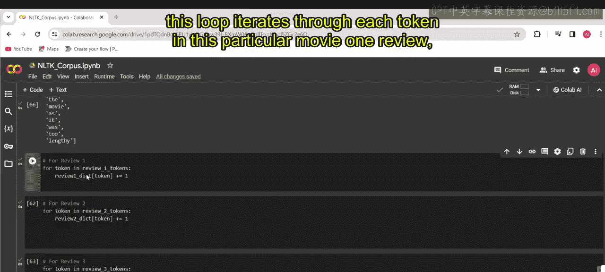

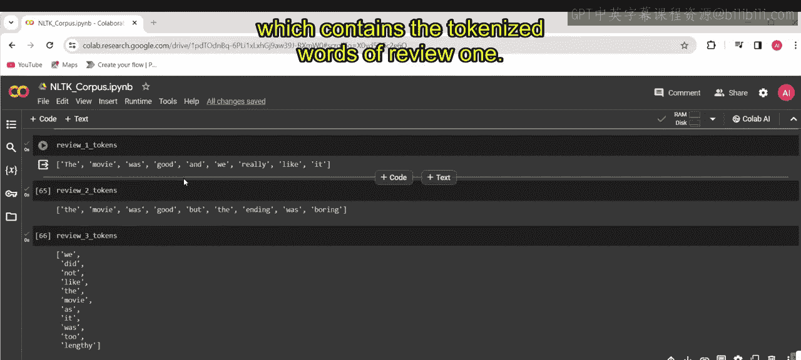

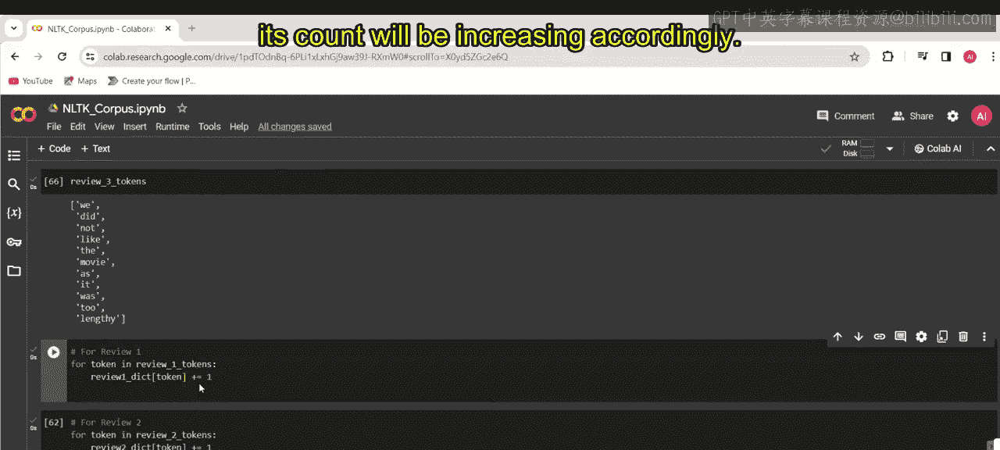

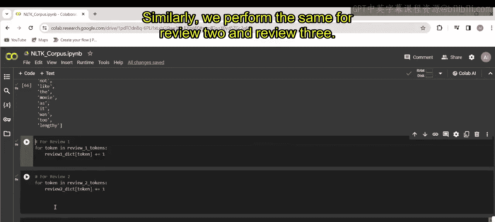

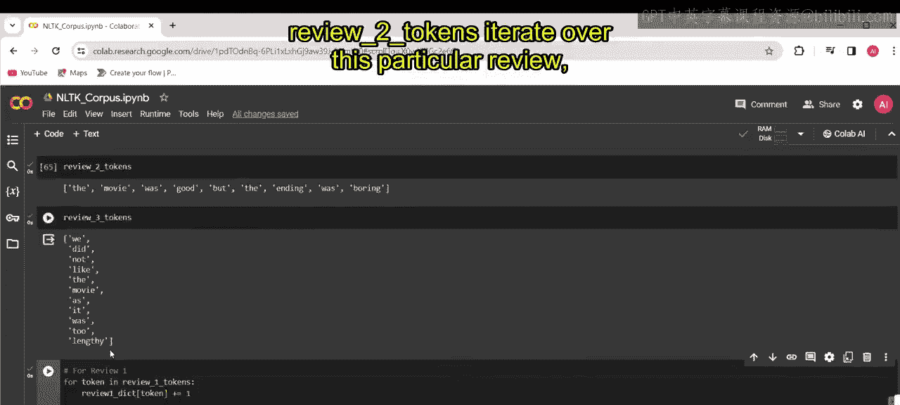

Increment the count of each token by plus one after these operations， each dictionary， like review 1。

2，3， contains counts of each token present in the respective review。

 These counts represent the frequency of occurrence of each token in the corresponding review。Now。

 let's create a pans data frame named reviews dictionary underscore D F using the dictionaries。

 review 1 dict，2 dt and3 dict。 Each di dictionary represents a review where these are the tokens。

 nothing but words， and the values are the respective counts， Nothing but frequency of occurrences。

 So here is the representation。😊，This period of data frame is used to create a data frame object in pandas inside the function。

 a list of dictionaries like review 1，2，3 is provided。

 Each dictionary represents the token counts for a specific review。

 the list of dictionaries is passed as data to the data frame constructor resulting in a data frame where each dictionary corresponds to a row。

 So let's execute this and then see the output。 Let's print it now， can you see the output。

 it is displaying all the tokens as columns and the three reviews as rows means each cell in the data frame represents the count that is nothing but occurrence of the corresponding token in the respective review。

 This representation of words and their counts in a tablet format is known as bag of words model。

 This simplifies text to data for further。😊。

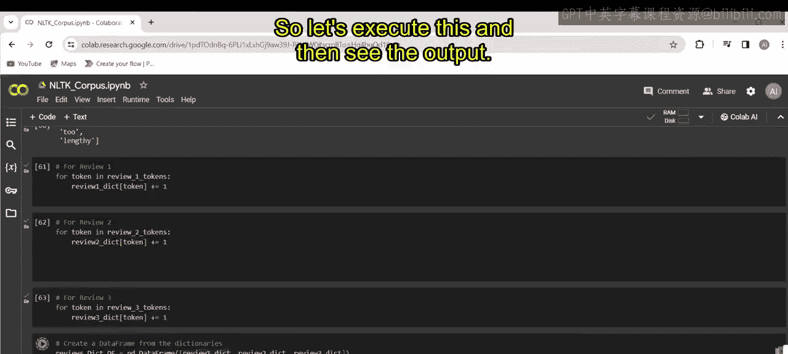

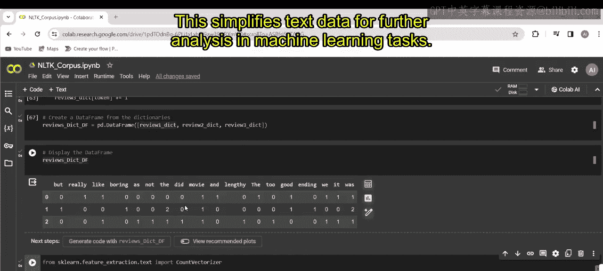

Analysis in machine learning tasks， this is all about bag of words So here we have provided the same representation。

😊。

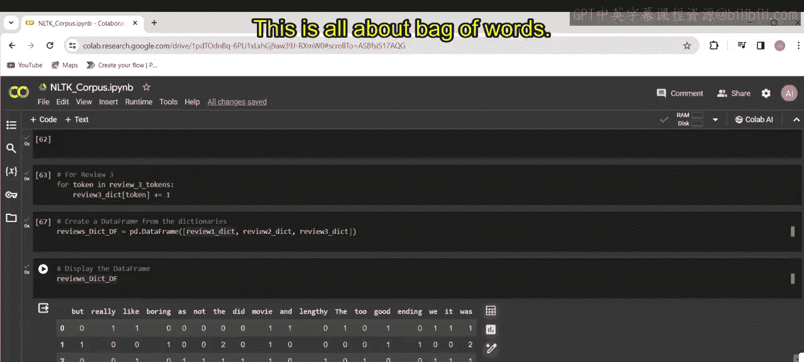

Now finally the summary in this lesson we have comprehend the bag of word approach like you know how to calculate the frequency of repeated words and all which simplifies text to data by representing it as a collection of word occurrences Additionallyly we have explored essential preprocessing steps vital for natural language processing tasks laying the groundwork for text analysis and machine learning applications Thank you。

😊。

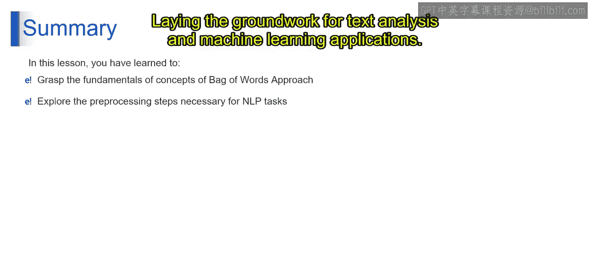