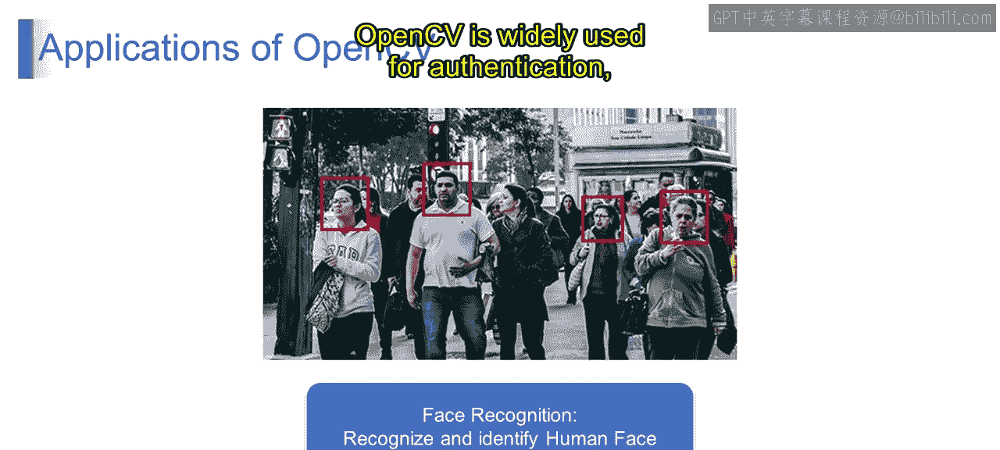
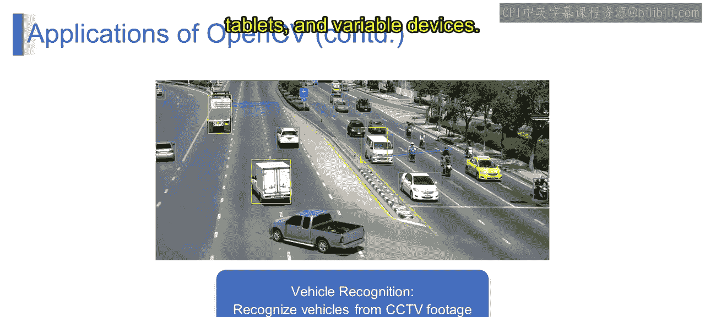
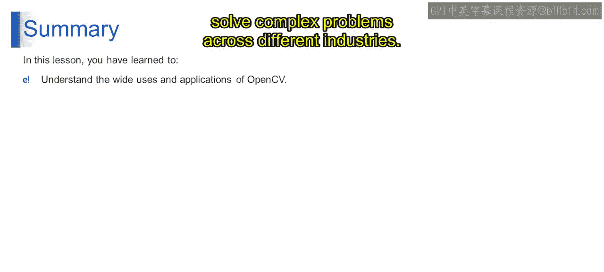

# Edureka《通过LLMs学习生成式AI（基础、应用开发、流行工具，第2、3、4课／共4课）｜Learn Generative AI with LLMs》中英 - P124：17_OpenCV的应用.zh_en - GPT中英字幕课程资源 - BV1ym421V7gx

Welcome to the immersive journey into the world of generative AI applications and popular tools。😊。

Applications of open Cv in this session we explore the worstity of open Cv and its diverse uses in various fields。

 By the end of this lesson， you'll have a comprehensive understanding of the practical applications of open Cv and how it can be leveraged for different tasks。

 So let's explore some uses of open Cv。 First one is face recognition。

 One of the primary applications of openCv is face recognition。

 Open C provides robust algorithms for detecting and recognizing human faces in images and video streams from security systems to photo tagging on social media platforms。

 face recognition powered by open Cvs widely used for authentication。

 Sur and personalization purposes。 Another significant application of open Cv is a vehicle recognition。

 By leveraging its image processing and object detection capabilities。

 Open C can identify and classify vehicles。😊。

From CCTV footage or traffic camera feeds， this technology finds applications in traffic management。

 tall collection systems， parking management and vehicle tracking。

 object detection which we have already studied in the previous videos is one of the applications of open CV that offers a wide range of algorithms for allowing users to identify and locate various objects within images or video frames。

From detecting pedestrians and animals to identifying specific objects like fruits or tools。

 OpenCv's object detection capabilities find applications and surveillance， industrial automation。

 augmented reality and robotics。 Apart from this， OpenC enables gesture recognition。

 allowing computers to interpret and respond to human gestures captured by cameras。

 This technology finds applications in human computer interaction， virtual reality and game me。

 For example， gesture recognition can be used to control interfaces navigate through menus or interact with virtual objects in immersive environments。

 and OpenC provides tools for document analysis and optical character recognition as well。

 enabling computers to extract text and information from scan documents or imagess。

 This technology is widely used in document management systems。

 digitization projects and automatic data entry。😊，Or in the field of healthcare OpenC is utilized for medical imaging tasks such as image enhancement。

 segmentation and analysis It assists healthcare professionals in diagnosing diseases detecting abnormalities in medical images like Xrays or MRI scans and monitoring patient health over time。

 OpenC plays a crucial role in augmented reality applications where virtual objects are overlaid onto the real world in real time by accurately tracking the position and orientation of objects in a scene OpenC enables immersive AR experiences on smartphones。

 tablets and wearable devices。😊。

Open CV's versatity and powerful capabilities make it a valuable tool in various domains。

 from computer vision and image processing to machine learning and artificial intelligence。

 It wide ranging applications empower developers， researchers and practitioners to innovate and solve complex problems across different industries。

 Thank you for exploring the diverse applications of openC with us in this lesson。

 We hope you now have a deeper appreciation for the versatility of OpenC and its potential to drive innovation and transformation in various fields。

 Stay tuned for the upcoming videos。😊。

