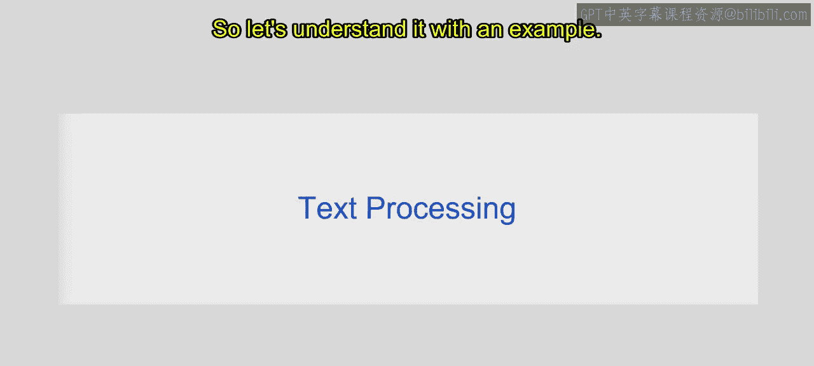
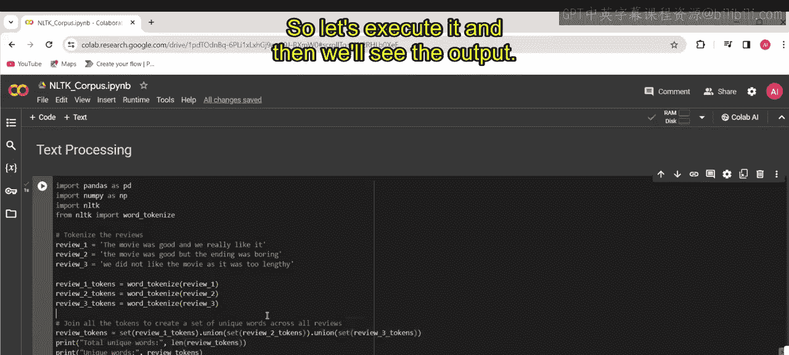
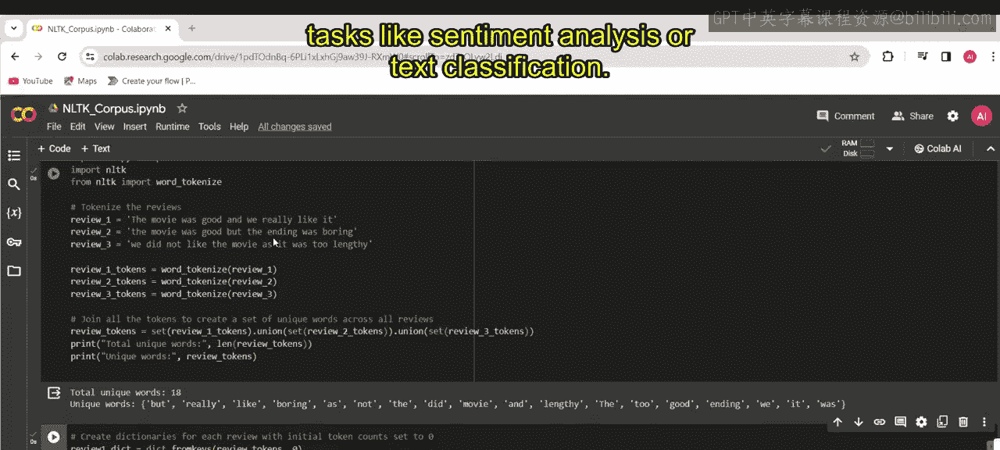
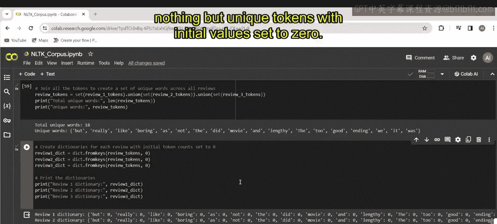
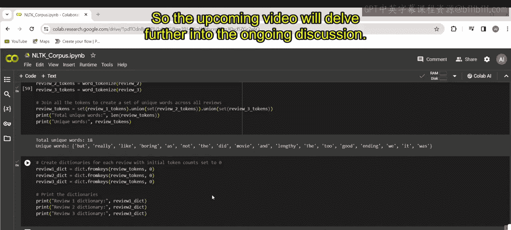

# Edureka《通过LLMs学习生成式人工智能（机器学习和NLP基础，第1课／共4课）｜Learn Generative AI with LLMs》中英字幕 - P125：124_文本处理.zh_en - GPT中英字幕课程资源 - BV1q4421Q7qh

Hello everyone welcomee back So now let's understand text processing whatddhist text processinging in NLP it involves manipulation analysis and transformation of texttable data to extract meaningful insights or features for various NLP tasks such as sentiment analysis text classification and machine translation so let's understand it with an example previously we understood how bag of words represents right so now let's understand text processing so here we import the required libraries like pans Ny and NLTK and pandas is one of the most important library with an alias PDd which is commonly used for data manipulation and import Ny as NP it imports the Ny library with an alias N which is used for numerical computation and then imports the NLTK library for natural language processing tasks。

😊。

And then from NLTK import word tokenize it specifically imports the word tokenize function from NLTK which tokenizes text into words then tokenized review so each review like you know review one review to review3 so these are represented as a string representing a movie review here we are having review one underscore tokens is equal to word tokenize of review one what this word tokenize is doing it is used to tokenize each review into list of words for example word underscore tokenize underscore review one tokenizes review one into a list of words then we are creating a unique word set each tokenized review is converted into a set。

😊，Using the set function to eliminate the duplicate words and the union function union function is used to combine sets of tokens from all three reviews into a single set this single set contains all unique words present across all reviews and finally we are printing the output like you know the length of the review tokens set gives the total count of unique words across all reviews and then the review token set the review tokens set itself contains all the unique words extracted from the reviews so let's execute it and then we'll see the output here you can see the reviews are the movie words good and really liked it out of all these it is extracting the unique words only where all the three movie reviews means this code demonstrates the initial step in text processing by tokenize。

😊。

The reviews and creating a set of unique words which can be further utilized for tasks like sentiment analysis or text classificationification。

 and then after what exactly we are doing here we are performing d dot form keys means here we are creating a dictionaries for each review with initial token counts set to0 means it creates a dictionary where the keys are the unique tokens that is review tokens and the initial value for each key is set to0 and then this is done separately for each review like review one underscore review two underscore and review 3 underscore Finally the dictionaries for each review are printed to verify their contents。

 Each dictionary should have the same set of keys。 nothing but unique tokens with initial values set to0 so let's。

😊。

Execcut it。 So we are getting exactly as is。😊，Means this code snippet initializes the dictionaries for each review where the key represent unique tokens extracted from all reviews and the initial value for each token is set to zero effectively creating a structure to track the frequency of each token within each review so the upcoming video will delve further into the ongoing discussion。

😊。

