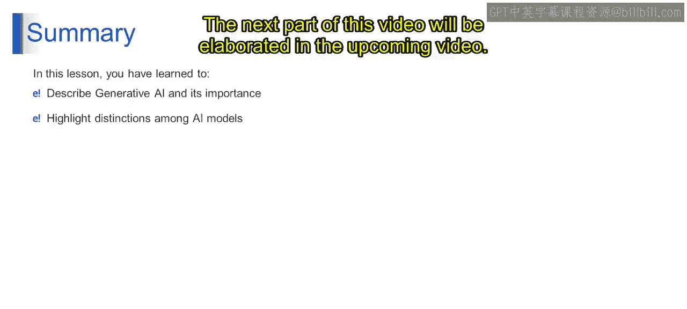

# Edureka《通过LLMs学习生成式AI（基础、应用开发、流行工具，第2、3、4课／共4课）｜Learn Generative AI with LLMs》中英 - P125：18_生成式AI vs判别模型.zh_en - GPT中英字幕课程资源 - BV1ym421V7gx

So the first topic here we are going to cover is that introduction to generative AI and generative AI versus discriminative models。

 so by the enddo session you all are able to understand the fundamentals of generative AI and you are able to analyze the generative AI roles in gener images hope now you all are clear with the concepts so now let's understand generative AI so generative AI is like creative and versatile mission capable of inventing things independently whether it's crafting art composing music or solving complex problems it's got you covered you just provide a starting point and it uses its vast knowledge to whip up something entirely new imagine asking it to paint a picture andvoA you get one of a kind masterpiece。

😊，If it's not perfect on the first try， no problem， just ask it to give it another go。

 but remember it's not an actual artist or a person with feelings it's a clever computer program that allows patterns it's learned it's like having a magical assistance for all your creative and practical needs this AI is strain on large data set to generate unique content that shares similarities with the training data while avoiding exact replication interestinging right now let's understand the difference between the generative AI versus discriminative AI so to better understand generative AI that's use a kitchen analogy let me give you one example imagine you are in a kitchen with two AI system the recipe creator and recipe identifier okay so consider recipe。

😊，Creator as generative a。 Now I will assign some role。 The role is that recipe creator。

 it is like a creative chef who invents new recipes。

 The job is that you tell a recipe creator what ingredients you have in your kitchen。

 and it comes up with a unique recipe using those ingredients。

 It's like having a chef who can create tasty dishes。 you have never tried before in resting right。

 Okay， let's take one example。 Supp you input ingredients like tofu。

 tomatoes and ba into the recipe creator。 It generates a recipe for mouthwatering cappress tofu dish means what it does it combined all the vegetarian ingredients in a unique and delicious way and provided a unique dish for you That is about a recipe creator。

😊，Which we considered as a generative AI。 Now let's understand the recipe identifier。

 which is nothing but a discriminative AI here， let's first assign the role。

 The recipe identifier is like a culinary expert who recognizes and categorizes existing recipes Now let's assign with a job you show the recipe identifier a dish。

 you have prepared and it identifies the types of vegetarian cuisin and provides the information about the dishes and what are the ingredients you have added。

 and how did you prepare it。 It does not create any new recipes same like a recipe creator but it is capable enough to identify what kind of dish it is means it's skilled at recognizing known recipes Okay let's consider one more example for recipe identifier you present a plate of spaghetti with the marineara sauce。

😊，And meatless balls to the recipe identifier It quickly identifies and explains that it is a vegetarian spaghetti and meatballs dish。

 It can be able to provide all the details like what are the ingredients present in this dish and also what all the cooking methods available in order to prepare this dish So that is how discriminative AI also works means it is not capable enough to produce something new out of it。

 but it can be able to classify the existing or known identities on its own So that's where we have provided the information about the generative AI models and also discriminative models here the objective for generative AI models is that they are capable enough to produce or create new content or output coming to the discriminative AI models they works on。

😊，Classifying or distinguished between the existing data and coming to the function。

 generative AI models learns patterns from training data and also able to generate the new content out of its based on its intelligence。

 but discriminative models learns patterns to classify or make predictions based on what it's learned and the output for the generative AI models is that it is able to generate the new and also original content because of its intelligence and because of its learning patterns but discriminative models are capable enough to predict the labels or categories for the given input coming to the training data。

 generative AI model requires a data， representing the desired output but for the discriminative models。

 it requires a labeled dataset for different classes also the models which。😊。

Can be considered as a generative models or GMs， HMms and Gs。

 These are some examples for the discriminative models。

 the proper machine learning models like support vector machine and neural networks and all the transformer networks。

 coming to the use cases， generative AI model is used for image synthesis， text generation。

 anomaly detection and many more。 But coming to the discriminative models。

 they are able to use for the image classification。

 sentiment analysis and object recognition and examples we have already seen and some more examples like painting a new thing like generating a new painting based on the existing artwork or text description。

 If you give some text to the generative A， it is capable enough to produce a new outcome out of it。

 the beautiful picture out of it。 But coming to the discriminative AI models。

 the example is that identifying whether the email or。😊。

Message is spam or not these are the differences between the generative AI models and also discriminative models the next part of this video will be elaborated in the upcoming video Thank you。

😊。

