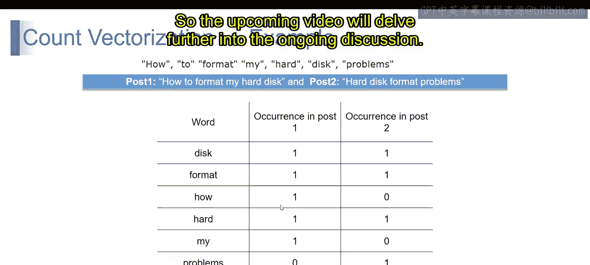

# Edureka《通过LLMs学习生成式人工智能（机器学习和NLP基础，第1课／共4课）｜Learn Generative AI with LLMs》中英字幕 - P126：125_计数向量化.zh_en - GPT中英字幕课程资源 - BV1q4421Q7qh

Hello everyone welcome back to machine learning and NLP basics so now let's understand the next topic that is count vectorizer in this we are going to understand what exactly count vectorization is all about and count vectorization using psychit learn By the end of this session you will be able to understand the brief concepts of count vectorizer and able to discoversyit learns features for basic text preprocessing so let's get started introduction to count vectorizer first of all what exactly count vectorizer count vectorizer is a method used to convert text documents into numerical vectors where each vector represents the frequency of words in the document for example let's say we are having two sentences sentence one the cat sat on the math and the dog played in the garden。

😊。

To apply count vectorization， we first create a vocabulary consisting of all the unique words across the sentence。

 However we have done in the TF IDF technique， so perform the same now and the vocabulary of all unique words for this is going to be。

😊，So this is going to be the vocabulary for the provided sentence。

 then we represent each sentence as a vector where each element of the vector corresponds to the frequency of the corresponding word in the vocabulary。

😊，Then we represent each sentence as a vector where each element of the vector corresponds to the frequency of the corresponding word in a vocabulary now the sentence one the vector would be1。

11，1，1 and remaining all zeros and similarly for the sentence to it is going to be1 double0 double0 double 1 double1 you might wonder it is working exactly like the previous technique like bag of words right so what is the difference here okay I will explain it later going forward you are going to understand this so this approach helps in converting text data into a format that can be used for machine learning algorithms where numerical data is required for processing so let's understand about it in a brief now so count vectorization count vectorization is a technique。

😊，Used in NLP to convert the text data into numerical vectors simplifying the process of text analysis。

 however it works based on word occurrence count in count vectorization each document。

 nothing but text sample is represented as a vector where each element of the vector corresponds to the frequency of particular word in a document。

 for example， if a document contains the word apple three times。😊，Let's see for example。

 if a document contains a word apple three times the corresponding element in the vector representing the document will have a value of three further word apple。

 then next one is of vectorization。 this process of converting text data into numerical vectors is called vectorization count vectorization specifically involves counting the occurrences of each word in the document and representing them as numerical values。

 Then the next one is of huge vector size since each unique word in the data that corresponds to a separate element in the vector。

 the resulting vectors can be very large， especially if the dataset contains a large vocabulary or a diverse range of words。

 this vector size can potentially be。😊，large as the total number of unique words across the documents in the data means in simple words。

 count vectorization simplifies the representation of the extra data by converting it into numerical vectors based on word occurrence count making it suitable for。

😊，Use in machine learning algorithms where numerical data is required for processing。

 so now you can see the example。 so let's break down the count vectorization example with the provided to post post1 how to format my hard disk and post2 is hard disk format problems。

 First we identify all unique words in both the posts。😊。

So let's write the unique words out of all this。😊，So now these all are the unique words from the both the post。

 so now lets see how it is going to occur for post1 and post2 this is the post one and post2 so so the disc first thing is disc yes we are having and format yes and how yes and hard。

😊，Yes。And my yes we are having and then problem we are not having problem in the provided sentence。

 so that's the reason it is set to0 and similarly in the second one we are having the first token hard desk format so these are at the words let's check whether we are having these words in the provided sentences or not the row represents each unique word in the dataset and the column represents each post the numbers indicate the occurrence of each word in the each post。

 for example the word disc appears once in both post1 and2 hence the value one in both correspondingence cells and the word how appears in post1 but not in post2 hence the value one in the post1 and column post1 column and0 in the post2 column post2 column this。

😊，It will essentially represent the count vectorization of。The two posts。

Each row corresponds to a unique word and each column corresponding to a post。

 the numbers in the table indicate how many times each word appears in each post this numerical representation allows us to perform various text analysis tasks such as sentiment analysis or document classification using the machine learning algorithm。

 so the upcoming video will delve further into the ongoing discussion。😊。

