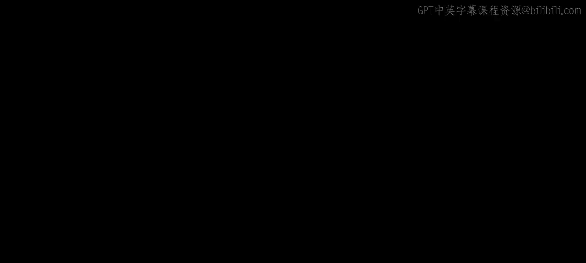
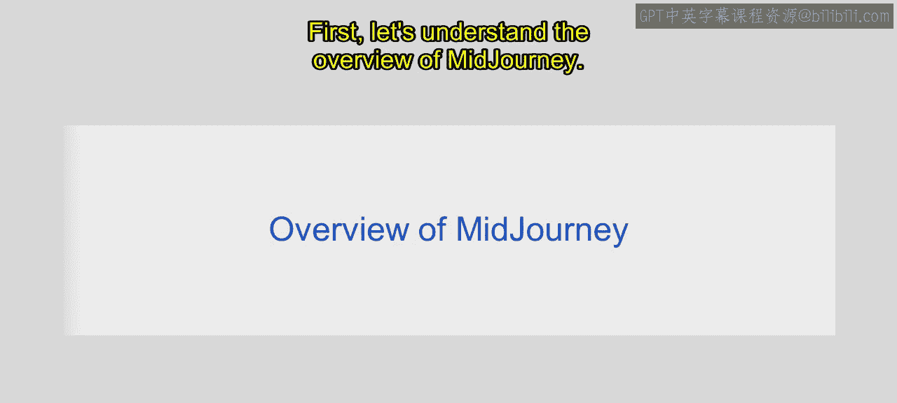
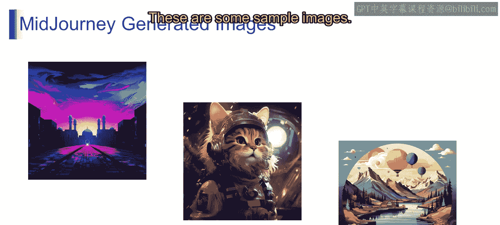
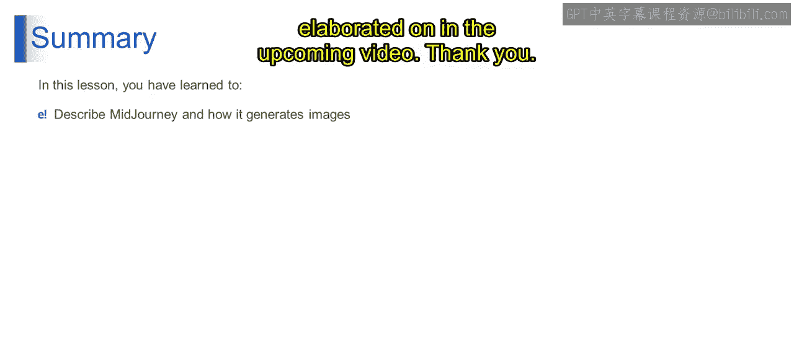

# Edureka《通过LLMs学习生成式AI（基础、应用开发、流行工具，第2、3、4课／共4课）｜Learn Generative AI with LLMs》中英 - P126：19_解密Midjourney.zh_en - GPT中英字幕课程资源 - BV1ym421V7gx

We are going to understand the overview of midjoney by this。

 We are able to understand the basic concepts of midjoney so let's get started First let's understand the overview of mid journeyney what exactly a mid journeyney is about think of mid journeyney as a magical computer program it does something really cool it turns words into pictures just like a ward turning rabbit into a hat。

 you can describe a picture with words and mid journeyney makes it appear like it's performing a magic trickrick even though it's still learning and getting better it's already catching the eye of many people。

 people are excited about it because it's like a digital sensation in the making even though it's not perfect yet here we can see an example this image is generated by mid journeyney which contains mountains slate trees and plans and also。

😊。

Clouds means this midgenney is like a digital tool which uses generative a platform that can create realistic and creative images from the text as an input to it means midgenney is not just about technology it's all about creativity people from all over the world use it to create beautiful and imaginative images。

 It's like having an artistic sidekick whether you are a pro artistist or someone who has never drawn a line Mgenney helps you make a art。

 It's on a mission to make art easy and accessible for everyone。

 So it's a tool that lets your imagination run wild and brings your ideas to life as stunning pictures in a nutshell Mgenney is a clever computer program that turns words into pictures and helps people make amazing art。

 but it's still learning。😊，And getting better day to day。

 Now let's see some examples of images which all are generated by the mid journeyney here we can see sunset over the city with colored clouds in the background。

 Then a cat wearing a spacesuit and helmet along with the headset Then hot air balloons flying over a lake in the mountains these all are generated by the mid journeyney。

 these are some sample images Now let's understand how does mid journeyney generated these images。

 So generally mid journeyney uses G4 to translate the textual description into images。

 Here is a pictorial representation for the reference。

 mid journeyney mainly contains the three parts。 one is of text to prompt encoding。

 then the diffusion model and then the image generator here in the text prompt encoding it is a process of converting it。

😊。

Text prompt into numerical representation means whatever the input we are here giving in the textual format。

 it will convert it into a numerical representation that can be used by the machine learning model then this input is sent to the diffusion model What exactly this diffusion model is it is a type of machine learning model that can be used to generate images or other types of data by gradually adding noise to a latent representation of the data and then Dno is the latest representation whatever we are giving here then it will convert that image into the image generator by performing the upscaling operation means the image generator is also a type of machine learning model that can be used to generate images from the variety of inputs。

 whatever it is taking such as text。😊，St prompts or sketches or other images。

 whatever the input you are giving。 and then it will generate the images out of it in a simple terms。

 let me explain what exactly happens over here with the example。

 Let's consider we are providing a text input prompt a cat sitting on a couch it will first go to the text prompt encoder which will convert the text whatever we have given over here will get convert into a numerical representation this process is called as vector then the vector representation is passed to a diffusion model the diffusion model iteratively re noise from the image guided by the vector representation of a text prompt the generated image is then upscaled and post processed to improve its quality directly Then the generated image is。

😊，To the user at the end means the mid journeyney image generation process is still under development。

 but it has the potential to revolutionize the way that images are created。

 The model can be used to create images in a variety of styles。

 including realistic surreal and also abstract mid journeyney can also be used to generate images that are consistent with complex and challenging text prompts。

 The next part of this video will be elaborated on in the upcoming video。 Thank you。😊。

