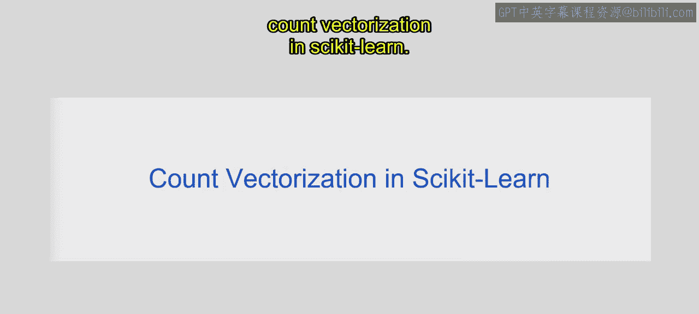
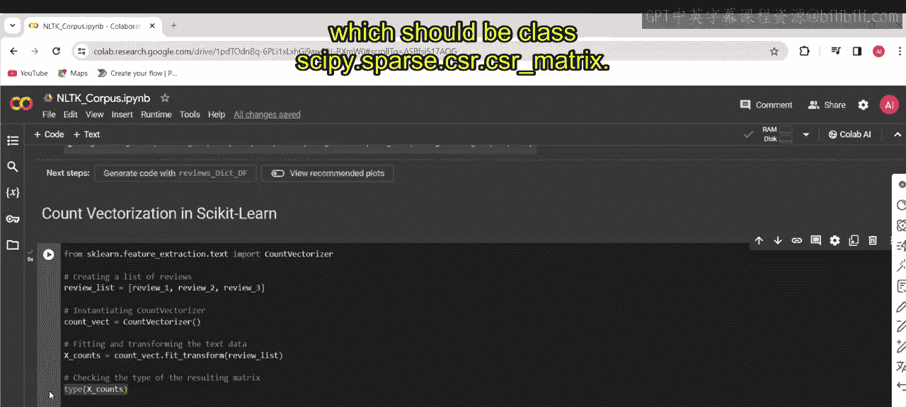
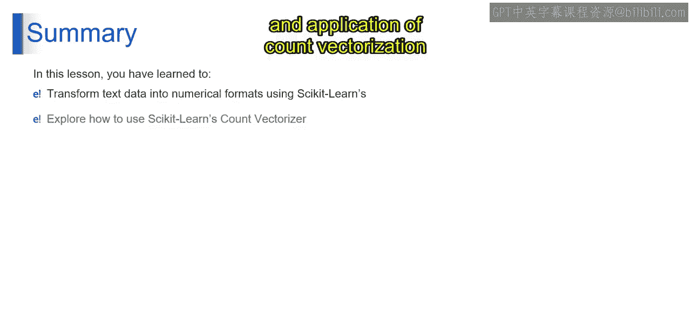

# Edureka《通过LLMs学习生成式人工智能（机器学习和NLP基础，第1课／共4课）｜Learn Generative AI with LLMs》中英字幕 - P127：126_Scikit-learn中的计数向量化.zh_en - GPT中英字幕课程资源 - BV1q4421Q7qh

So， let us now explore the progression from our previous discussion so now the next topic is count vectorization in Saigit land。

😊。

So let's understand it with practical approach。So here we are having the code for count vectorization in psyit learn in this code snippet。

 we are using the psyit learns count vectorizer to perform count vectorization on a list of reviews。

 The first thing is import the required libraries we import count vectorizer from。😊。

Scal learn dot feature underscore extraction dot text。

 then creating a list of reviews so we can create a list called review underscore list containing the three reviews and then we instantiate the count vectorizer class as count count underscore width then。

😊，Fitting and transforming the text data， we use the fit underscore transform method of the count vectorizer object to both fit the vector to the text data and transform the text data into a matrix of token counts the result x underscore counts is a spa pass matrix which each row represents a review and each column represents a unique word in the entire data set with the cell value indicating the count of that word in the corresponding review。

😊，Now， finally， here we are checking the type to check the type of the result matrix using the type function。

 which should be class Skype dot pass dot CSsr dot CSr underscore matrix。

 Let's execute it which will indicate the X underscore counts is this past matrix。

 Can you see this here we are having the attributes advantages everything we are having the list means this code segment demonstrates how to use psyit learns count vectorizer to convert a collection of x document into matrix of tokens token counts effectively。

😊。

So once we are able to identify the type of the resulting matrix now lets obtain the list of unique names after the count vectorization by providing count underscore fact dot get feature names out so lets execute and well see can you all see this these all are the unique values。

😊。

So now creating a new pandas data frame from this spa matrix。

 so this x underscore counts dot2 array this converts the spa matrix x underscore counts into a dense array representation then columns is equal to x underscore names here we specified the column names further data frame using the list of unique feature names obtained earlier then PD dot data frame。

 this initializes in new pandas data frame using the dense array and the specified column and names。

😊，Let's execute it now。 So now the resulting data frame A contains count vectorized representation of the input text data where each row corresponds to a document。

 nothing but review and each column corresponds to a unique word in the corpus。

 the value in the data frame represent the frequency of each word in each document， Okay。

 so we are able to get the count vectorization output also。

 but where we are getting the difference when we are comparing with the bag of words。

 So especially when comparing the bag of words and count vectorization。

 they are closely related concepts used in the NLp。

 but there are subtle differences like you know bag of words it is also known as BW represents a text document as an an ordered collection of bag of words disregarding。

😊。

Grammar and word orders。It closely considers whether words are present in the document not their frequency。

 bag of words is typically represented as past matrix where each row corresponds to a document and each columnman corresponds to a unique word in the entire corpus document the value in each cell of the matrix represents the presence one and absence0 correspond word in the document where when coming to the count vectorization count vectorization on the other hand considers the frequency of the words in addition to their presence it represents text document by counting the occurrences of each word in the document the output of count vectorization is similar to bag of words but the value in the matrix represents the frequency of each word in the document rather than。

😊，Just its presence or absence means while both bag of words and vectorization involve representing text document as numerical vectors based on the words that contain count vectorization includes information about the frequency of each word various bag of words does not that is the main difference between the bag of words and count vectorization。

 So now the summary in this lesson， we have gained an understanding of transforming text to data into numerical format using the psychic learns count vectorizer through practical examples we have explored the functionality and application of count vectorization in NLP task。

 Thank you。😊。

