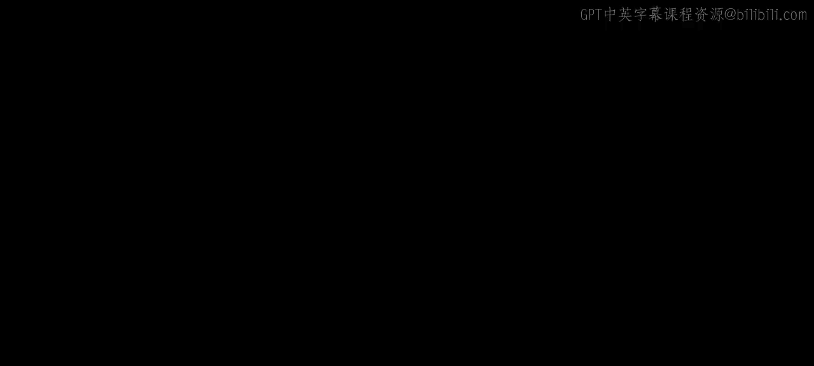
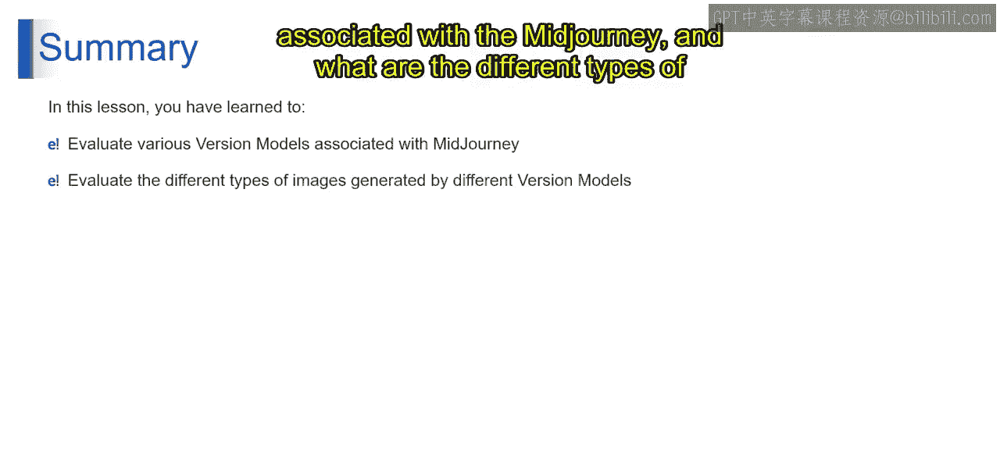
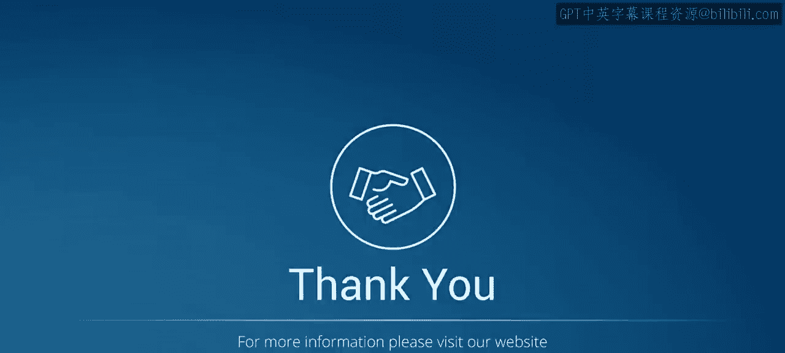

# Edureka《通过LLMs学习生成式AI（基础、应用开发、流行工具，第2、3、4课／共4课）｜Learn Generative AI with LLMs》中英 - P127：20_Midjourney的起源与发展.zh_en - GPT中英字幕课程资源 - BV1ym421V7gx

We are going to understand about the history of midjoney By this。

 you are able to understand what is the origin of midjoney and how to analyze the various features of the midjoney。

 Let's get started。 First， let's understand the history of the midjoney。

 So who started this midjoney。 David Hoes， he is the founder of midjoney he started working on the project as a self fundunded research project in August 2021。

 He is also the former co-founder and CTvo of leap motion a Vr AR Company。

 which is nothing but virtual and augmented reality。

 midjoney is still in the beta and development phase。 Let's understand the timeline of the midjoney。

 So midjoney Inc was founded in San Francisco California by David Hoes in March 2022。

 then this midjoney image generation platform first entered into the。😊。

Beta on July 12 2022 then by the November 2022， the alpha creation of version 4 of mid journeyney was made available to everyone then in the March 2023 mid journeyney is one of the many AI image generators that have emerged into the market on March 2023 the alpha iteration of version 5 was released and here the versions of the mid journeyney mid journeyney regularly updates its model to enhance efficiency coherence and quality of the images。

 whatever it is generating each model excs at producing different types of images So as of July 2023 mid journeyney has released7 different models the versions here listed are 123455。

1 and also 5。2 So by default obviously the latest version。😊。

Will be selected as of July 2023 the latest version was 5。2 so version 5。2 will be selected。

 but it can be changed as per user' requirement as well so now let's understand niy model mid journey the niji model is a joint venture between the mid journey and spell brush specifically designed to excel in creating anime and illustrative art styles。

 but exactly the spell brushes it is a company killed in developing AI model particularly focused on an specific image generation using the natural language problems and it collaborates with the mid journeyney in creating such AI model then it possesses an extensive understanding of enemy aesthetic styles and themes This model is particularly skilled a crafting dynamic action scenes and。

😊，Composition centered around characters。 So in summary。

 here we understood what are the different version models associated with the journey and what are the different types of images generated by the different versions of model。

😊。

