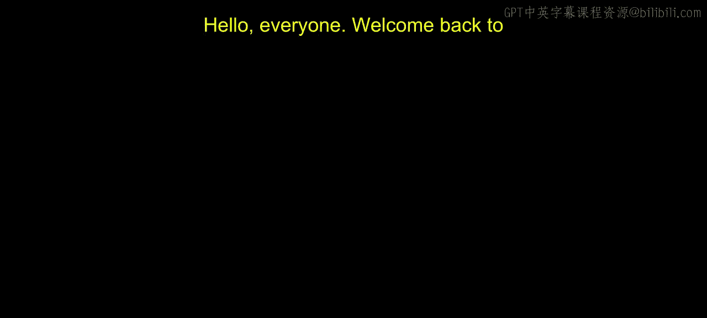
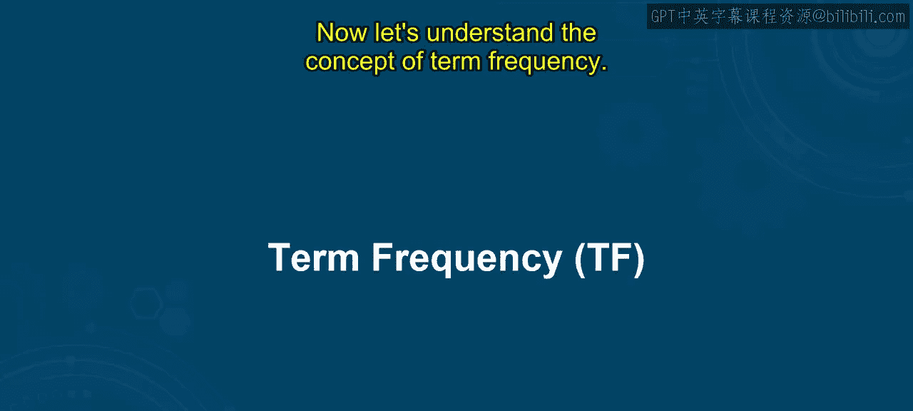
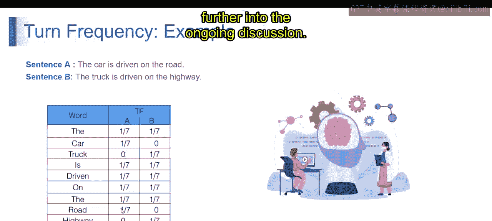

# Edureka《通过LLMs学习生成式人工智能（机器学习和NLP基础，第1课／共4课）｜Learn Generative AI with LLMs》中英字幕 - P128：127_词频（TF）.zh_en - GPT中英字幕课程资源 - BV1q4421Q7qh

Hello everyone welcome back to machine learning and NLP basics so now let's understand the concept of term frequency in this we are going to understand what exactly a term frequency and by the end of this lesson you will be able to comprehend the concept and purpose of term frequency in text classification so let's get started what exactly a term frequency is Imagine you have a collection of document like articles on a block each document contains various words and you want to know how often certain words appear within each document term frequency helps you understand this by simply counting the number of times a word appears in the document relative to the total number of words in that document for example let's say we have two document document one and document2 document1。

😊。

Contains the cat jump over the fence and document2 the dog chased the cat。

 So now let's focus on the word cat in document1， the cat appears once out of the total 7 words，1，2。

3，4，5，6。 So now let's focus on the cat in the document1 So Howard is going to convert it into the tokens means in this the first document is converted it into the tokens。

 Now let's count how many number of words we are having1，2，3，4，5，6。

7 means if we focus on the word cat the cat appeared once out of total 7 words Now the term frequency of cat in document1 can be represented as1 divided by7。

 Now in the document2， the cat appears1。Out of total six words。

 so the term frequency of catd in document 2 is going to be2 by 6 right means technically term frequency。

😊，Is calculated using the formula of total number of times the term appeared in the document to the total number of terms in document means here we have provided a simple definition Tf stands for term frequency it is a measure use it in natural language processing and information retrieval to determine the frequency of term nothing but word within a document or a carpus。

 so now now let's understand but brief about it， so as I mentioned Tf can be calculated as a term X frequency in the document y divided by total words in a document N X is nothing but term and y is nothing but document in our case means this represents the count of occurrence of a specific term X within a particular document for example in our case。

😊，The cat how many times it appeared in that particular document that is going to be the number of times the term appeared in the document to the total number of terms in the document means this indicates the total count of terms in the entire provided document it represents。

The size of the document， for instance， if the document contains00 words。

 this value would be0 like that， so in our previous example we were having the CAd term。😊。

One time out of seven words means the output is going to be the 0。14。

 This means it will calculate how many times the word accounts the total words in the document indicating its frequency or importance within that particular document so now let's understand it with easy example sentence A and sentence B here we are having the car is driven on the road and the truck is driven on the high so the both the sentences are having total seven words after tokenization including the first stop Now these all are the words and this is sentence A and sentence B so now if we can understand total terms in the sentence A is going to be the seven term car appears in sentence one sentence a is one and term driven appears in sentence a is。

😊，Also one， and then term road appears in sentence a is also one。

 The term frequency for each term in a sentence is going to be one by 7， one by 7 and one voice。

 one by 7 means approximately。It is equal to 0。143。

 similarly in a sentence B also it is going to be the same likewise means term frequency for each term in both the sentence is approximately 0。

143 indicating that each term contributes around 14。

3 person to the total term in its respective sentence so the upcoming video will delve further into the ongoing discussion。

😊。

