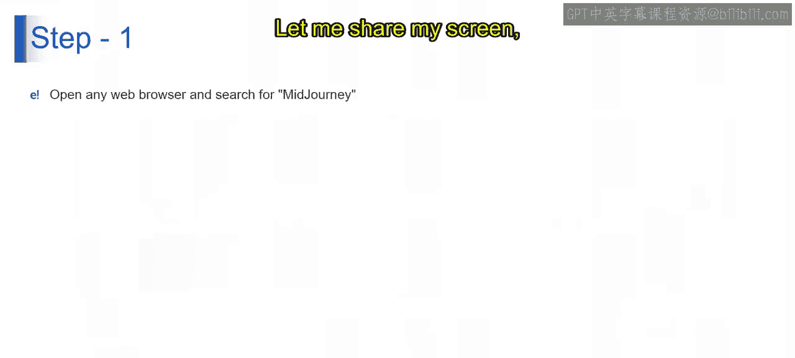
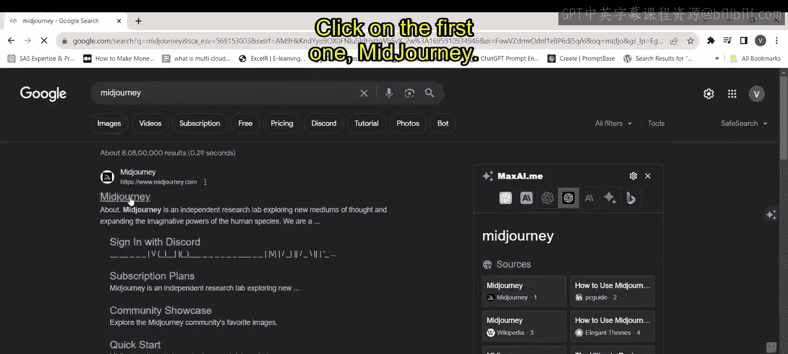
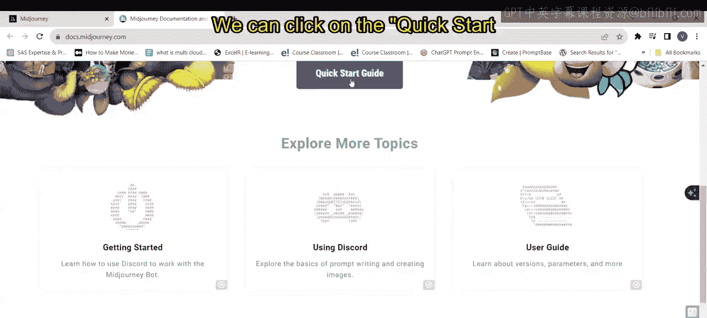
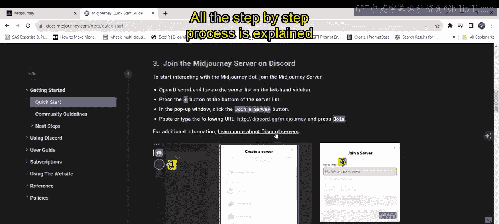
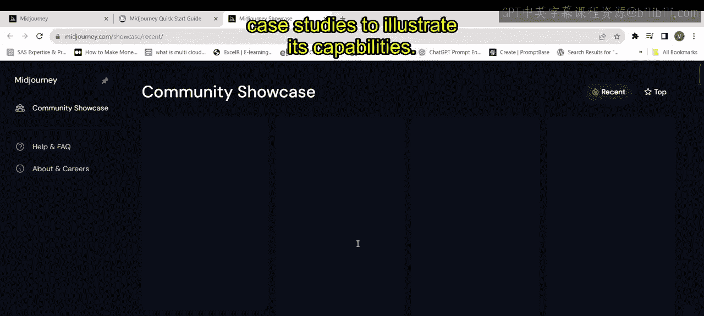
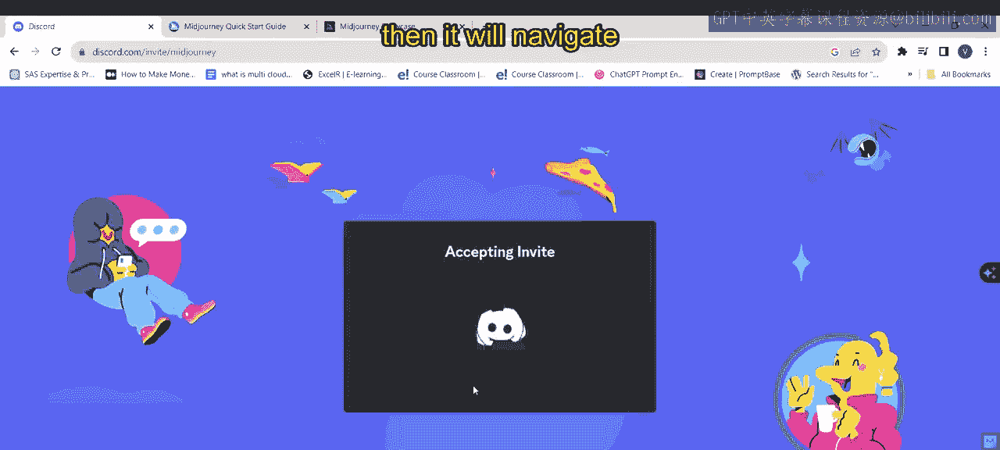
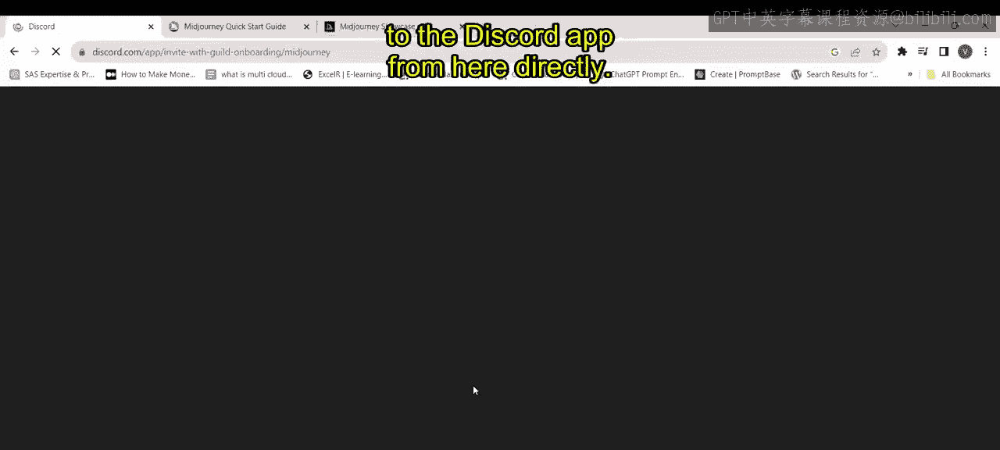
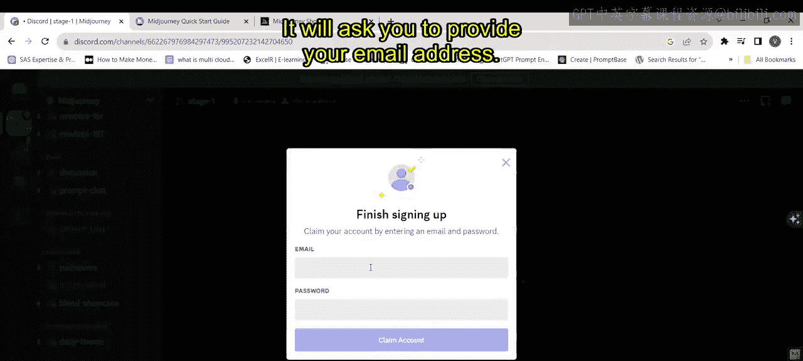
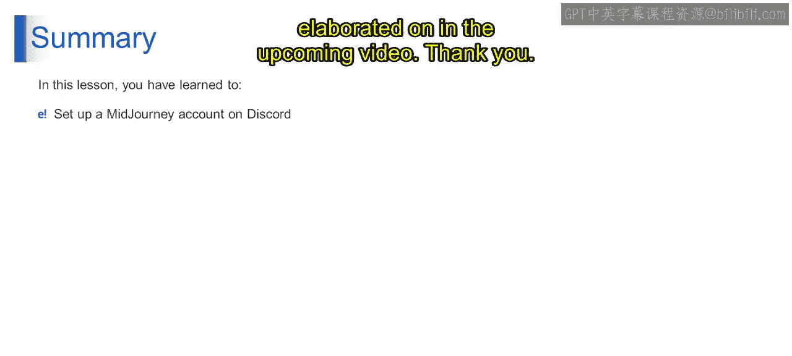

# Edureka《通过LLMs学习生成式AI（基础、应用开发、流行工具，第2、3、4课／共4课）｜Learn Generative AI with LLMs》中英 - P128：21_Midjourney账户设置.zh_en - GPT中英字幕课程资源 - BV1ym421V7gx

The midjourney account set up on the Discord by this you are able to understand the purpose and benefits of setting up a midjoney account on the Discord and also able to understand a step by step process of creating a midjoney account in the Discord let's get started midjourney account setup Discord the first step is that if you want to have midjoney the very first step is to set up a Discord account then followed by signing in on midjoney website so what exactly Discord is before joining midjoney it is important to know about the Discord Discord is a platform user friendly communication platform that serves as a virtual gathering place for people to connect and converse it offers a variety of communication tools including text messaging voice calls and video chats。

😊，Making it versatile for different types of interactions users can create their own virtual spaces called servers where they can organize discussions into the channels each dedicated to a specific topic or theme Its widely embraced by gaming communities actually but its appeal extends to diverse groups like study groups and also based on the hobbies and professional teams and interestbased communities as well Discords easy of use and customization options make it a popular choice for online communication and collaboration as well Additionally。

 Discord provides feature like integration with the other applications and as well as boards that can automate tasks or add extra functionality to the server it has become a central hub for online socialization allowing people to connect。

 share and collaborate in。😊，Virtual environment that is where mid journeyney is a community oriented application this feature of Discord helps connect people from all around the world and generate the images Now let's understand environment setup of the Discord The first step is that open any web browser and search for the mid journey so let me share my screen open a Chroe window and search for mid journey。

😊。

It will navigate you to this place click on the first one mid journeyurney。

It will open the mid journey page which contains the four options get started showcase join the beat and sign in first let's understand what exactly this gets started I just clicked on it here。

This get started is an option typically allows users to begin their interaction with a product or service guiding them through initial setup or usage to become familiar with its basic features as well as functionalities so we can click on the quick start guide and then you can see here making images with mid journeyney log in Discord first subscribe to a mid journey plan all the step by step process is explained over in this page that is about get started then the next one is of showcase。

😊。

Showcase is it is likely refers to a section or features that highlights the most prominent or exemplary aspects of a product or service often through demonstration examples or case studies to illustrate its capabilities。

 you can see all these as an examples over here， some pictures which all are generated by the mid journeyney。

😊。

You can see all this here。Then the next option is of join the beta， so this suggests。

An opportunity for users to participate in a prerelease version of your product or service。

 allowing them to provide feedback， test new features and help identify and resolve potential issues before the official launch means this is where we are going to join first。

 then will work on the things。 Let me click on this later。

 Now I just wanted to show you this option as well sign in。

 This action typically grants users access to their accounts or profiles。

 enabling them to personalize their experiences access saved data or preferences and engage with the product or service in more personalized manner。

 If you are already having an account in the midjoney， simply click on the sign in。

 But if you are doing it for the first time， I request you guys to click on the join the be。😊。

It will navigate you to this page。😡，Where it is saying you have been invited to join midjoney and also you can see how many number of people is in online and how many active users at there vitamin means how many members have already registered here you simply click on the accept invite。

😊，Then it will navigate you to the Discord app from here directly you can see it is navigating to the discord here。

😊。

If you can see here， it is asking to enter your birthday， let's enter the birthday over here。😊。

Then click on done。It will ask you to provide your email address。

 The next part of this video will be elaborated on in the upcoming video。 Thank you。

