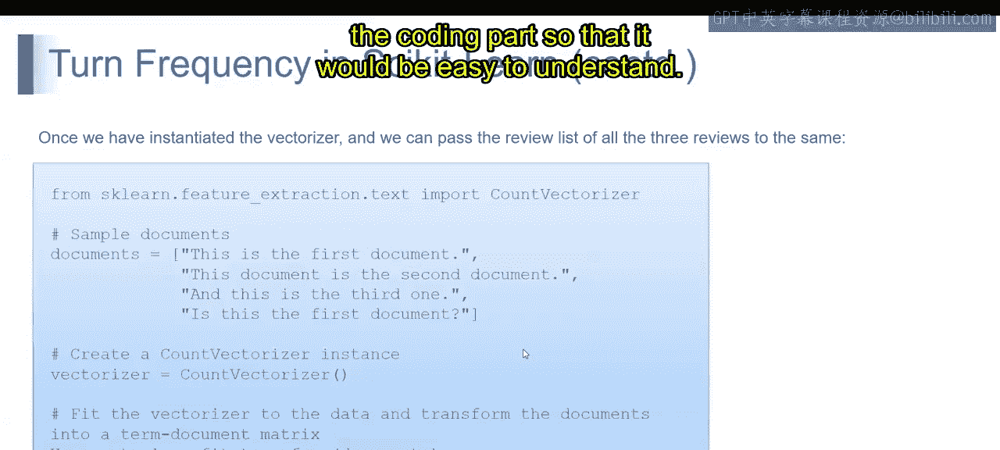
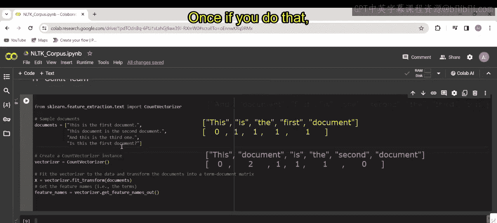

# Edureka《通过LLMs学习生成式人工智能（机器学习和NLP基础，第1课／共4课）｜Learn Generative AI with LLMs》中英字幕 - P129：128_Scikit-learn中的词频.zh_en - GPT中英字幕课程资源 - BV1q4421Q7qh

So let's now explore the progression from our previous discussion。

 so now let's explore it with the coding part so that it would be easy to understand so this is my code here first of all。

😊。

I am importing a account vectorizer。Count vectorizer class from the ecal and dot feature underscore extraction dot text module。

 then sample documents I am considering here。 I have defined a list of documents containing sample documents like this is the first document and this document is a second and and this is the third one。

 And is this the first document like this， Then I have instantiated a vectorizer。

 I have created an instance of count vectorizer named vectorizer then。😊。

I fit and transform means use the fit underscore transform method of count vectorizer to fit the vectorizer to the data。

 our data here is nothing but documents and transform the documents into term documents。😊。

Term document of vector。Term document matrix X。 so let's execute it first。 So as per a is。

 So what is the output that we will get 1，2，3，4，5，6 out of6。 This is repeated once means okay。

 so let's execute and we' see how we are going to get。 And then now I am going to print it。😊，So， now。

 let's understand。Hard to do this The first step is to split each document into individual words。

 so if we can split into the tokenization， we will be having this is the first document。😊。

And then this document is the second document full stop。 And this is the third one full stop。

And then is this the first document like this we are going to have？😊。

Now let's create a vocabulary which is just a list of unique words present in all the documents in our case the vocabulary is going to be and document first is one second the third this so this is going to be the vocabulary of our document now start counting the occurrences now so each document。

😊，We count how many times each word in the vocabulary appears in the document。

 We represent this as a matrix where each row corresponds to a document and each column corresponds to a word in the vocabulary。

 the numbers in the matrix represent the count of each word in each document。

 So for the first document， it is going to be check if we are having end， it is not there。

 So it should be0， then document。 Yes， it is present one， and then first， yes。

 it it is present in this。 and then is likewise， you need to go and check each and individual word。

 it it is matching with the vocabulary。 then you will have to place it the word position as one。

 Otherwise you will have to make it as0。 Similarlyly， you can do it for second。

 third and fourth sentences。 Once if you do that， let's print。😊。

The array， the matrix representation。