# Edureka《通过LLMs学习生成式AI（基础、应用开发、流行工具，第2、3、4课／共4课）｜Learn Generative AI with LLMs》中英 - P129：22_Midjourney订阅.zh_en - GPT中英字幕课程资源 - BV1ym421V7gx

Now let's understand midjoney subscription before understanding the plans so why do we need subscription in order to use the midjoney so midjoney used to provide new users with a complementary trial which enabled them to utilize the platforms's AI power tool to create up to 25 jobs a job refers to any task that can be carried out by using the midjourney board or Discord channel in a simple batch if you want to create any image you can simply go to the midjoney board and type your text or pro and midjourney will provide the output in a image format however owing to a high demand and to avoid the misuse of AI generatedrated images this offering has been modified hence it is now mandatory to buy a subscription to generate the images now let's understand the subscription plans of midjoney so if you want to check what are the subscription plans。

😊。

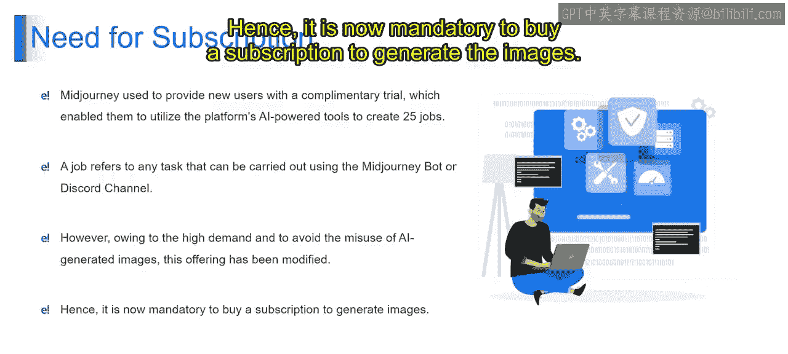

Available， we can check it in two different ways。 One is go to midjoourney official platform or website。

 click on the get started。 It will open the documentation page and click on the quick start guide and it will open the home page here in the left hand side panel you can see the option called subscription click on it and click on subscription plans it will navigate you to the subscription plans where they have mentioned midjoourney has three different subscription tiles pay month to month or for the entire year for it 20 person discount each subscription plan includes access to the midjoney member gallery the official discountord and general commercial usage terms and more and here you can see how to subscribe use the forward slash subscribe command to generate personal link to the subscription page Let's check this go to midjoourney and type。

😊。

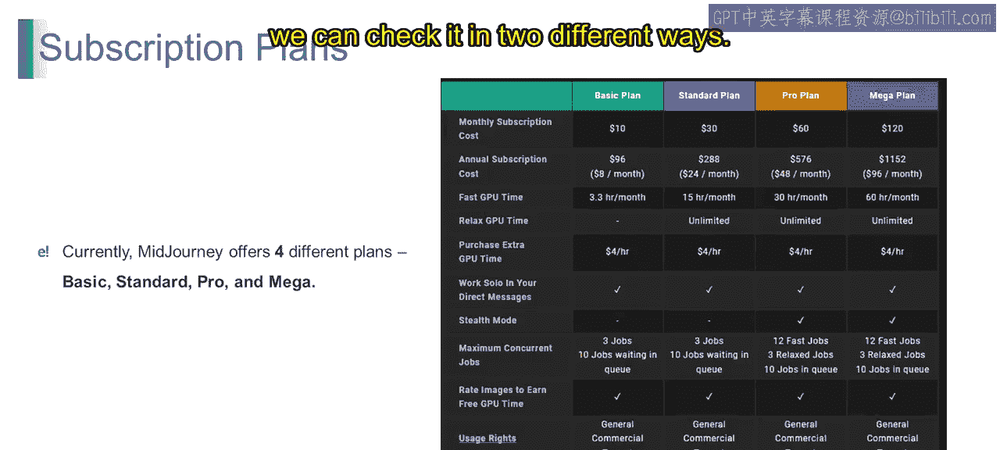

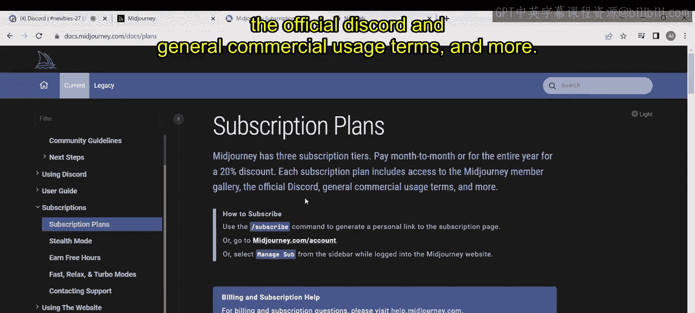

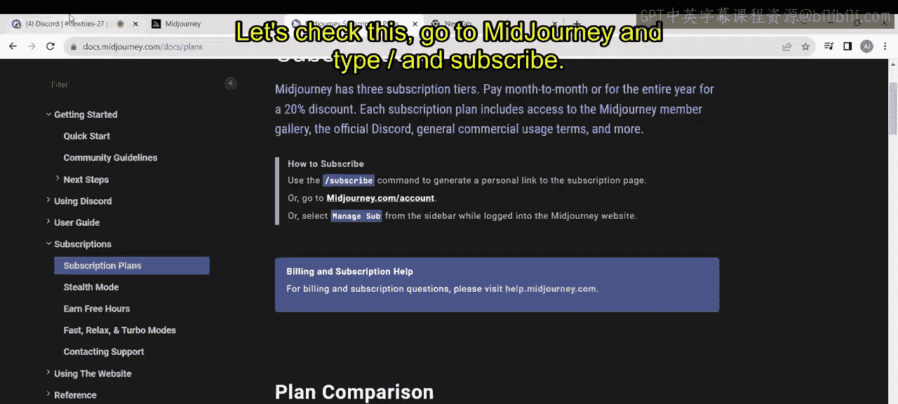

Forward slash and subscribe you can see we are getting this option click on it and also enter。😊。

If you can see it is telling me to open this personal link， do not share it with anyone， click on it。

😡。

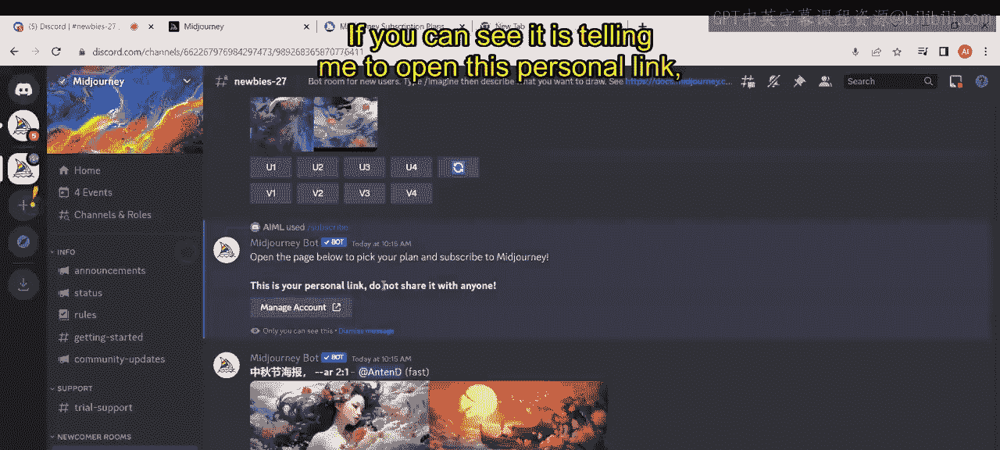

And it will navigate you to a page。😊，And it is checking if the side connection is secure and it is loading。

 Click on verify you are a human。😊。

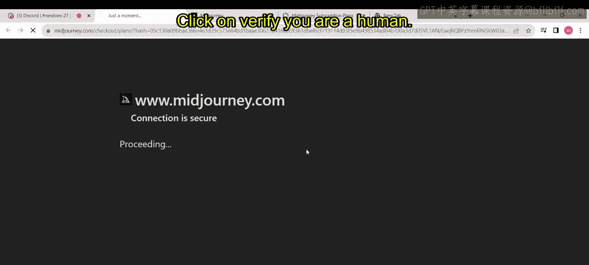

And now you can see the purchase a subscription chooseose the plan that works for you。

 you can go for the yearly buildinging or also monthly billing here we can see four different plans。

 one is of basic standard pro and also mega plan you can even switch over to monthly billing as well in order to understand the price structure and if you can see here in the midjoney subscription plan they have provided the plan comparison one by one you can see monthly annually also and they have provided the four different possibilities that is basic standard pro and also mega plan so now the monthly subscription cost the fee you pay on a monthly basis for access to the midjoney services if you want to go for the basic plan you are expected to pay $10 and for the standard it is of $30 and for the pro plan it is of $60 and then for the mega plan it is for $120 and then coming to the annual subscription cost。

😊。

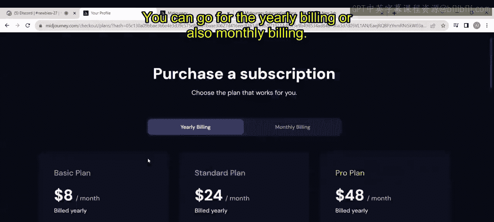

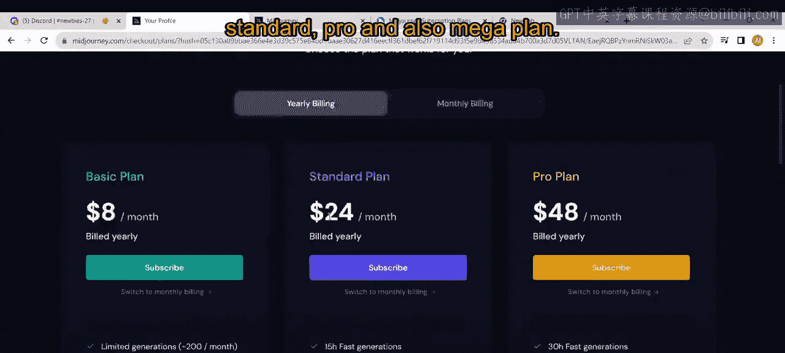

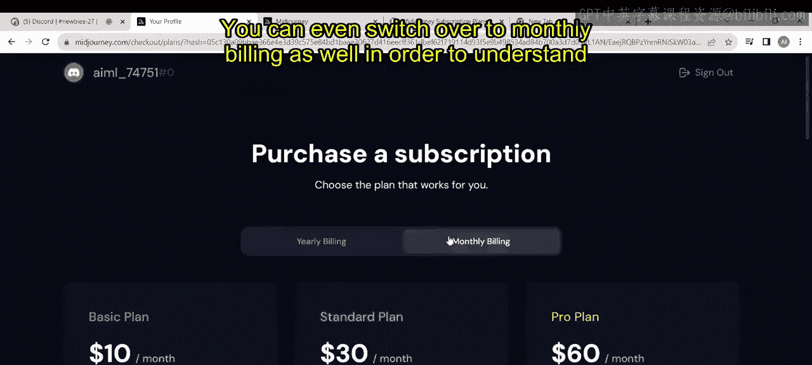

Means the yearly fee annual subscription is the yearly fee for access to midjoney services often at a discounted rate compared to the monthly and you can see this is what you are expected to pay 96 to88 and also 576 and double152 respectively and then coming to the fast GPU time This is something allocated time on high performance GPus for faster task execution if you want to get that。

 you will have to go for this and for the basic plan they are giving 3。

3 h per month and if you are using the standard plan they are giving you 15 h per month and if you are going for the pro they are giving 30 h and for the mega plan users。

 they are giving 60 h per month they relaxed GPU time So what exactly it is it is a time on the lower priority GPus for cost saving but slower the task execution as well there is nothing for the basic plan but。

😊，going for the standard plan。 It is unlimited and even for the pro and mega plans as well then purchase extra GPU time here。

 this option is to buy additional GPU time beyond your subscription if you want to use it extra then go for this and for this you will have to pay $4 per hour as an extra for all the plans whether you are going for basic standard pro or mega you are expected to pay $4 additionally then work solo in your direct message This is something the ability to work privately without sharing project or data in direct messages and this is applicable for all the plans and steal mode This is nothing but it is a feature that allows you to work without appearing online or visible to other people and then coming to the maximum concurrent jobs it is a maximum number of tasks or project you can run simultaneously if you are going for your basic plan。

You can run three jobs and 10 jobs waiting in a queue and it is similar for the standard plan as well。

 but if you are going for the pro or mega plan it is they are given2 well fast jobs。

 three relaxed jobs and 10 jobs in queue for both of them and then rate images to earn free GPU time。

Here it is a reward system where you can earn GPU time by providing feedback on the images and it is applicable to all the plans。

 Then the last one is of usage rights。 it is nothing but the permissions and restrictions on how you can use the GPU time and services provided by the mid journeyney and it is for general commercial terms for all the applications you can see this is all about the subscribes and you can see if you have subscribed at any point。

 you are free to use your images in just about any way you want and also you can go through the terms of the service also from here and also if you wants to understand the subscribe to a plan you can simply go and enter forward slash subscribe we have already seen Okay now let's get back to the Discords over here and as I mentioned。

 if you click on the manage account you will be able to understand the subscription plan。

 Even you can subscribe it from here directly。 if you are going。😊。

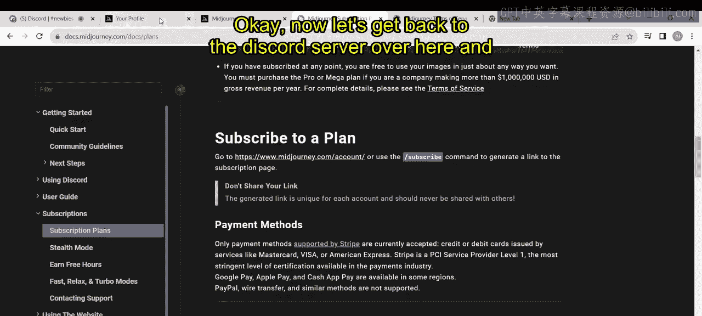

Your basic plan simply click on the subscribe option and it will navigate you to a page where you are expected to provide the account details and also you can see it is per year$96 and you are expected to provide the email and card payment method and also information and billing address and all this mandatory fills you are expected to fill and then click on the subscribe then you will get the subscription once you are done with the subscription go back to the Discord channel and if you are again once you expect to get the images directly start from here in the midjoney board directly the next part of this video will be elaborated on in the upcoming video Thank you。

😊。

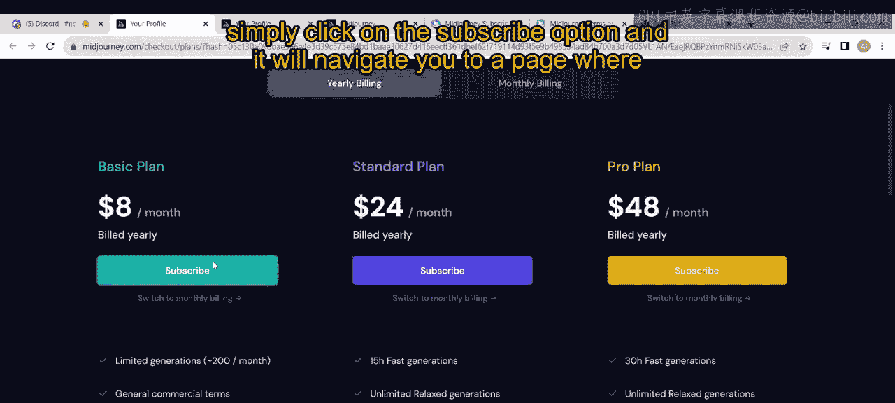

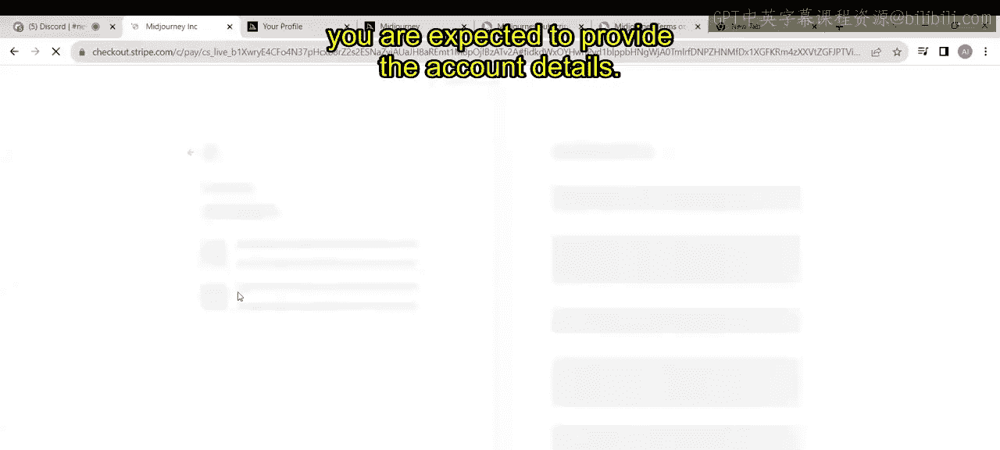

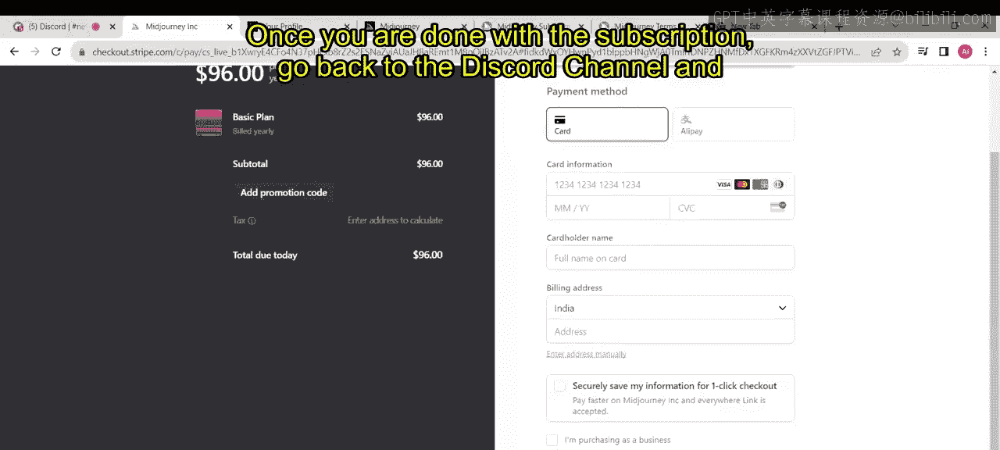

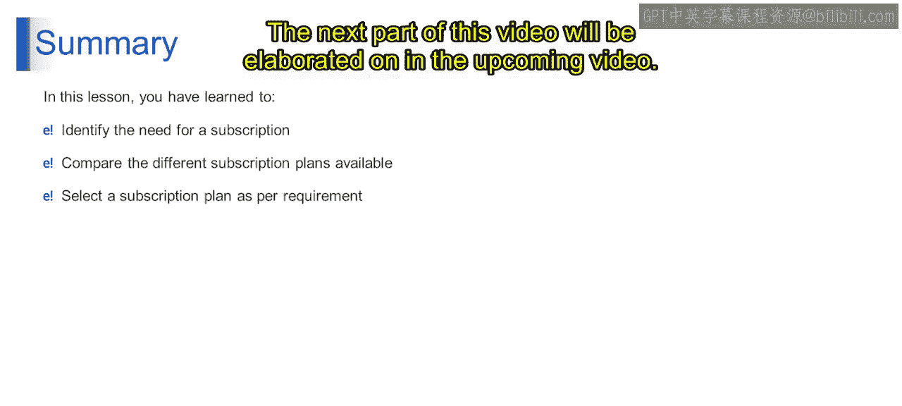