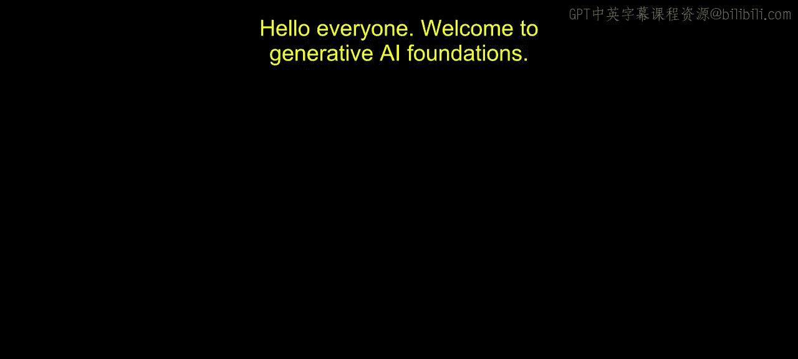
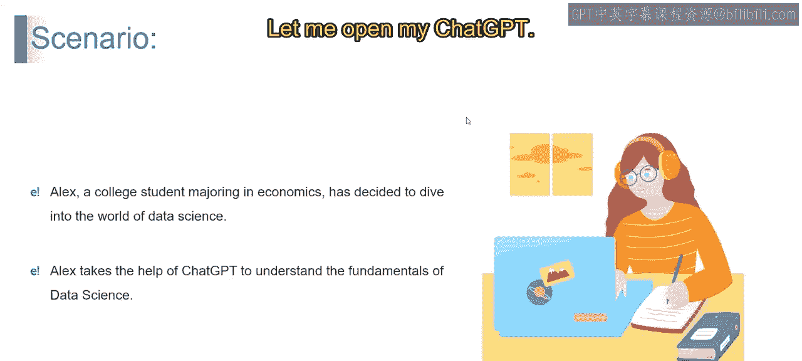
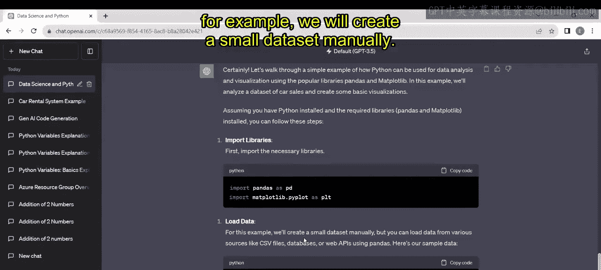
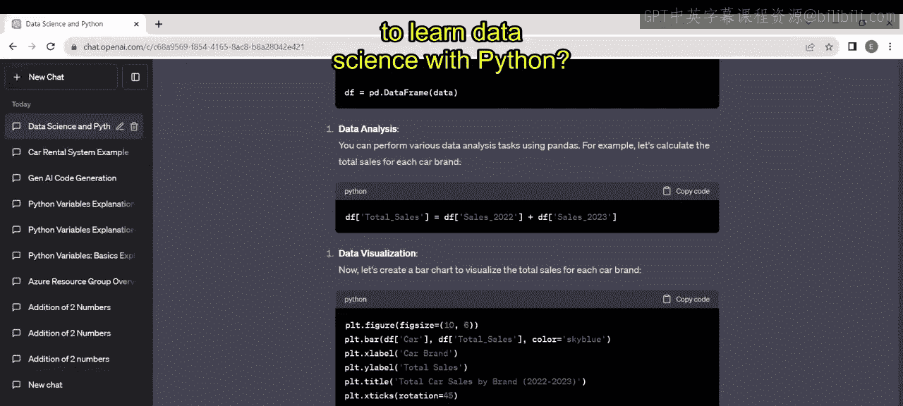
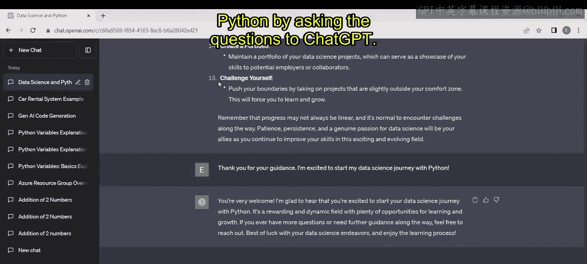
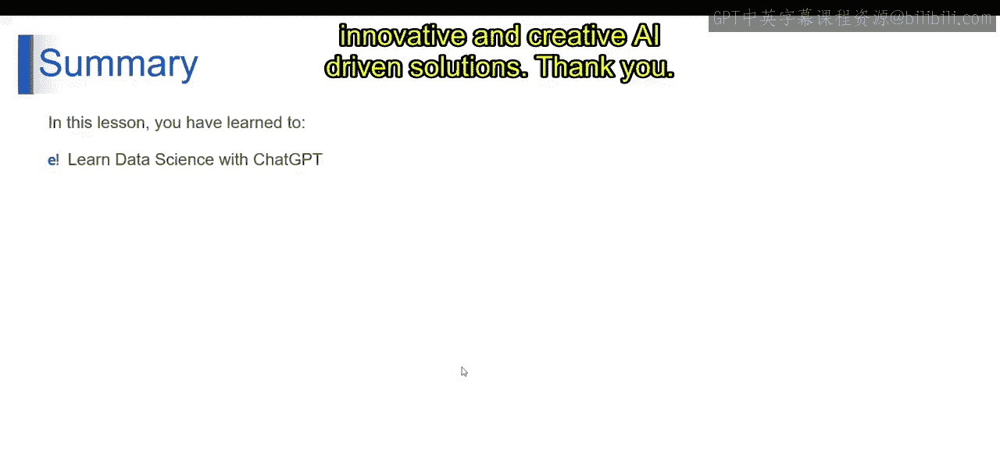

# Edureka《通过LLMs学习生成式AI（基础、应用开发、流行工具，第2、3、4课／共4课）｜Learn Generative AI with LLMs》中英 - P12：11_利用ChatGPT学习Python数据科学.zh_en - GPT中英字幕课程资源 - BV1ym421V7gx

Hello everyone， welcomele to generative AI Foundations。

 The first one is leveraging Chad GPT to learn data science with Python In this we are going to cover Python for data science with Chad GPT By the end of the session you will be able to use prompt engineering to improve the performance of LMs on a specific task Let's get started Here is a scenario for you Alex a college student measuring in economics has decided to dive into the world of data science Alex takes the help of Chad GPT to understand the fundamentals of data science Let's see how can we do this Let me open my Chad GPT Now let's see how can we help Alex to learn the fundamentals of data science with Python by using the Chad GPT Now here in Chad GPT let's ask I am new to data science and Python can you provide an overview of what data science is。

😊。

And its relationship with Python because I'm completely new to it being in Alex position。

 let's raise a questions。 You can see Cha G started providing the answer。

 certainlyly data science is a multidisciplinary field that involves using various techniques。

 algorithms， processes and systems to extract valuable insights and knowledge from the data it combines elements of statistics。

 computer science domain expertise and data visualization to analyze and interpret data for making informed decisions and predictions and here they have provided the brief information and key aspects of the data science。

 data collection， data cleaning and preprossing E machine learning， statistical analysis。

 data visualization， big data and distributed computing and domain expertise all these things。😊。

Now I want to raise a question that how do I set up Python and data science environment on my computer because I want to learn this so for this I' am going to ask this question I don't know anything about it let's raise this question to chat GT now you can see setting up a pythonbased data science environment on your computer invo a few essential steps here they have even provided the guide step by step processor install Python from this website and also choose a core editor or integrated development environment which is nothing but ID and also created a virtual environment all the listed process you can see you can follow the stepby step procedure of these in order to start working with Python for data science and this is the environment set up in your local computer。

😊，Now， I want to ask， what are the key fundamentals I need to understand in data science。

 you can see it is telling we will have to understand statistics， mathematics， programming skills。

 data manipulation and analysis， machine learning， feature engineering， data preprosing。

 model selection and evaluation big data distribution。

 computing and NLP and CVv and domain knowledge， ethics and privacy， communication。

 continuous learning and problem solving。 These all are the fundamentals that we need to have in order to understand the data science。

 Now let's ask one more question。 I don't know anything about this data science or Python programming language。

 I just wanted to see some example。 So for that， what I' am asking this。

 can you show me an example of how Python is used for data analysis and visualization and click on enter。

😊，You can see it started providing the solution assuming you are having Python installed and required libraries。

 you can see first of all we need to import the required libraries。

 then we have to load the data and we need to perform the data analysis。

 data visualization and further analysis and visualization These are the steps that we are expected to perform。

😊，Here you can even see the description as well。 if you want to load the data， for example。

 we will create a small dataset set manually， but you can load the data from the various sources like CSv files databases or Web various every definition of the code has been given over here Now I want to ask one more question with aju Now I am clear that I need to have all these minimum basic knowledge if I want to understand it more in a better way I want to raise a question where can I find more resources to learn data science with Python it will start generating the solution for you or answer for you online courses。

 Cosera，eds Umi and YouTube tutorials， books， mo platforms， blogs， websites， forums and communities。

 documentation and official websites， so many extra things you can see these are the sources that you can learn data science with Python Now I understand from where I can gain the knowledge Now I have one more question that is what's the best way to keep improving。

😊。

My data science skills。 Let me ask this question to chat G。

 So it is telling improving your data science skills is an ongoing process that requires dedication and practice。

 you will have to ensure the continuous learning handsson project open source contributions online coding challenges online courses and certifications data science books。

 mentorship and networking， teaching and explaining specialization coding practice critically analyze your work soft skills stay curious create a portfolio and challenge。

 These are the things which can keep improving your data science skills。 That's great to hear。

 I'm so happy with the inputs whatever chat Gp has provided。

 So now I'm just telling thank you for your guidance I am excited to start my data science journey with Python you can see it is providing the response even for this Also you are most welcome So in this scenario Alex uses chat GpT to receive guidance on data science。

😊，Fundamentals， Python and practical examples。 the stepby step approach ensures a structured learning experience。

 and Alex can gradually build expertise in data science with Python by asking the questions to chat GpT。

😊。

Now the summary， in this lesson， you have discovered how to utilize ChaGPT as a valuable resource for learning data science。

 helping you understand key concepts， tools and practical examples to kickstart your journey into the world of data science。

 which is completely a new thing for you in our next lesson we will unlock the power of generative AI for breathtaking visualizations taking your data art and design to the next level with innovative and creative AI driven solutions。

😊。

Thank you。