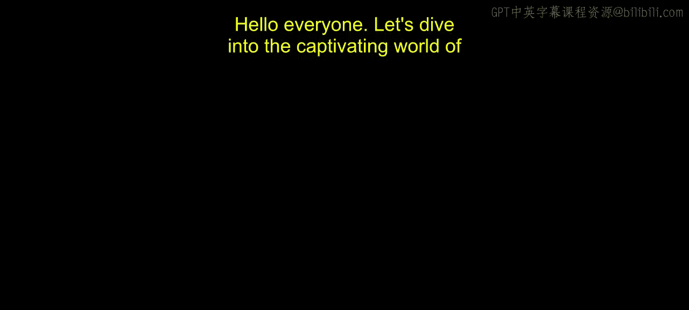
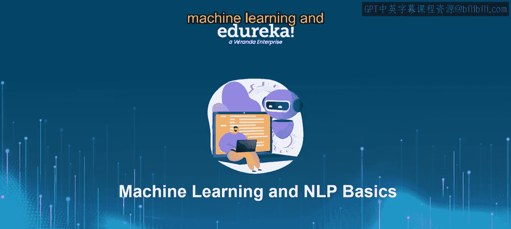
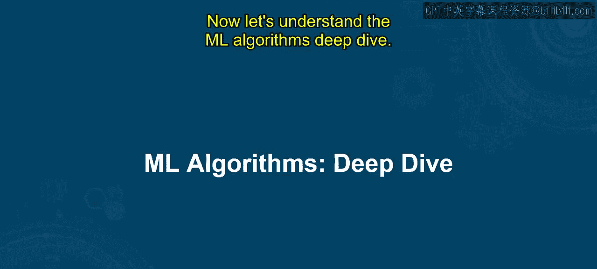
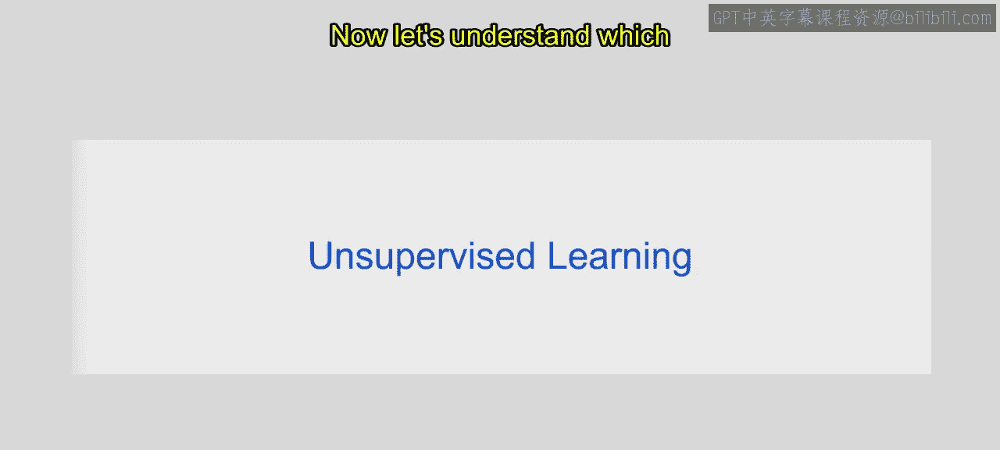
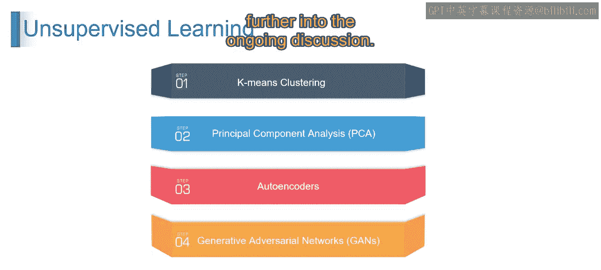

# Edureka《通过LLMs学习生成式人工智能（机器学习和NLP基础，第1课／共4课）｜Learn Generative AI with LLMs》中英字幕 - P12：11_机器学习算法深入探讨.zh_en - GPT中英字幕课程资源 - BV1q4421Q7qh

Hello， everyone。 let's dive into the captivating world of machine learning and the foundational concepts of NLP together。

 So now let's understand the Eml algorithms Deep dive in this。 we are going to understand。😊。

The different ML algorithms， supervised learning， unsupervised learning。

 semiupervised learning and reinforcement learning By the end of this session you are able to understand how to select and apply machine learning algorithms effectively and adapt the principles and applications of both learning paradigm efficiently and capable of implementing and optimizing reinforcement learning algorithms so let's get started understanding the machine learning algorithm So building on our understanding of ML foundation in the previous session let's explore how ML operates by training algorithms to recognize the patterns from the data enabling autonomous decision making so ML algorithms are like the brain behind the ML and AI teaching computers to learn from the data and use。

😊，UseThat knowledge to make the decisions。Here we are having total four different types。

 supervised learning， unsupervised learning， semiupervised learning and reinforcement learning。

 So let's understand all these different types and how do they work The first one is going to be a supervised learning Imagine you are teaching a child to recognize the animals。

 you show them some pictures of different animals along with their names。

 helping them learn which animal is which For instance。

 you show a picture of dog and say this is a dog and similarly。

 you show a picture of cat and you can say this is a cat。

 you repeat this process with several examples of dogs。

 cats and other animals means supervised learning in machine learning works exactly in a similar way。

 you have a data set where each example is paired with label or outcome you want the algorithm to predict just like。

Teaching the child with labeled pictures， the algorithm learns from those labeled examples to understand the relationship better the input data and the corresponding output labels。

Means in simple terms， supervised learning involves training an algorithm on the labeled data to make predictions or the decisions based on input features just like teaching a child to recognize animals by showing labeled pictures as mentioned in the earlier module regarding different modules these all of the list of models comes under the supervised learning The first one is of linear regression which will predict the outcomes using a straight line based on input feature and coming to the logistic regression it predicts binary outcomes using a logistic curve based on the input feature then decision trees it makes the decisions by splitting the data into branches based on the features than the random forest it is an ensemble of decision trees for more accurate predictions than the support vector mission。

It finds best hyperplane to separate the data into the classes and then the neural networks it will mimic human brains to learn complex patterns for predictions so these all are the different supervised learning techniques so the next one is unsupervised learning unsupervised learning is a type of machine learning where algorithms are trained on the input data without explicit supervision or the name aiming to find the patterns or the structures within the data so now let's understand which all algorithms comes into the unsupervised learning the first one is of k means clustering。

😊。

Imagine you have a basket of fluids with the different shapes and colors。

 So K means clustering is like sorting these fluids into groups based on their similarities in shape and color without knowing the categories beforehand means K means clustering is an unsupervised learning algorithm that partitions the data into K clusters based on the nearest mean aiming to minimize the within cluster variance then the next one is of PC that is also known as principal corporate analysis think of a high resolution photo that you want to reduce in size while preserving its important features PC is like finding the main direction of variation in the photo and representing it with fair dimensions while retaining its essence technically PC E and。

😊，Supervised dimensionality reduction technique that identifies the orthogonal access。

 Those are known as principal components along which the data varies the most allowing further reduction of the data dimensionality while preserving most of its variability。

 so that's about PC so the upcoming video will delve further into the ongoing discussion。

