# Edureka《通过LLMs学习生成式AI（基础、应用开发、流行工具，第2、3、4课／共4课）｜Learn Generative AI with LLMs》中英 - P130：23_Midjourney版本解释第1部分.zh_en - GPT中英字幕课程资源 - BV1ym421V7gx

Welcome to the immersive journey into the world of generative AI applications and popular tools so as I'm already having the account with a subscription I'm simply signing into the account here it will ask you to enter the email or phone number and also you need to enter the password and click on the login option。

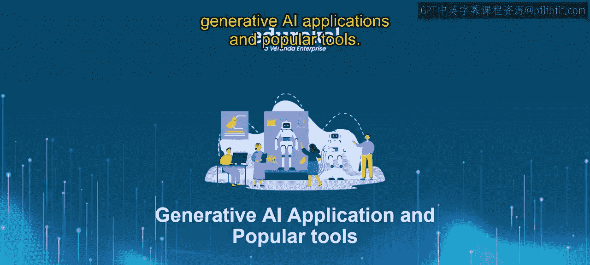

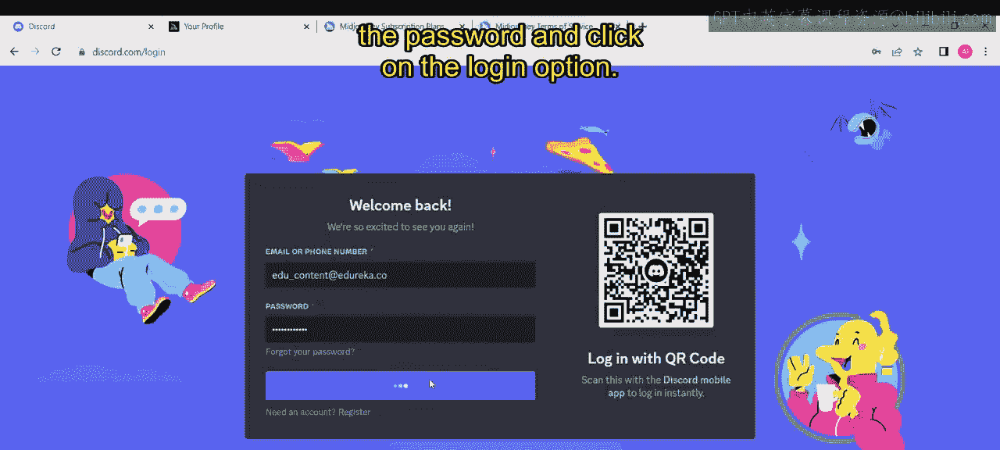

Now it will navigate you to the midjoney interface。

 first click on Exp discoverable servers and it will navigate you to this page where it shows home gaming music education science and technology and entertainment and students home So if you can see these all of the featured communities here we are having。

 So click on the midjoney it will navigate you to the midjoney interface page And here you can see follow to get this channels update in your own server means here even you can create your own server as well。

 let's see how to do that。 So let's understand how to create our own midjoney Discord server over here here in the lefthandet panel。

 click on the plus symbol。😊。

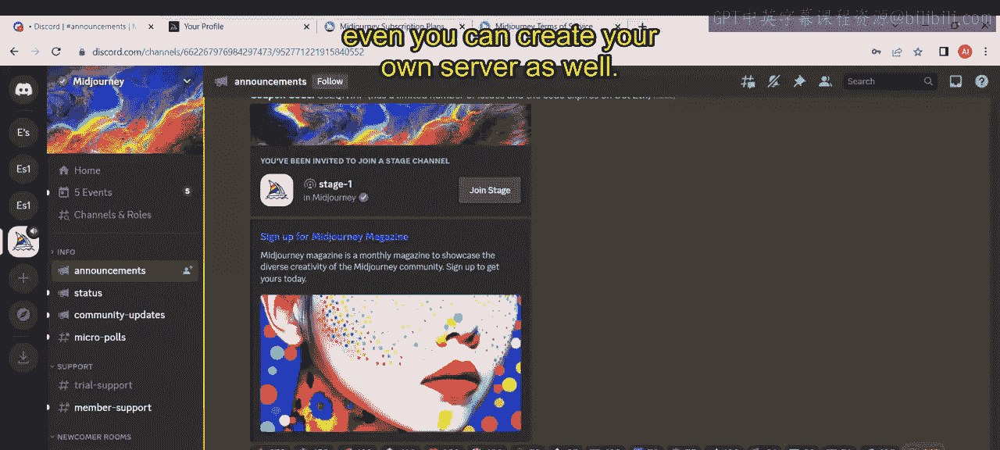

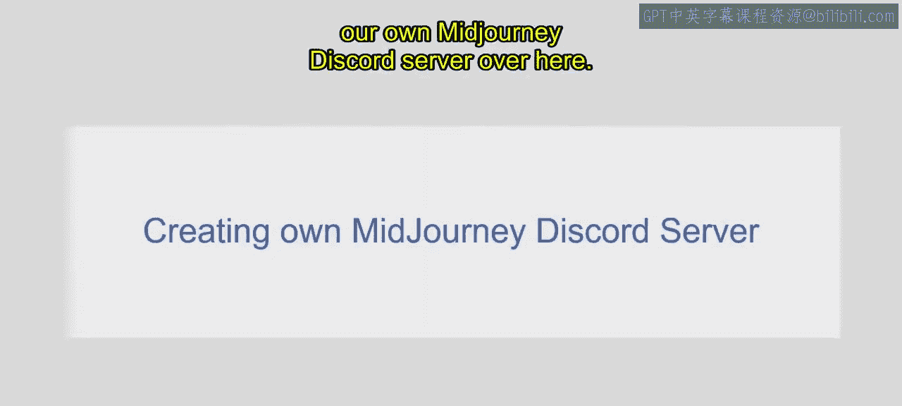

It can show you add a server。 Click on it。😊。

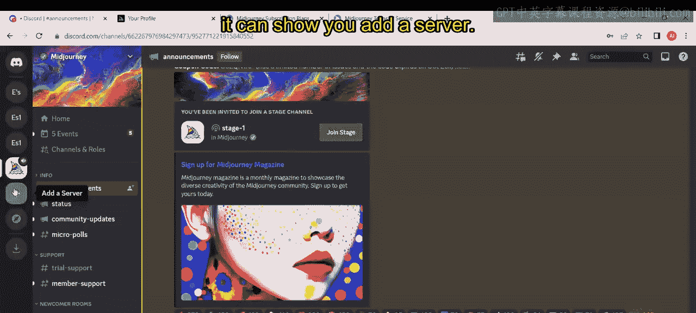

And also， it is giving you。😊，Multiple option， create own and also gaming school and also study group right now I am clicking on create my own account。

 And for me and my friends or for a club or community。

 click on for me and my friends and you can edit the server name and also even upload a picture as well right at this moment I am just editing my server name as。

😊，Eduras。Midjoney and click on the C。

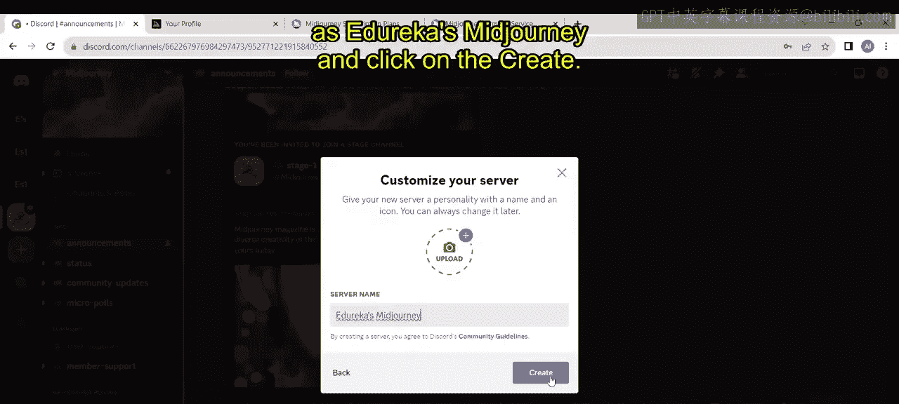

So now you can see Edureurekas mid journey， this is a server created by me now click on mid journey。

😊。

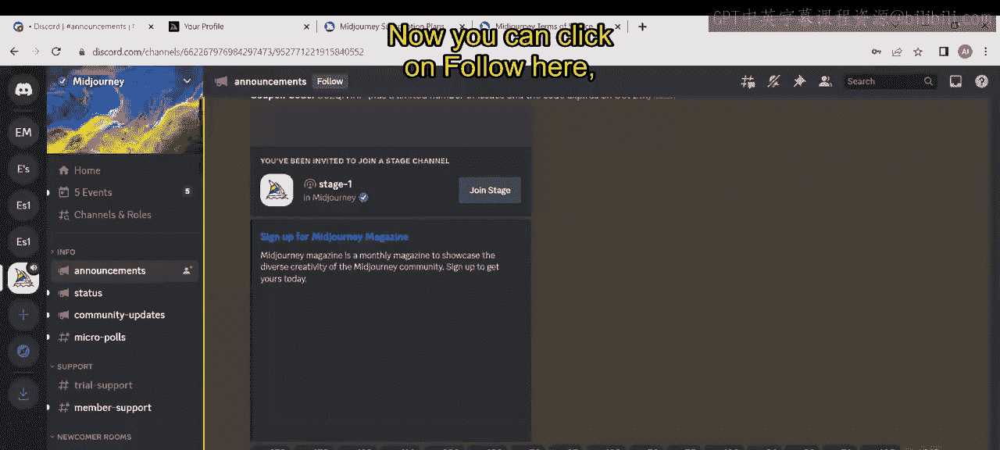

Now you can click on follow here， follow to get this channels update in your own server because now I have created my own Discord server I want to add over here click on follow and it will ask you to add this channel's update to your server and send to here if you can click on the dropdown button you can see that servers which all are created by you so these all are the servers right now I'm having I am adding the latest server Ed midjo and also click on the follow。

No， it's done。And you can click on the got it。

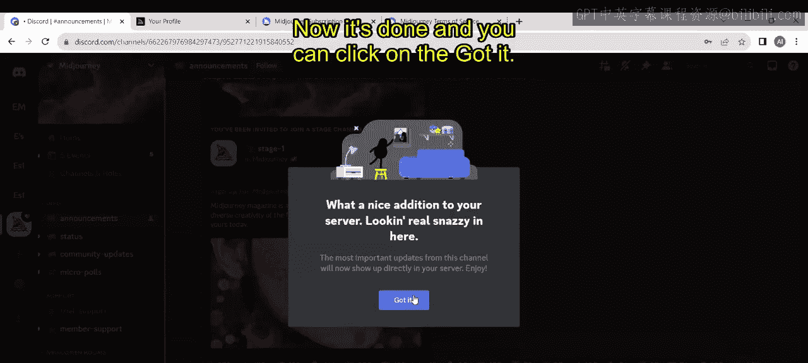

Now click on the midjoney chatboard again。😊，And now you can search for the newbie room where you can add your own prompt and generate the images here in the left hand side panel。

 you can see newcomer rooms available over here， click on this。😊。

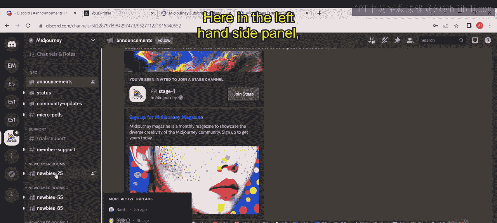

It will navigate you to this page here you can see multiple users are creating the different images and you can even create your own image as well so as I told you by default mid journeyourney will use the latest version let's see how it is going to happen and remember one more thing mid journeyourney will create four different images at a go now let's understand how this happens first let's understand。

😊，What is the version that we are using and how to create the image。

 So if you want to create the image， it is very simple， enter。

Forward slash and also you can simply say imagine and also you can create a prompt。😊，Here。

 if you can click on this， it will ask you to enter a prompt over here。

 I am giving some simple prompt。 I am simply saying crystallized。😊。

Desert oasis and click on enter so you can see that here I am using the version one。

 but if you are using it for the first time by default you will be able to see the latest version prior understanding that once if the image generates I will show you why it is coming for the V1 as because I have selected V1 version one so it is still waiting to start let's wait for some time and by the way this is not the one which I have created it is some other users who are creating it and you can see it started0%。

😊。

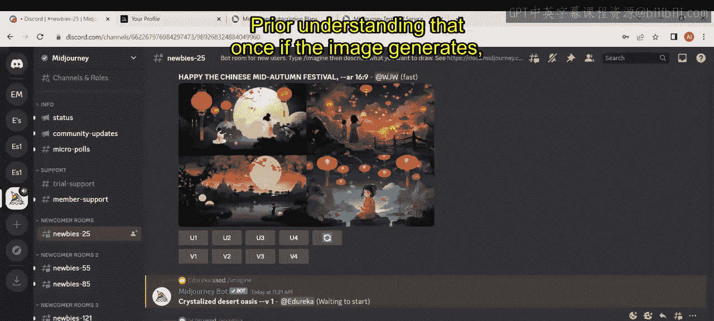

And it is still loading 6%， 20%。26%。For as 6%。

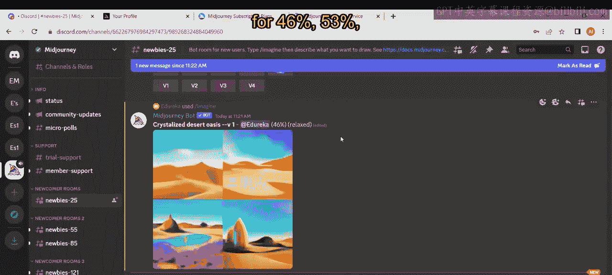

53% and 66%。73%。And here you go you can see four different images for our work crystallized dessert oasis prompt you can click on it and also you can open in the browser click on it and go here and you can see this you can even zoom it and you can see the different four images as I mentioned so this image is generated based on the version one the next part of this video will be elaborated on in the upcoming video。

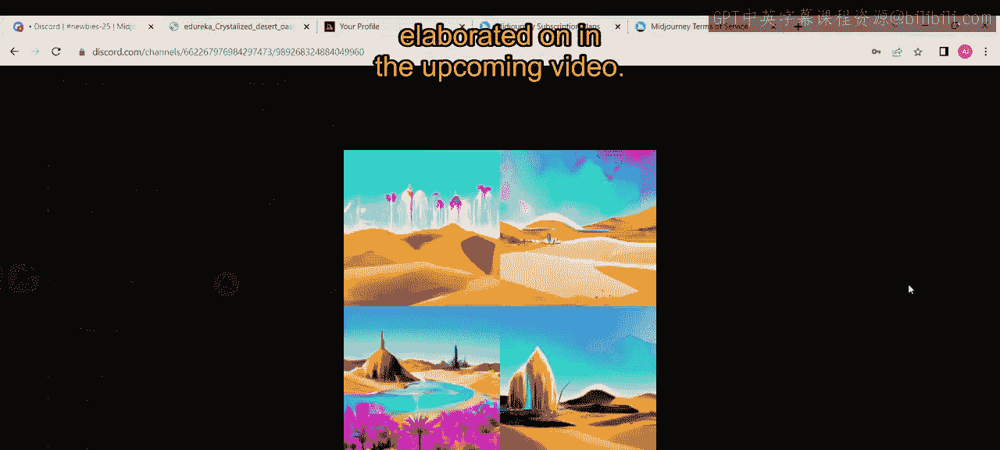