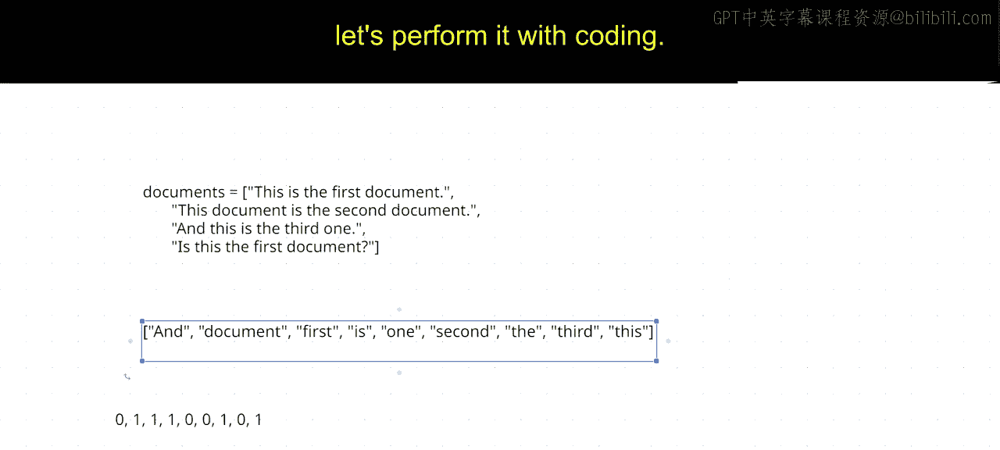
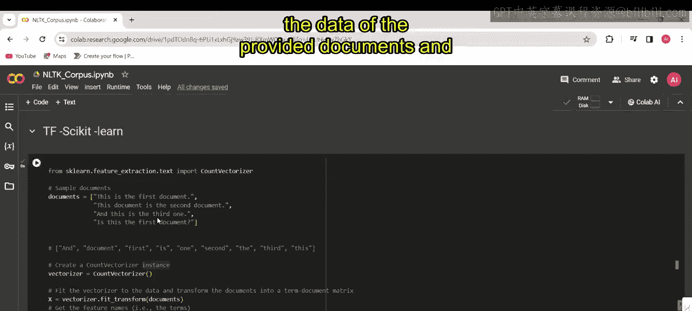
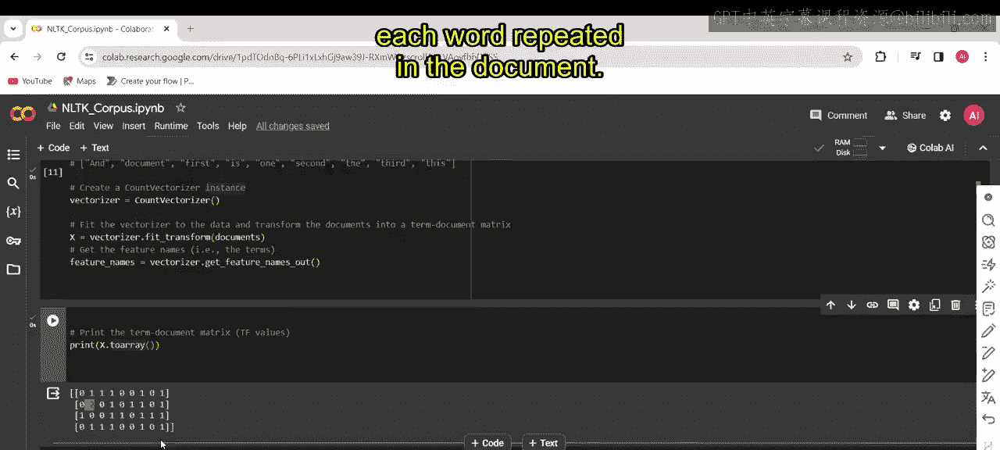
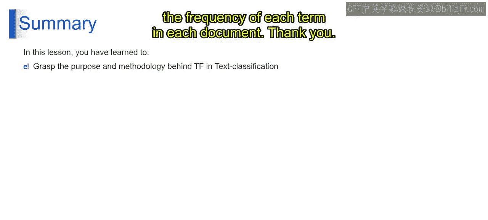

# Edureka《通过LLMs学习生成式人工智能（机器学习和NLP基础，第1课／共4课）｜Learn Generative AI with LLMs》中英字幕 - P131：130_词频演示II.zh_en - GPT中英字幕课程资源 - BV1q4421Q7qh

So let's now explore the progression from our previous discussion let's say for example we have a list of documents telling that this is the first document and this document is the second document and this is the third one and is this the first document now let's say if we wanted to get the vocabulary for this how can we do that we will have to choose the unique words present in all document right so what would be the vocabulary for this in that situation it is going to be this here the unique words for the provided document is and document first is one second the third and this so now let's say if we want to perform counting occurrences how can we do that we will compare the document with the provided vocabulary right。

😊，So let's write the vector representation for the first document。 It is going to be first。

 It is present in the first。 the first word is end go and check if we are having end here So in this case we are not having n so the representation is going to be0 and next one is document yes。

 we are having then keep it as one and then first yes。

 we are having it so make it as one and then is yes。

 we are having is also and then one no it is not there then second it is also not there and the yes。

 we are having and third0 and this yes， we are having it means vector representation of the document1 is going to be0 triple10 triple1 double0101 similarly for the remaining document。

It is going to be like this。😡，Means row1 represents the first document here and row represents the second document and row3 represents the third document and row4 represents the fourth document columns corresponds to the words in the vocabulary we provided the vector representation each value in the metrics represents how many times the word corresponding to that column appears in the document corresponding to that row so based on this understanding let's perform it with coding here I am having a code I consider the same one the vocabulary for this is going to be the end document first is one second the third this so let's execute it and now let's check what is the term document matrix for this。

😊。

Can you all say this？😊，We are getting the same and this is our understanding so lets do it by providing the feature underscore names you will get that also can you see this the same when whatever we represented here means what exactly this code is doing initially first of all we are importing the count vectorizer class from the Scal and feature extraction dot text module then we are defining a list of documents containing for samples documents those are represented here and then we are instantiating the count vectorizer we are creating an instance of count vectorizer named vectorizer and then fit and transform use the fit underscore transform method of count vectorizer to fit the vectorizer to the data of the provided documents and transform the documents into。

😊。

Term document matrix X。Now here we are converting this spa matrix x to a array using the two array method and printing it。

 This matrix represents the term frequency of each term in each document and then we are printing the feature names obtained from the vectorizer means we are providing how many times the vocabulary value repeated in the provided sentence or document in the first time if you can see the words are hardly repeated ones and in the second you can see one word is repeated two times。

 likewise you need to understand means this code utilizes the count vectorizer that is what we performed in the other session which convert the text data into the term document matrix where each row represents a document each column represents a term and。

😊，The values represents the frequency of each term in each document that is where here we are getting the term frequency of the provided document。

 nothing but how many times each word repeated in the document。😊。

So this is the same code that we have seen and now the summary in this lesson we have delved into term frequency in text classification。

 we comprehend its significance and its practical application using the count vectorizer in psyit learn which aids in transforming text data into numerical format by generating a term document metrics representing the frequency of each term in each document thank you。

😊。

