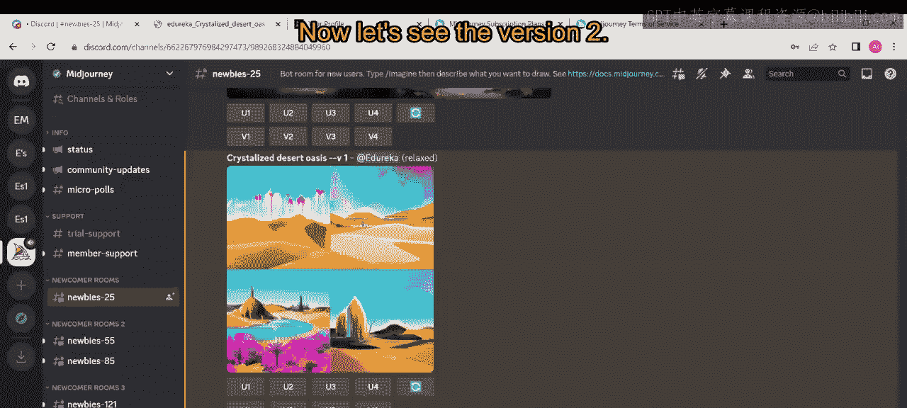
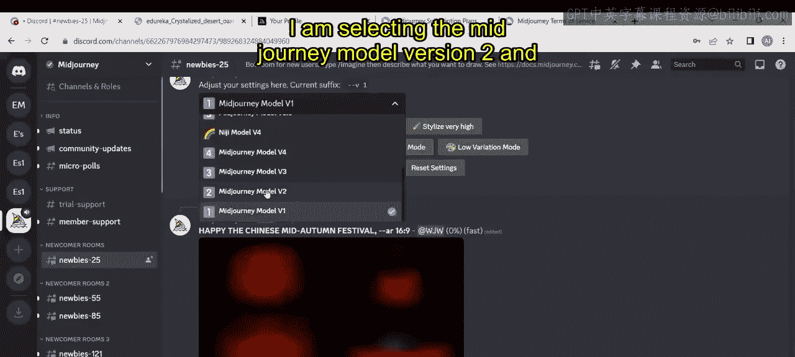
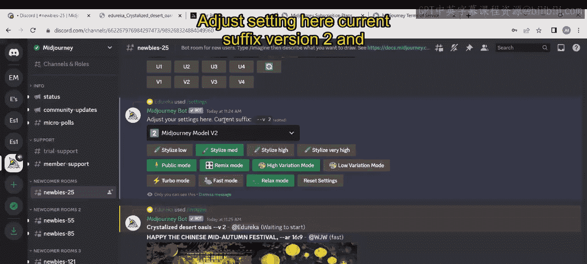
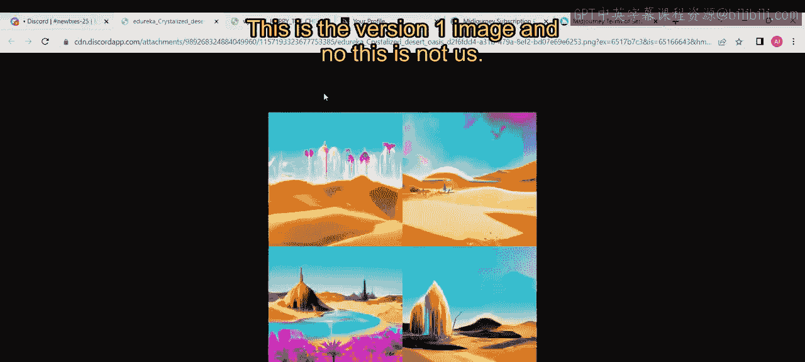
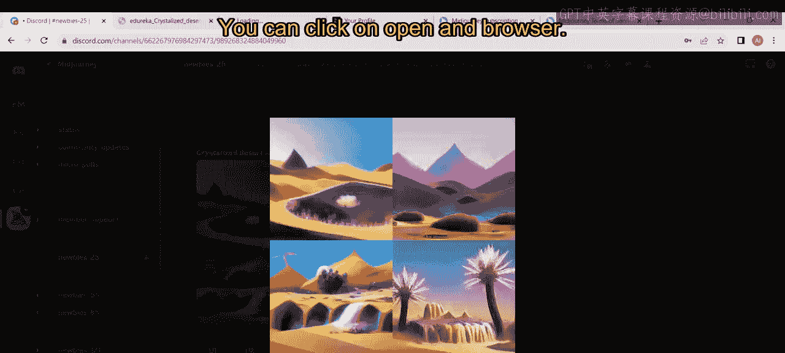
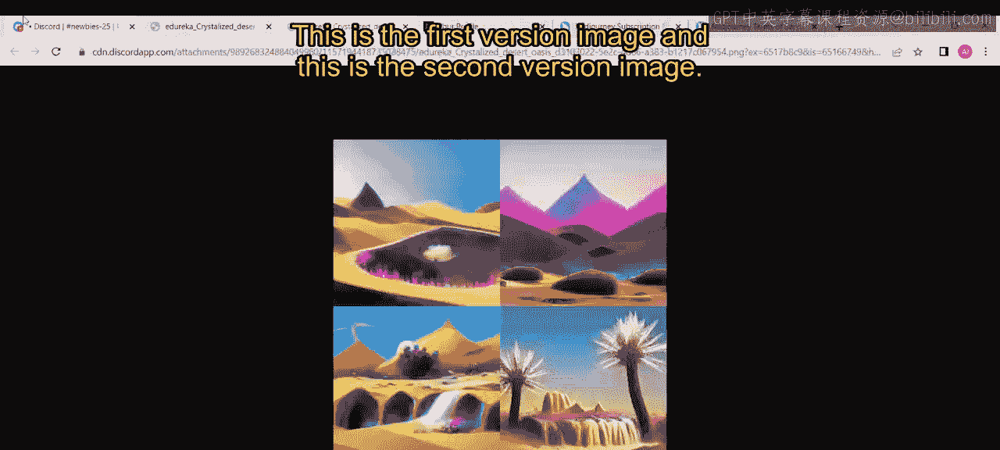

# Edureka《通过LLMs学习生成式AI（基础、应用开发、流行工具，第2、3、4课／共4课）｜Learn Generative AI with LLMs》中英 - P131：24_Midjourney版本解释第2部分.zh_en - GPT中英字幕课程资源 - BV1ym421V7gx

So let's now explore the progression from our previous discussion。

 so if you want to change the version， so go here， I just wanted to show you how the improvements happened based on the individual versions as because mid journeyney is keep on updating its version it is because to improve the image quality so the image right at this moment you are seeing is of the version one now let's see the version to if you want to change the version click on forward slash go to the settings and enter。

😊。

And you can select from this drop down。😊，Version 1， version 2， version 3。

 version 4 and also niy model and 5。0 and niy Wifi and also 5。1 and 5。2。 The latest version is 5。

2 So by default if you did not select anything by default， you will get the version5。

2 as because this is the latest one。 but I will show you the same image how we will get the same image with the version 2 I' am selecting the mid journey model version 2 and now I wants to provide the prompt Imagine and also I am giving the same prompt。

 which is nothing but the crystallized dessert oasis。

 Let's see how the image difference quality comes in with version 2。😊。

So in Bwin you can see multiple other users or also using them ajo you can see their images as well this is us are just setting here current suffix version two and you can see crystallized dessert oasis now the image is generated click on it and also you can open in browser。

😊。

Now we are something saying different。 This is the version one image and no this is not a story it is still waiting to start。

 it will take some time。 And when more option I can tell you if you wants to select this first image you can simply click on the U1 and you can click on the U2 for the second image and U3 for the first image and also u4 for the fourth image and here also you can see the navigation V1 v2 v3 V4 but if you do not like the what to say image and if you want to regenerate it again you can see the option called this And if you click on this it will start regenerating the image again it is still loading let's give a couple of more minutes。

😊。

Now it started generating。Yeah now it is done click on it and also you can see the difference you can become open and browser can you see the difference to the first one and also second version this is the first version image and this is a second version image the next part of this video will be elaborated on in the upcoming video。

