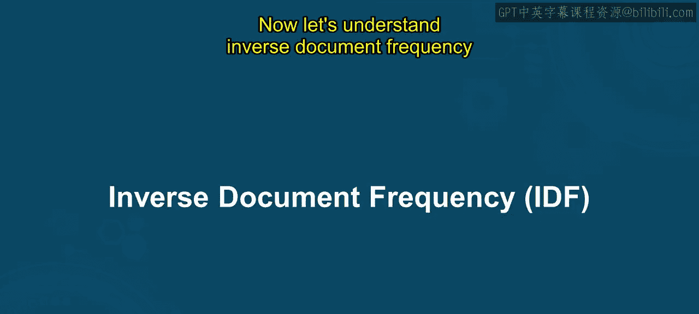
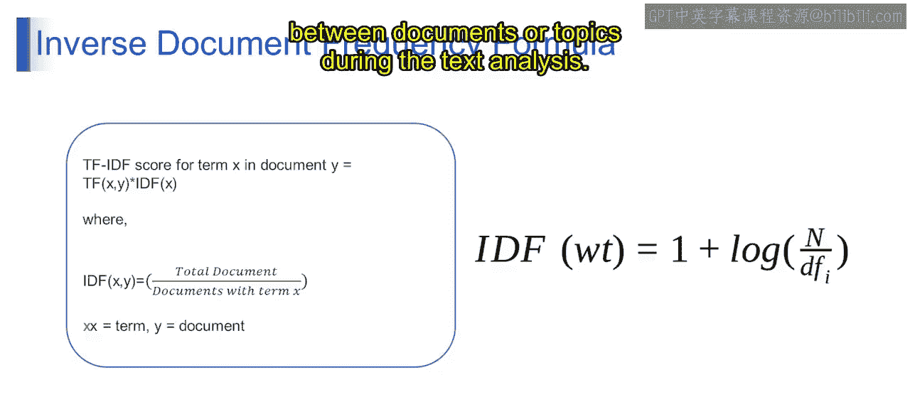
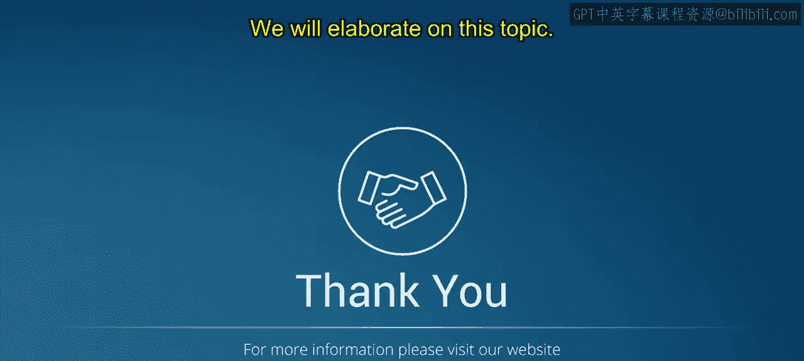

# Edureka《通过LLMs学习生成式人工智能（机器学习和NLP基础，第1课／共4课）｜Learn Generative AI with LLMs》中英字幕 - P132：131_逆文档频率（IDF）.zh_en - GPT中英字幕课程资源 - BV1q4421Q7qh

Hello， everyone， welcome back to machine learning and NlP basics。

 So now let's understand the next topic inverse document frequency。 So in the previous module。

 we identified what exactly a term frequency。 Now， let's understand inverse document frequency。

 That is If in this。 we are going to understand what exactly the inverse document frequency is all about。

 By the end of the session。 you are able to understand the concept and purpose of ideaf inverse document frequency in text classification。

 So let's get started。 So I will start explaining it with an easy example first。

 Imagine you are searching for information on a specific topic。 Let's say machine learning， okay。😊。

So imagine you are searching for information on a specific topic。

 say machine learning in a library filled with books on various subjects now think about two different scenarios。

😊，Funny common words。 And the other one is unique words。 Let's say， for example。Okay。

So now think about two scenarios， one is common words。

 other one is unique word in one scenario you find the term machine learning mentioned in almost every book along with the common words like the and or is while these common words are everywhere they don't tell you much about the specific topic you are interested in right now let's come to unique words in another scenario you find machine learning mentioned only in a few books but when it appears it is often accompanied by technical terms like neural networks algorithms or training data these terms provide valuable insights into subject matter and are more powerful are more useful for understanding the machine learning means in this particular situation。

😊，Inverse document frequency captures this exactly same idea。

 It assigns higher importance to the words that appear in fear documents across the entire collection。

 This means the terms unique to certain documents or topics receive higher idea of scores。

 making them more influential in distinguishing between different documents or topics。

 So based on this understanding。 Are you able to figure out what is the difference between the Tf and idea。

 Okay， let's say So Tf， when we were working with Tf。

 it was measuring the frequency of a term in a document。

 It's calculated by dividing the number of times。 a term appear in the document by total number of terms in that document。

 right when coming to the idea If measures， the importance of term across a collection of documents it。

Elicated by taking logarithm of total number of documents divided by total number of documents containing the term that is where the main difference comes in any which way we will understand it in a more brief way so let's understand the mathematical understanding here。

The formula to calculate the IDF is IDF is equal to1 plus log n divided by Dfi here n is the total number of documents in the carpus and Dfi is the document frequency of the term。

😊，Which represents the number of documents in the corpus that contain the term。😮。

So this ratio represents how common or rare the term is across the corpus if it appears in many documents that is going to be a high Dfi。

 this ratio will be smaller， indicating lower IF conversely if the term appears in only fewer documents that is going to be the low Dfi means this ratio will be larger。

 indicating higher IDF， when we are applying logarithmic to it。

 the natural logarithm of ratio serves to scale the ID values。

 taking the logarithm helps dampen the effect of very large ratios ensuring that ensuring that IDF values don't grow too large and now onepl log n divided by Dfi。

 adding one to the logarithm is a smoothing technique。

To avoid division by zero errors when a term appears in every document。

 this ensures that even common terms receive a nonzero idea of score means idea of assign。

 higher weights to the term that are rare across the CApus and lower weights to the term that are common terms that are unique to specific documents or topics receive higher idea of scores。

 making them more influential in distinguishing between documents or topics during the text analysis。

So stay tuned for the next video where we will elaborate on this topic。😊。

