# Edureka《通过LLMs学习生成式AI（基础、应用开发、流行工具，第2、3、4课／共4课）｜Learn Generative AI with LLMs》中英 - P132：25_Midjourney版本解释第3部分.zh_en - GPT中英字幕课程资源 - BV1ym421V7gx

So let's now explore the progression from our previous discussion now let's see the same image with the version3 now I am again giving the image I want to change the setting from version2 to version3 and clicking on the drop down and also enter the V3 and now enter imagine。

😊。

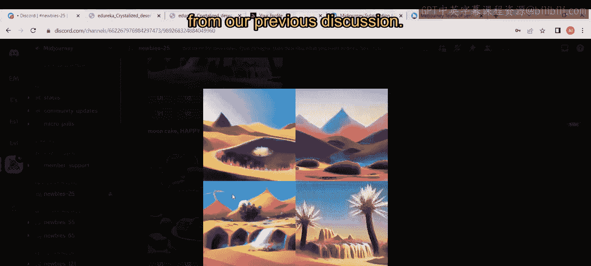

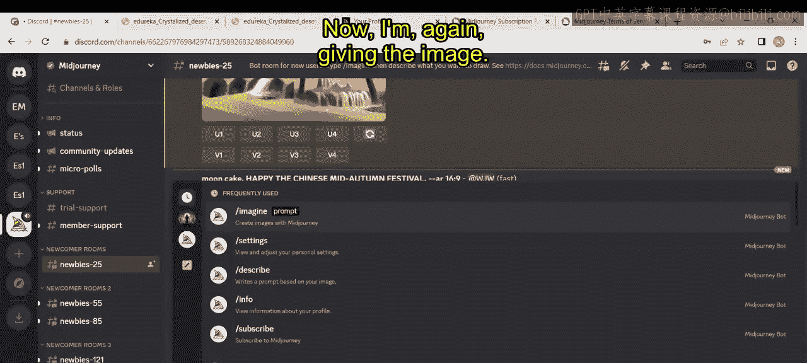

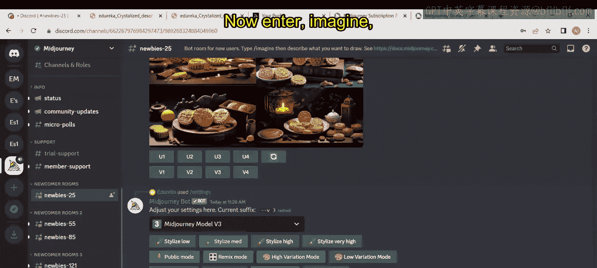

And provide the prompt， same prompt， and you on the enter。Again， it will take some time。

 let's wait for it to complete。😊。

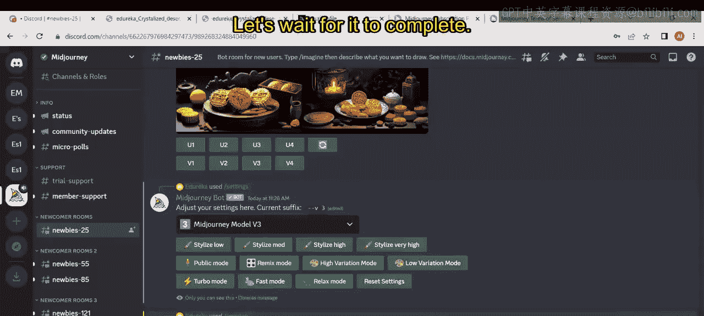

It is still loading， it started loading。

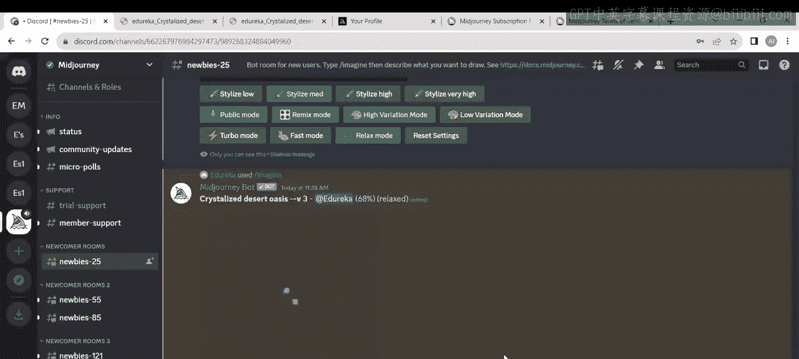

Yeah， now it is ready now click on this and also open it in a browser。😊。

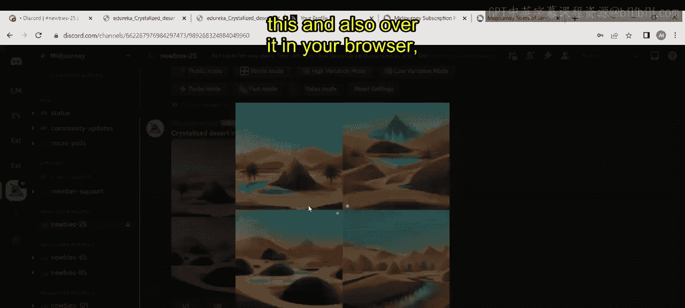

You can see the difference the four different images compared with version two and version one means the image quality is improved when compared to the previous version now let's get back here and now check for the next version and I'm again clicking on the settings。

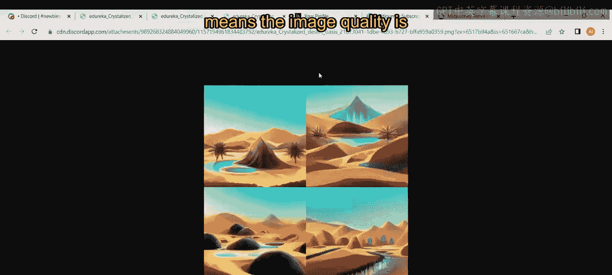

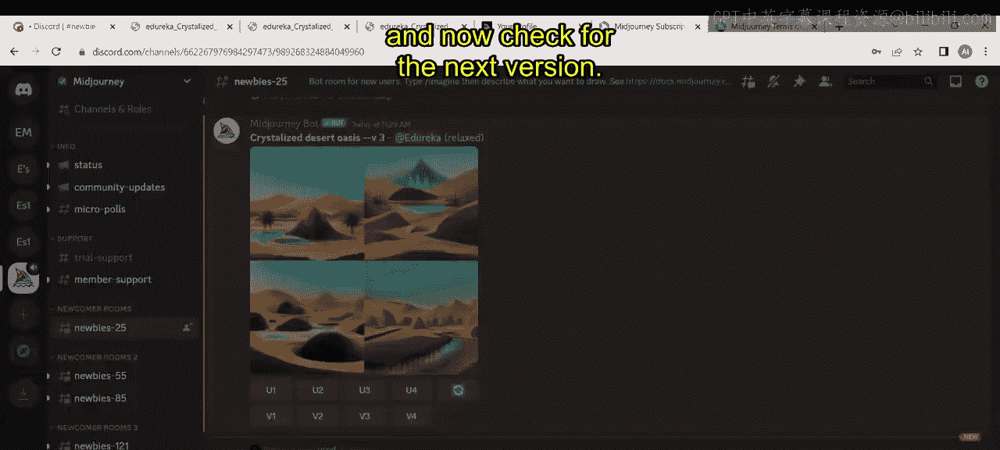

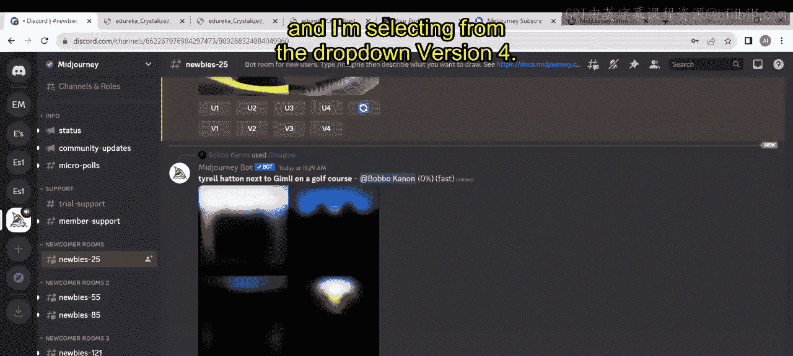

And I am selecting from the drop down。Version four and also I'm telling the same thing。

Imagine and also same So in the dropdown you might noticed some niy model right so what exactly it is So in the previous workaround we have seen Niy is an an specific AI image generation model in midjoney that has a vast knowledge of anime styles and also S It is combined with the midjoney in order to produce a great outcome offered so that's where they also included niy over here and the version for image is still loading。

 Yes， it is done you can see this open this and click on the open and browser now you can compare it。

😊。

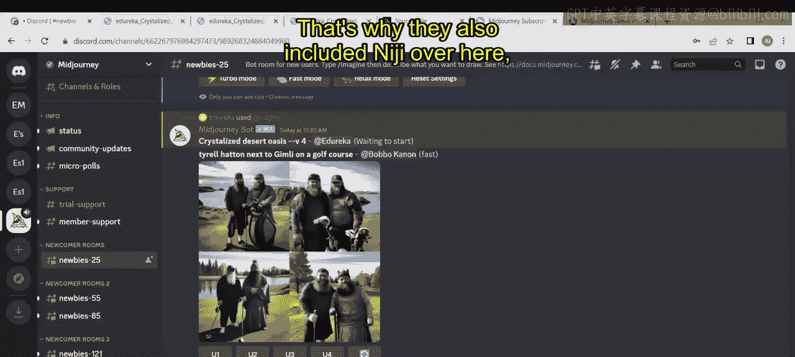

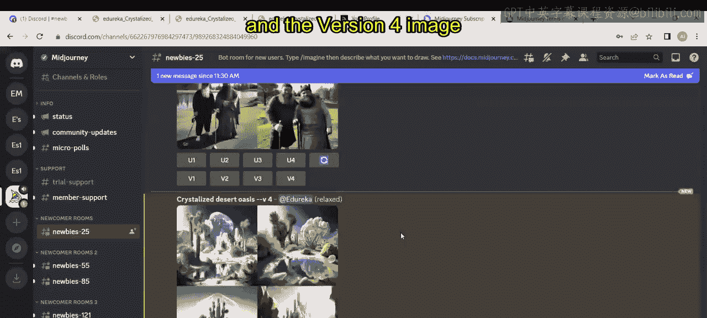

H now you can see the difference this is the first one this is a second version and third version and fourth version you can see a big change in between the third version and also fourth version right and also if you want to select the first image out of it go here and also you can even if you want to select the second image you can simply click on the you。

😊。

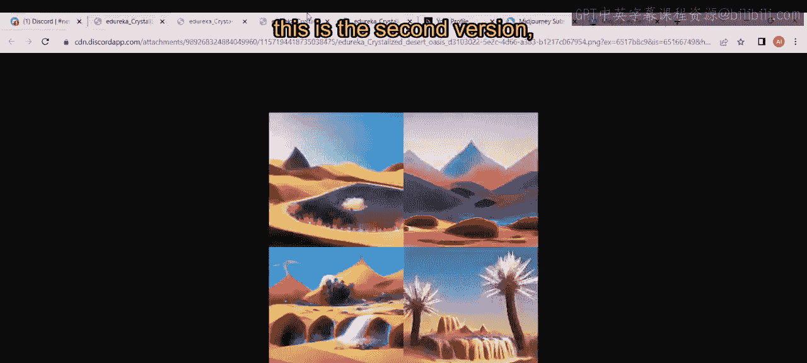

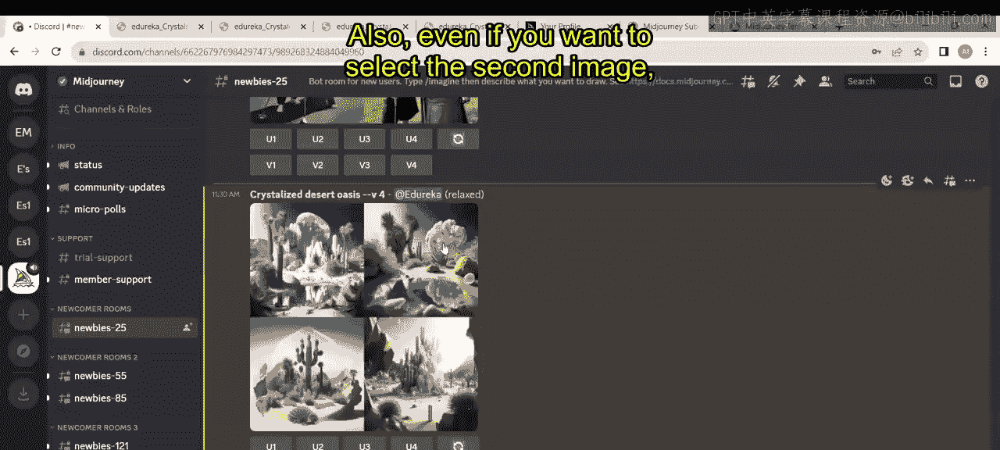

And it will start loading it and even if you want to zoom it。

 you can zoom it and also zoom out and can see the pictures individually directly this is about the version for。

😊。

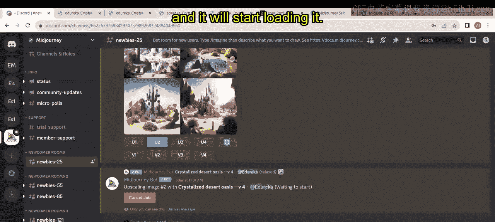

The next part of this video will be elaborated on in the upcoming video。

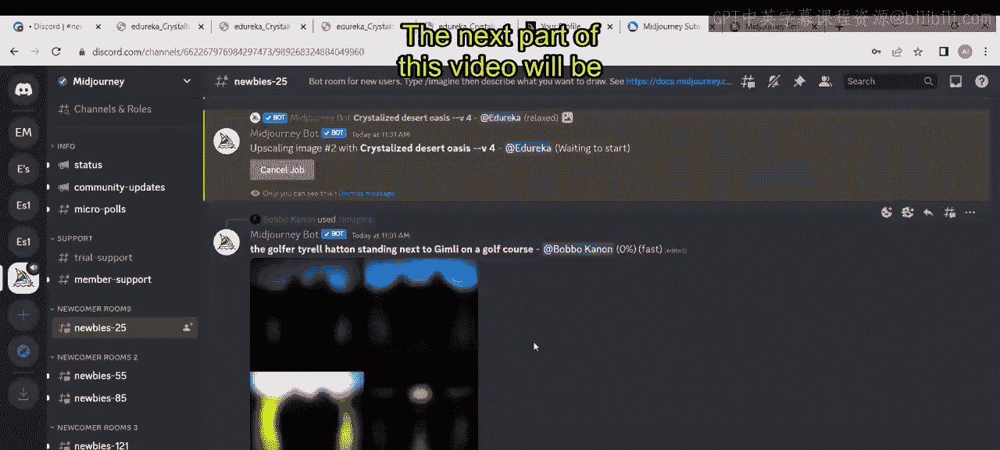