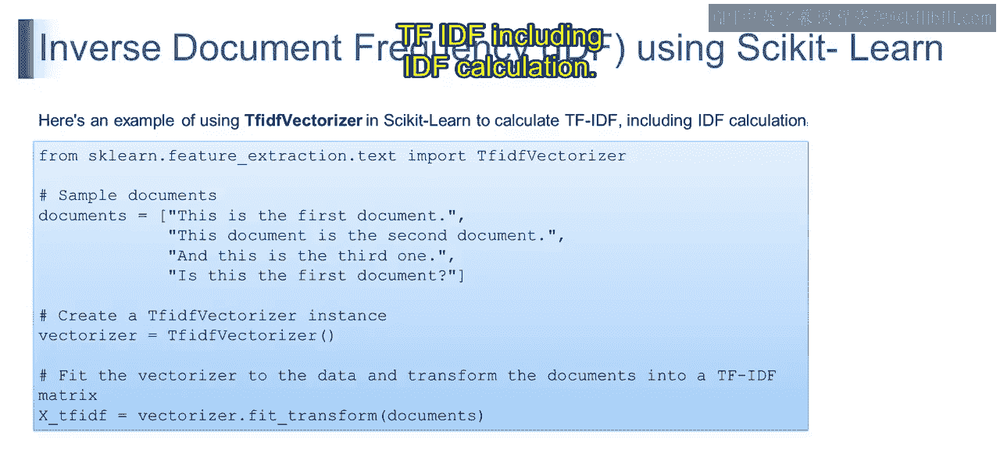
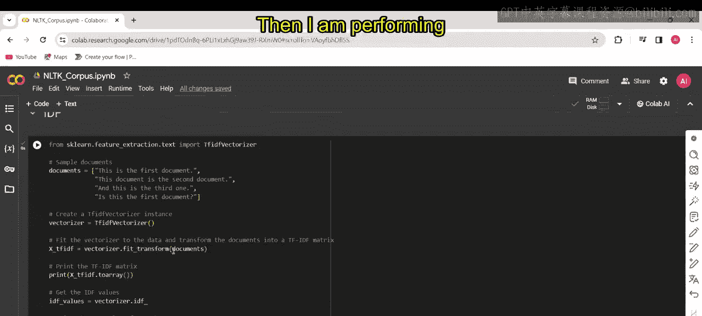
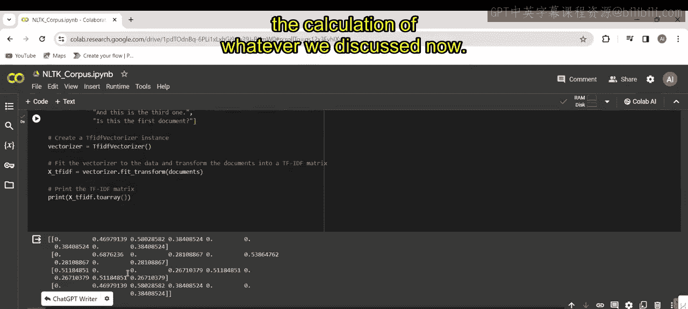
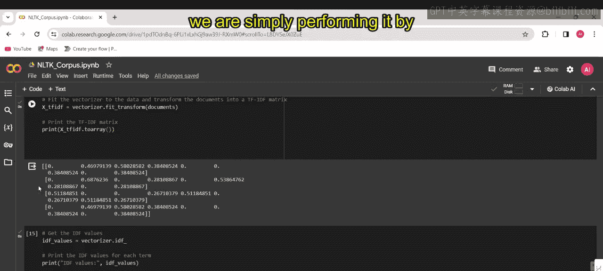
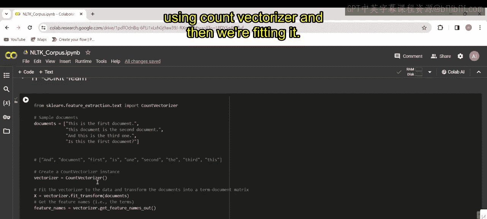
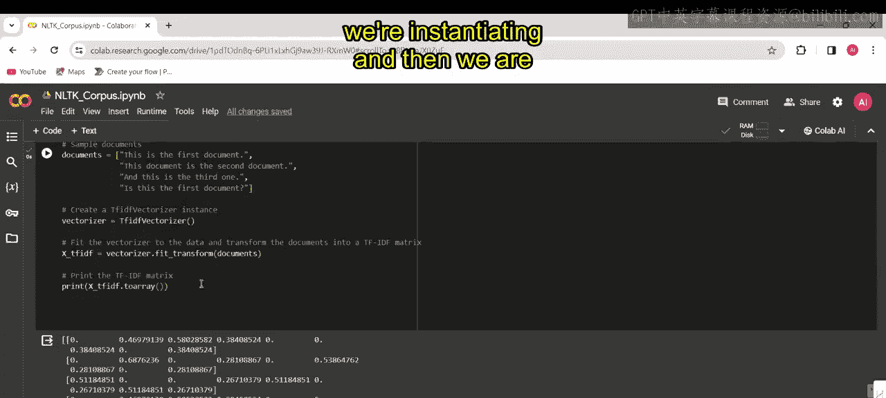
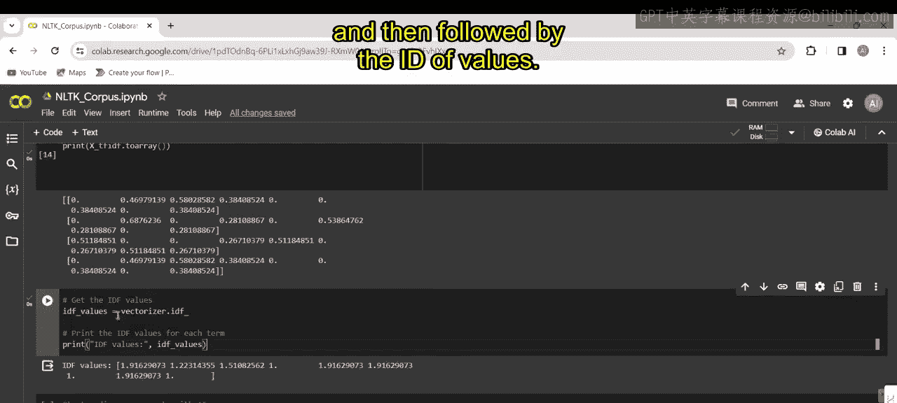
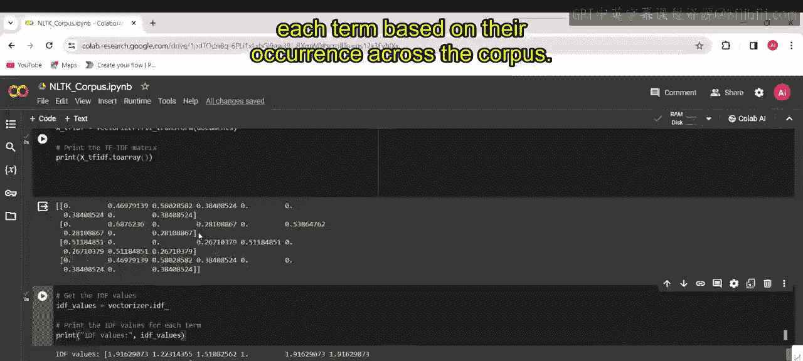
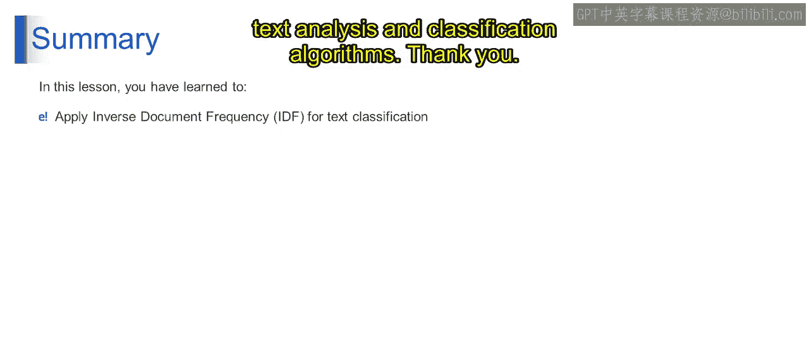

# Edureka《通过LLMs学习生成式人工智能（机器学习和NLP基础，第1课／共4课）｜Learn Generative AI with LLMs》中英字幕 - P133：132_逆文档频率（IDF）示例.zh_en - GPT中英字幕课程资源 - BV1q4421Q7qh

So let's now explore the progression from our previous discussion。

 So now let's understand it with an example to calculate the idea for each term in the given sentence。

 we need to first determine the document frequency for each term which is the number of documents containing the term and then we can use the formula of whatever we discussed that is one plus log n divided by Dfi。

 So let's see where n is the total number of documents in the carp and Df is the document frequency of the term nothing but number of documents containing the term So let's calculate the idea for each term in the sentence。

 the car is driven on the road。 that is sentence A and the truck is driven on the highway。

 that is sentence B here total number of documents is equal to2 means n is equal to2。😊。

Right， as because we are having two sentences now the document frequency。

 nothing but D for each term now go and check how many times the is appearing in this particular sentence the car is driven on the road means D for this is going to be。

😊，Df for this is going to be two for the for the term the and similarly car how many times car is present here。

 only one So for car the Df is going to be the one and now the truck go and check how many times the truck is present in both the documents it is only one then is it appears two times in both the sentences So that's the reason it is2 and driven here we are having it for two times again it is going Df is going to be the two here the representation is nothing but log off and divided by Df。

 So that's the reason we are considering it as and and then it is going to be the Df Similarlyly apply for all the words whatever we have given like you know on it appears two times and wrote it appears only in sentence。

a that is going to be the one like this you will and then highway it is also appeared one only in the sentence B like this you need to calculate the Tf Now we can plug these values into the IDF formula。

 What is a formula one place log n divided by Df means n divided by2 one place2 divided by 2 Okay so now let's understand it with the practical coding standard so that it would be easy to understand here we are having the coding here is an example using Tf IDF vectorizer in psychit learn to calculate Tf IDF including IDF calculation。

😊。

So here again I am considering the same documents， I am instantiating the TF ID vectorizer and then I am performing fit transform to the provided documents。

 so first of all let's print the array so this is going to be the values of TF ID because we are performing the calculation of whatever we discussed now so now I am going to print it。

😊。

So whatever with the mathematical formula we are substituting in Tf idea of there。

 we are simply performing it by providing Tf idea of vectorizer when we were performing the Tf。

 we were just providing or using vectorize count vectorizer and then we are fitting it but when we are performing Tf idea of vectorizer we are instantating and then we are performing this into the provided documents and then you can see the output this is going to be the final output value and then followed by the idea of values if you can provide vectorizer dot idea without Tf idea it will access the idea of values Cal by the vectorizer using the idea of attribute these idea of values represent the importance of each term in the corpus and then print the value for each term this provides。

😊。

s intoto the importance of each term based on their occurrence across the corpus。

 so here is the same code we have provided。 So now the summary in this lesson we identified and drawn the insights into in this lesson we have gained insights into how inverse document frequency enhances text classification by quantifying the significance of term across the documents by applying idea we identified and prioritize the term terms that are unique to specific documents thereby improving the effectiveness of text analysis and classification algorithms Thank you。

😊。

