# Edureka《通过LLMs学习生成式AI（基础、应用开发、流行工具，第2、3、4课／共4课）｜Learn Generative AI with LLMs》中英 - P133：26_Midjourney版本解释第4部分.zh_en - GPT中英字幕课程资源 - BV1ym421V7gx

So let's now explore the progression from our previous discussion and now if you want to see the version4。

 you can simply say settings again and click on enter and select the。😊。

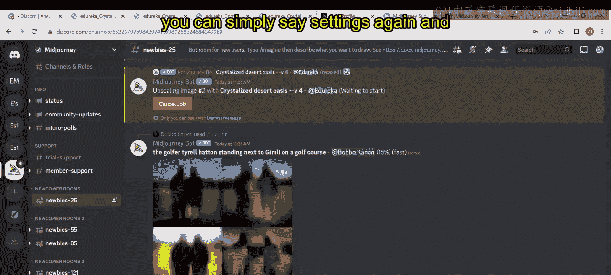

Nizzy model4 lets see how it is going to work and can say imagine and also can say crystallized dessert oasis now we change the model to niy and let's see how it is going to create。

😊。

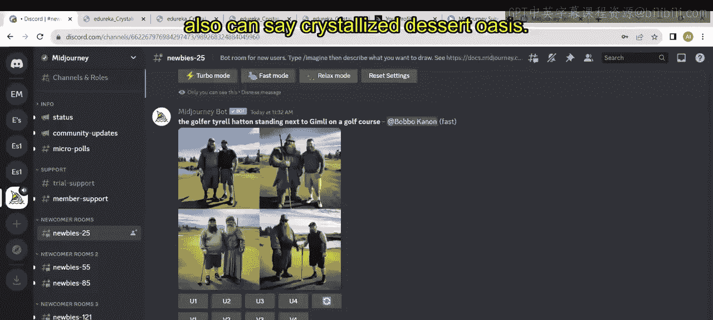

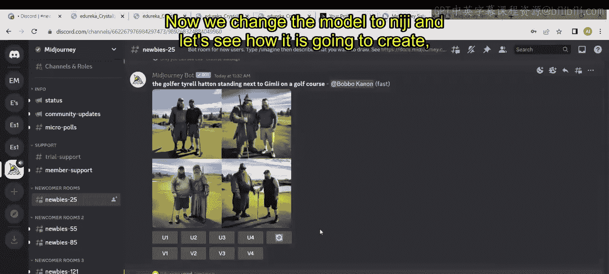

It will take some time and it will load the image。

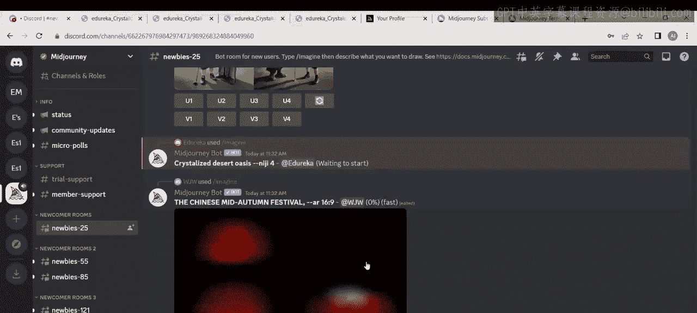

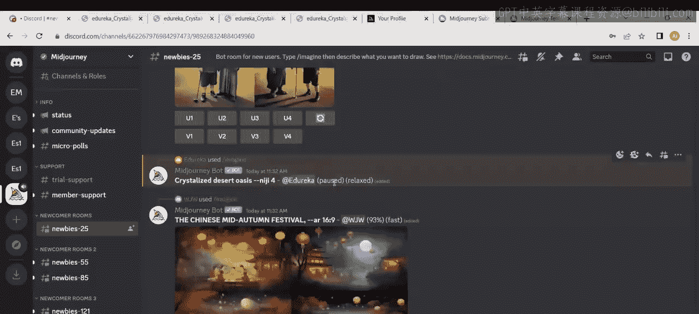

Now， let's select the other version。With journeyney version 5。1。And now， say。

Magine and also provide the prompt。

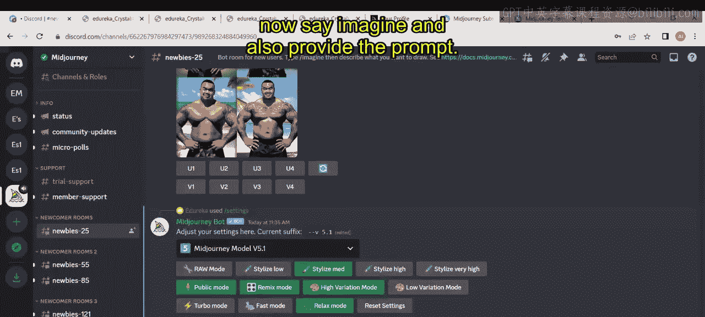

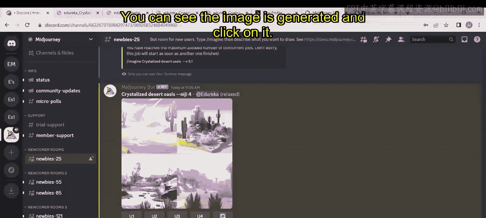

You can see the image is generated。😊，And click on it。

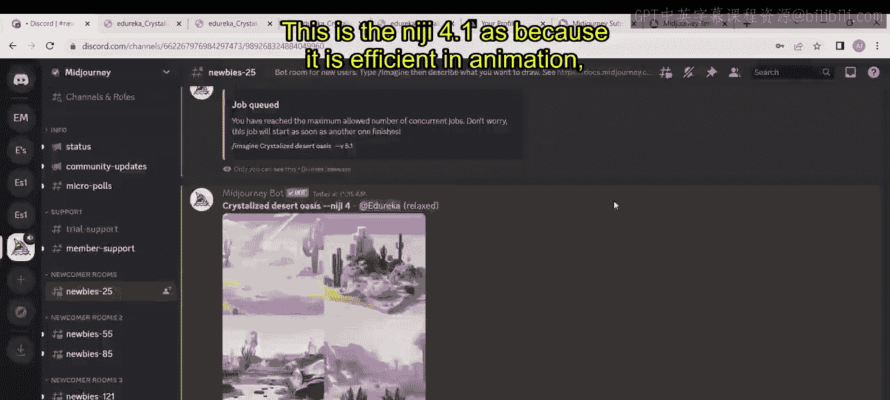

This is the easy4 one。As because it is efficient in animation it is showing the animated kind of things you can see the difference over here now go back here。

😊。

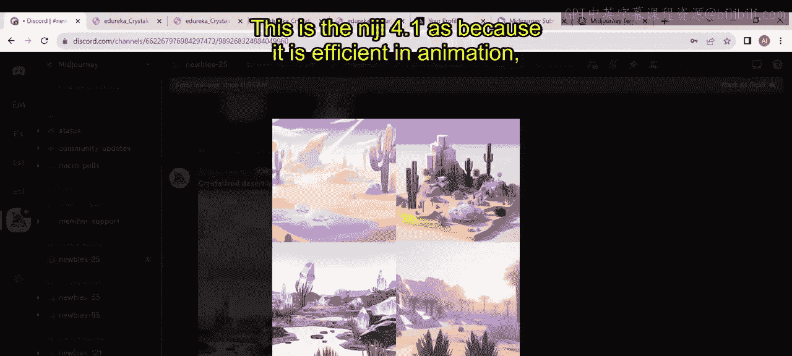

And wait for the version for to get generated。

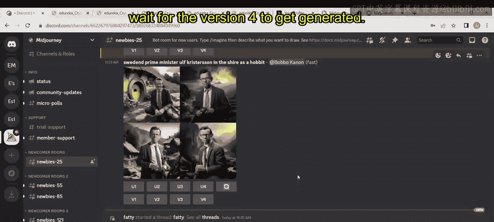

Yep， it is done。

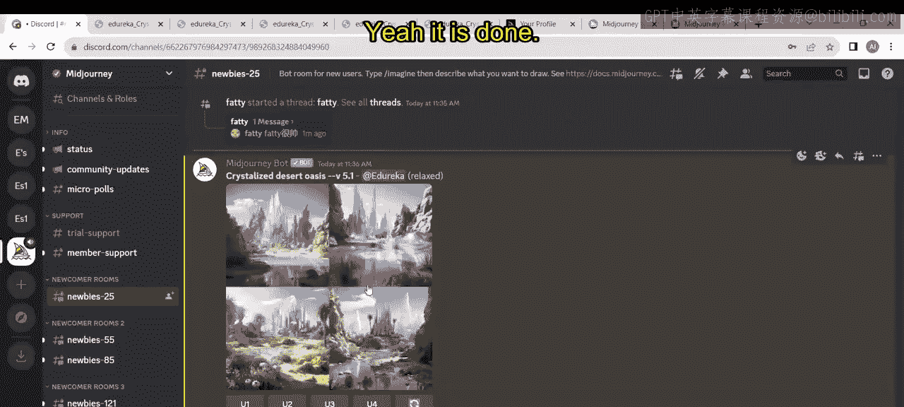

You can see this is a version 5。1 and open in browser and can see the difference， the image quality。

 you can see the difference here。😊，And now let's try with the latest version。😊，Stittings。

And you can select。Ladies version。With journey 5。2 or even if you can select this。

 this is the default mode and you can simply say imagine and also say provide the same prompt if you can enter。

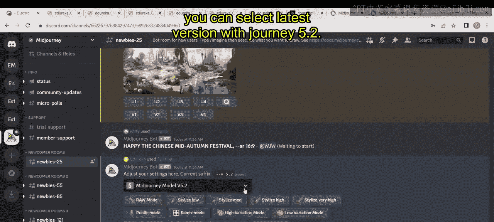

It will start generating the images by using the version file。

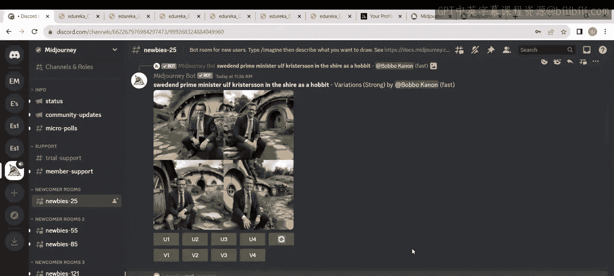

谢育果。And this is for the latest version you can see the difference here。

 This is a version1 version 2 and version 3 and version 4 and this is N version which is animated one and also the next 5。

1 and 5。2 you can see the difference in the quality of the images even after zooming also how it is coming and as we mentioned with journey is still under the development we are expecting the updates into it as because 5。

2 version is the latest version we can see all the different images like this as I mentioned if you want to see the particular image or if you want to select one particular image you can simply go and click on the U4 if you did not like the image you can simply click on over here it will again regenerate the image I'm clicking on it。

😊。

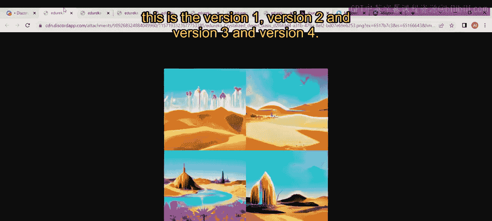

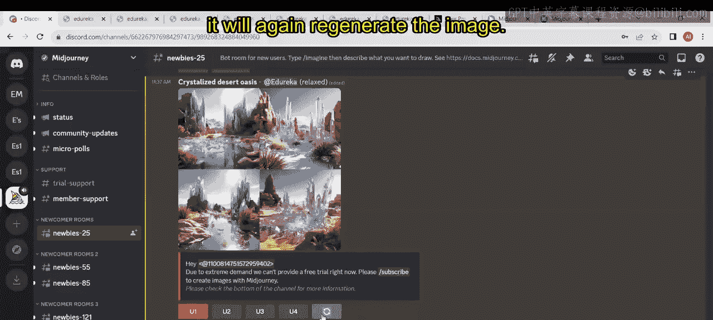

And it is telling prompt and also I am giving the same prompt and clicking on a submit。😊。

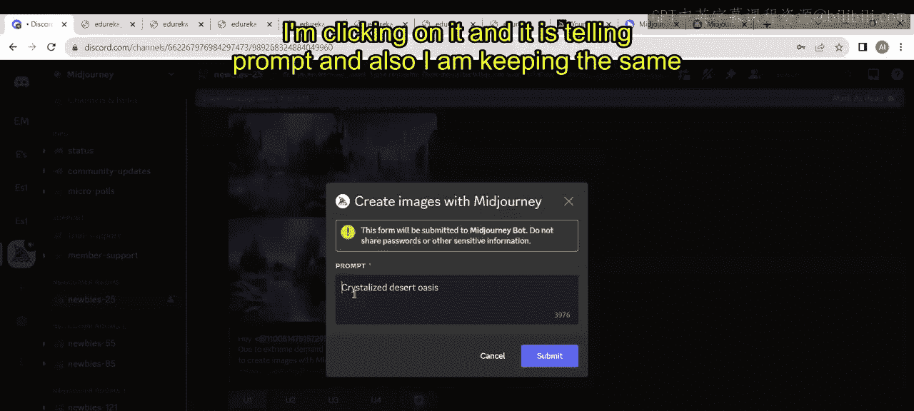

And it will regenerate the image again。

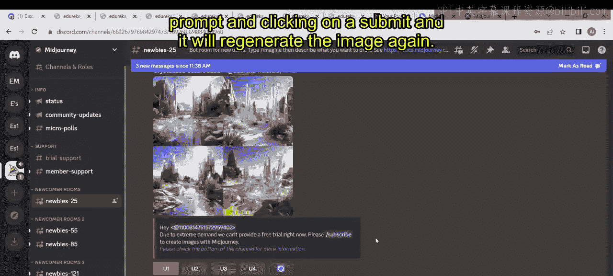

Now can you see this， it is generated again in new name with some difference and open in browser。😊。

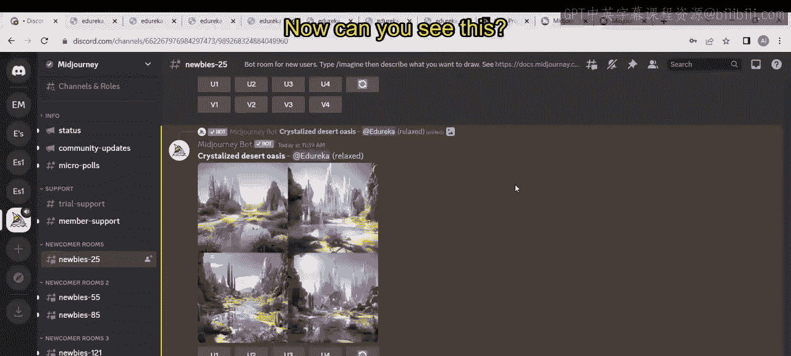

There are no major huge differences， but it has generated some other way around that is where the difference you can see here the plans and also here it is difference here it is so this is the way that you can give the prompt and can generate the images as per requirement so as I wants to explain the difference between the different versions like from the beginning to end how the quality image has been changed I selected the versions independently and also I have shown you here but by default if you want to create the images as because the latest version is of 5。

2 it will choose the 5。2 as a default you know need to go to settings and can choose the version from the dropdown by default you will be able to see the latest version utilization by the mid journey and create a prompts out of it now you all are done with the first image generation。

😊。

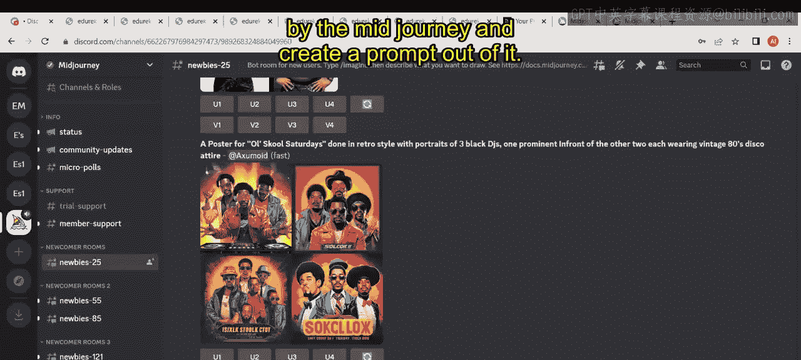

Okay so that's about creating an images after adding the discords over to the mid journeyney here we have understood what exactly the subscription and why do we even need that and how to subscribe it and also compare the different subscription plans and also we have seen the different images also by using the mid journey。

😊。

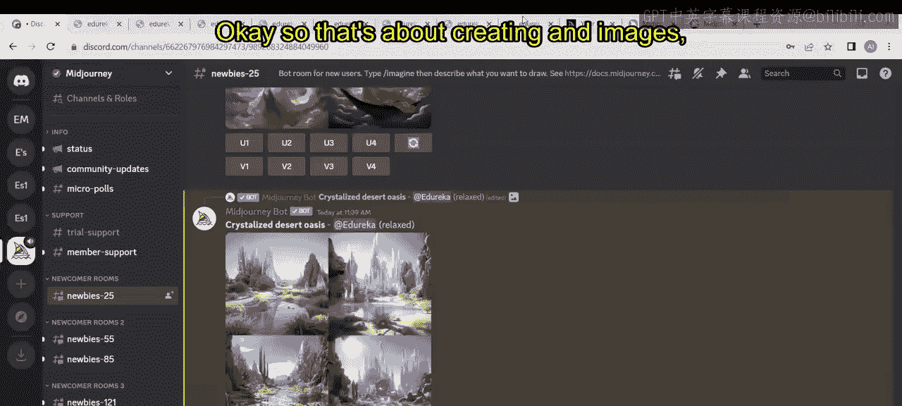

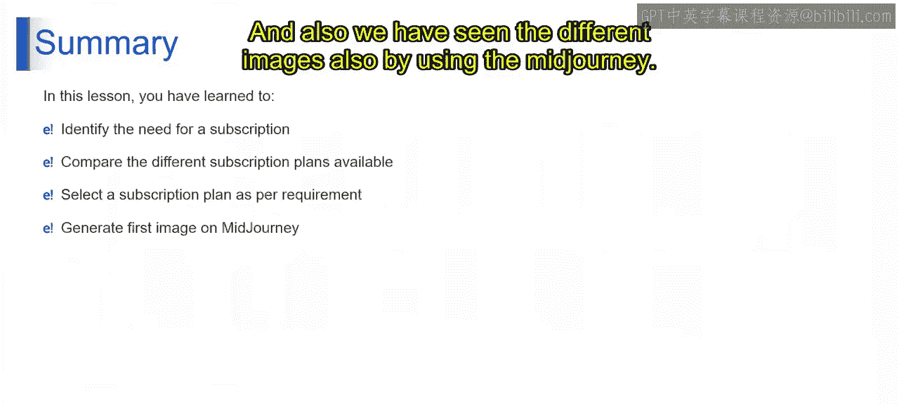

Thank you。