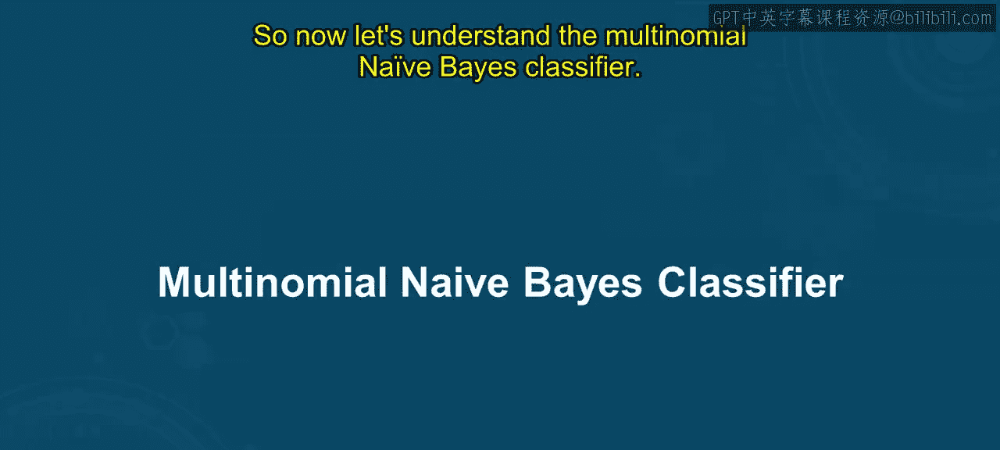
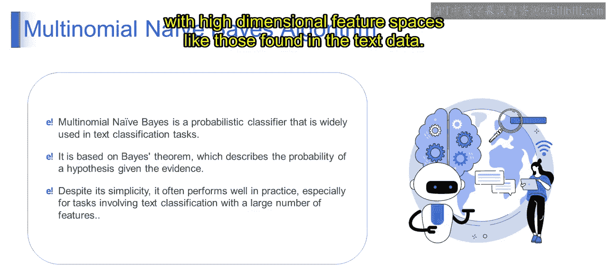

# Edureka《通过LLMs学习生成式人工智能（机器学习和NLP基础，第1课／共4课）｜Learn Generative AI with LLMs》中英字幕 - P134：133_多项式朴素贝叶斯分类器.zh_en - GPT中英字幕课程资源 - BV1q4421Q7qh

Hello everyone welcome back to machine learning and NLP basics so now let's understand the multiomial nave bias classifier in this we are going to understand what exactly a multinoial nave bias classifier is by the end of this session you will be able to describe the nave bias classifier and also able to evaluate the performance of the classifier using the appropriate metrics so let's get started before understanding multinoial nave bias algorithm first let's understand what exactly a nave bias algorithm is all about the nave bias algorithm is a simple yet powerful class technique based on bias theorem with an assumptionion of independence among the features it's widely used in text classification spam filtering。

😊。

And recommendation systems imagine you are categorizing the emails as either spam or not spam based on the occurrence of certain words。

 Imagine you are categorizing the emails as either spam or not spam based on the occurrence of certain words nave bias works by calicculating the probability of each class。

 whether if it is of spam or not spam For example， imagine you are categorizing the emails as either spam or not spam based on the occurrence of certain words。

 nave bias works by calicculating the probability of each class that is spam or not spam。

 given the presence of certain features， nothing but words， despitesp despite its simplicity。

 nave bias often performs well in practice， especially。😊，In text classification task。

Means technically na nave bias algorithm involves using bias theorem to calculate the probability of a class given certain features。

 especiallyly it assumes that all features independent of each other which simplifies the calculation of na bias。

😊，So based on this understanding of na bias， lets understand multinoial na bias。😡。

So I will explain with a simple explanation of text classification。

 suppose we have a data set containing emails labeled as either spam or not spam each email is represented as bag of words where the features are the presence or absence of specific words。

 for example let's say we are having two emails。😊，So email one is containing congratulations you have one one a vacation an email to meeting reminder don't forget tomorrow's conference call in this example we want to classify these emails as either spam or not spam based on their content so now let's break down the technical definition of multiial na biasas algorithm so here multi multinoial na biasas models。

😊，Models， the probability of absorbing absorbing a document D。

 given the class it assumes a multinoial distribution of the features。

 nothing but word documents within each class then each document is represented as a vector of word counts where the eighth element of the vector represents the count of the word in the vocabulary。

 so let's understand it with a practical definition。😊。

Mulinomial nave bias is probabilistic classifier that is widely used in text classification task and it is based on various theorem which describes the probability of a hypothesis given the evidences So now lets understand the technical definition multinoial nave bias This refers to a specific type of nave bias classificationifier that is multinoial means multinoial means it suitable classification tasks where feature represent the frequency with which certain even occur for example。

 word counts in classification text classification nave bias is nave because it assumes that features are independent of each other。

 which is often not true in practice but still works surprisingly well then the probabilistic。😊。

Clifier multiomial na bias assigns probabilities to different classes for a given instance of data。

 it calculates the likelihood of particular class， given the feature and then selects the class with the highest probability as the predicted class the next one is of bias theorem。

 it is a fundamental theorem in probability theory that describes how to update probabilities based on new evidence It the context of classification。

 it helps calculate the probability of a class given the features which is exactly what na bias does and multinoial na bias is simple and easy to implement despite its simplicity it often performs well in practice because it can handle high dimensional data like text data。

😊，Many features efficiently and effectively， the text classification involves categorizing the text document into predefined classes or categories multinoial nave bias is particularly well suited for text classification tasks because it can handle the large number of features for example。

 words are or N gras means that typically occur in a text data means multinoial nave bias is one of the popular choices for text classification tasks due to its simplicity efficiency and often surprisingly good performance。

 especially when dealing with high dimensional feature spaces like those found in the text data。😊。

So stay tuned for the next video where we will elaborate on this topic。😊。

